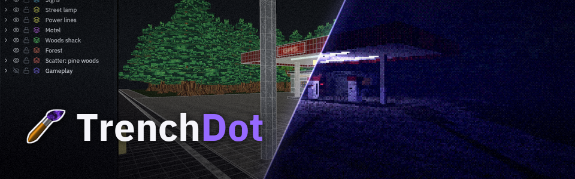
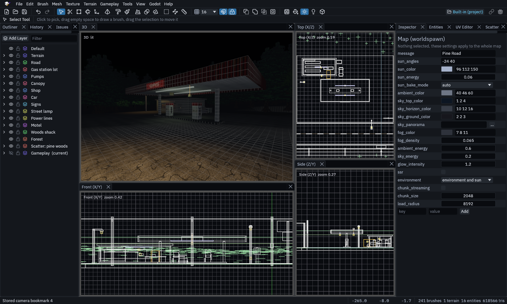

# TrenchDot

TrenchDot is a brush based level editor for Godot in the spirit of TrenchBroom and Hammer.
Supports I/O, custom meshes (Hammer, Quake, Blockbench) and more!

## Where to go

| You want to | Read |
| --- | --- |
| Set up a project and build a first room | [Getting started](getting-started.md) |
| Find your way around the editor | [Interface and navigation](editor/interface.md), [Shortcuts](editor/shortcuts.md) |
| Understand what happens in Godot | [Building maps](godot/building.md) |
| See edits in Godot before saving | [Saving, live mode and hot reload](godot/live.md) |
| Make doors, triggers and scripted scenes | [How entity I/O works](gameplay/io.md), then [Button opens a door](tutorials/button-door.md) |
| Build outdoor terrain | [Terrain](editor/terrain.md), then the [sea island tutorial](tutorials/sea-island.md) |

## Download

TrenchDot has a [rolling beta on GitHub](https://github.com/Paraxdev/TrenchDot/releases/tag/beta), meaning it is
always the newest version you can get.
Due to being at a very early stage no LTS version is currently planned. Once it emerges as useful software, a full
release will be made.

Alternatively, it is also available on [itch.io](https://paraxdev.itch.io/trenchdot).

For building it from source, visit [Development](development.md).

## Advanced: MCP

Optional, and not needed to make maps. The editor can also be driven from scripts or AI agents. The [MCP server](mcp.md) page explains how to connect one and
which tools it offers.

