# Brushes and CSG

Brushes are what you build most of a level from. They are quick to draw, snap cleanly to the grid and turn into meshes
with matching collision in Godot. Everything here uses the **Select** tool (Q), unless a section names another tool.

## Draw and move

Drag anywhere off the selection, in any view, and a box follows the mouse. The 2D views print its size next to it. In
the 3D view it starts on the surface under the cursor and is one grid step thick. In a 2D view it takes the depth of
the last brush you drew, 128 units for the very first one.

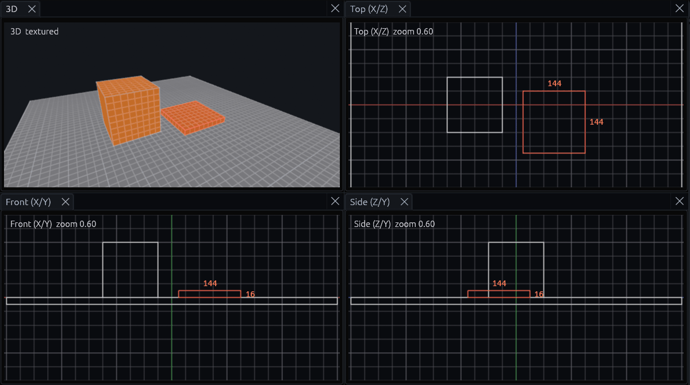

Once a brush is selected you can move it around:

| Input | Result |
| --- | --- |
| Drag the selection | Move it, Shift locks to the main axis |
| Ctrl+drag the selection | Move a copy, the original stays |
| Alt+drag the selection (3D) | Move vertically. Started off the selection, Alt+drag orbits the camera |
| Arrow keys, Page Up, Page Down | Nudge by one grid step |
| `[` and `]` | Halve and double the grid |

In 3D the selection also gets a move, rotate and scale gizmo. Rotation snaps to 15°, or 1° with Shift. If it gets in
your way, turn it off under *View > Transform Gizmo*.

## Exact position and size

Sometimes you want exact numbers, like a door cutter exactly as deep as the wall. Select the brush and type them into
the **Inspector** on the right.

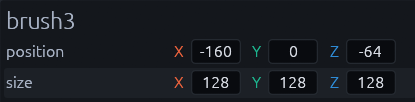

Position is the lowest corner, the smallest X, Y and Z, which is the corner that usually sits on the grid. A new size
grows the selection away from that corner, so the position stays put. Dragging a field steps by the grid while
snapping is on, a typed value is kept exactly. The same fields show up for meshes, a brush entity and a selection of
several objects.

## Reshape

You can reshape a selected brush without leaving the Select tool:

| Input | Result |
| --- | --- |
| Shift+drag a selected face (3D) | Push or pull that face |
| Ctrl+Shift+drag a selected face (3D) | Extrude a new brush out of it |
| Drag a selection edge (2D) | Resize. The edge lights up yellow and the cursor changes where a drag resizes |

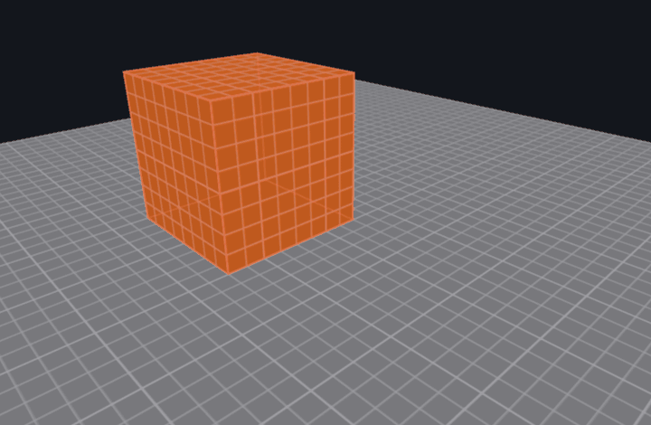

For slopes, ramps and angled walls, press C for the **Clip** tool:

1. Click two or three points along the cut. They snap to the grid, and in 3D they land on the surface you click.
2. Press Tab to pick what to keep, the front, the back or both halves. The text at the bottom of the view tells you
   which one is active.
3. Press Enter to cut. Backspace removes the last point if you misclicked.

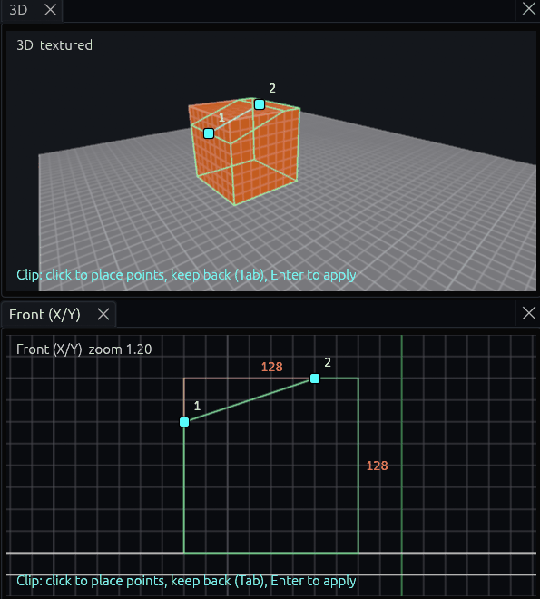

To drag single corners, press V for the **Vertex** tool, or Tab with brushes selected. It shows handles on the corners,
and small dots on the edge midpoints and face centers that add a vertex when you drag them. Delete removes the selected
vertices.

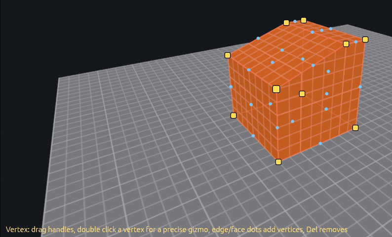

> [!NOTE]
> A brush cannot have dents, so a vertex move that would make one is refused. For dents and overhangs,
> convert the brush to a [mesh](meshes.md).

## Rotate, scale and measure

| Tool | Input | Result |
| --- | --- | --- |
| **Rotate** (R) | Drag a ring around the selection | Rotates in 15° steps, with Shift in 1° steps. A 2D view has one ring, around the axis it looks along |
| **Scale** (T) | Drag a handle on the selection's bounds | Resizes on the grid, with Alt on both sides at once so the center stays put. The 3D view has a handle on each side |
| **Measure** (M) | Drag, or click two points | Shows the distance in units and meters, and at the bottom of the view its X, Y, Z and horizontal parts |

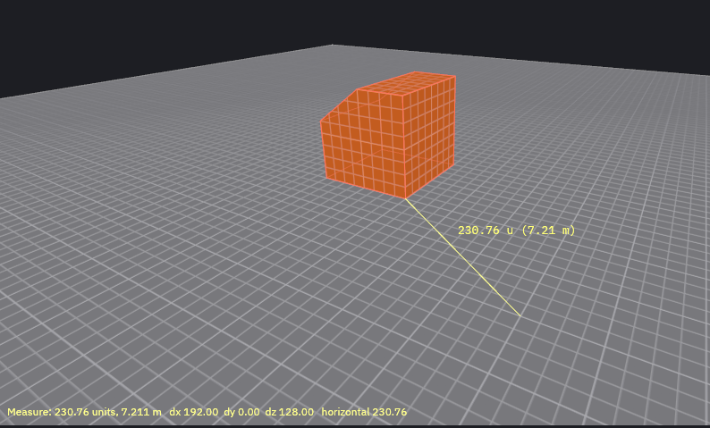

## Shape Generator

For cylinders, arches, stairs, roofs and other shapes that would take a lot of hand drawn brushes, use the Shape
Generator.

1. Draw a box where the shape should go, and leave it selected.
2. Open *Brush > Shape Generator…* (Ctrl+Shift+B).
3. Pick the **Shape** and its options. The dialog says the bounds it fills, and that it replaces the selection.
4. Click **Create**.

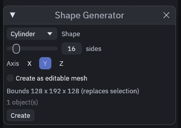

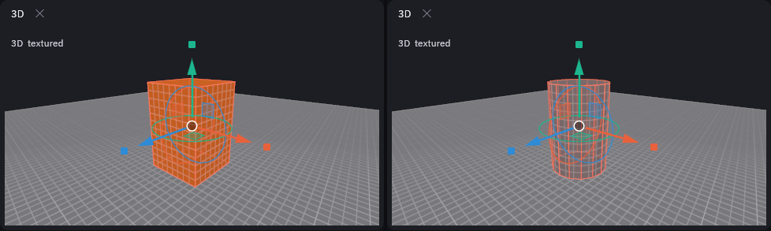

Cylinders and cones stand upright by default. Pick **X** or **Z** under **Axis** to lay one down inside the same box,
for pipes, logs or a beam, instead of rotating it afterwards. The torus, arch wall, gable roof, spire and grid are
always made as a [mesh](meshes.md). Cylinders, cones and spheres can be one too with **Create as editable mesh**, then
**Smooth shading** rounds them off. The **Text** shape builds block letters from brushes, for signs and floor
lettering.

## CSG

The CSG operations are under *Brush > CSG*, which also holds their two settings.

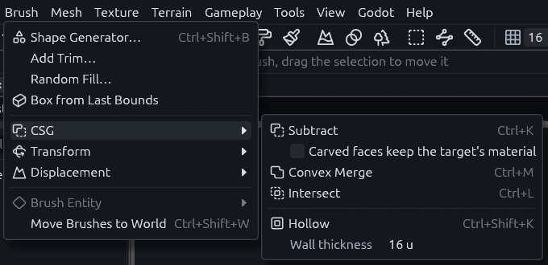

All four also have a button in the toolbar, to the right of the snapping and UV lock buttons.

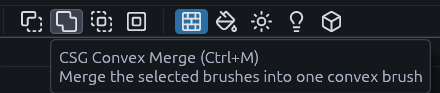

| Operation | Key | Result |
| --- | --- | --- |
| Subtract | Ctrl+K | Carves the selection out of every brush it touches, then deletes the selection. A selection that touches no other brush is kept and the status bar says so |
| Hollow | Ctrl+Shift+K | Turns a brush into walls around its old volume, 16 units thick unless you change *Wall thickness* in the same menu. A brush too thin for two walls is left alone |
| Convex Merge | Ctrl+M | Fuses the selection into one convex brush that wraps it |
| Intersect | Ctrl+L | Keeps only where the selected brushes overlap |

To punch a doorway or window, place a brush where the hole goes and Subtract it,
[Getting started](../getting-started.md) walks you through one. The faces a cut opens take the cutter's material,
unless you tick *Carved faces keep the target's material* in the same menu.

## Displacements

For uneven ground inside a brush level, like a rubble slope, you can turn a face into a displacement and sculpt it.

1. Shift+click a four sided face, or select the brush to use its top face.
2. Open *Brush > Displacement* and pick one of the **Create** entries. A higher power gives a finer grid.
3. The **Sculpt** tool (G) switches on by itself, drag over the face to shape it.

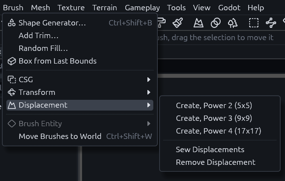

For bigger outdoor areas a [terrain](terrain.md) works better.
