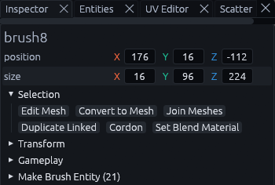
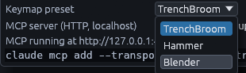

# Coming from Unity or Blender

TrenchDot is a brush editor in the line of TrenchBroom and Hammer. A level starts as solid blocks you draw on a grid,
not as imported meshes. Most of what you know from Unity and Blender still has a place here, only under other names and
keys. This page maps them, and [Getting started](../getting-started.md) walks you through a first room.

## Where things are

| In Unity or Blender | In TrenchDot |
| --- | --- |
| Hierarchy, Outliner | The **Outliner**, with [layers and groups](organizing.md) instead of parent objects |
| Inspector, N panel | The **Inspector**. Its position and size fields take typed values, Enter applies them |
| Scene view, viewport | The 3D view plus the Top, Front and Side views. Drawing and lining things up is easiest in 2D |
| ProBuilder shapes, Add menu | Drag in any view to draw a box [brush](brushes.md), Ctrl+Shift+B for arches, stairs and cylinders |
| Boolean modifier | *Brush > CSG*: subtract (Ctrl+K), merge, intersect and hollow. They change the brushes right away, there is no modifier stack |
| Edit mode | The **Vertex** tool for brushes, the **Mesh** tool for [meshes](meshes.md), both on Tab |
| Prefabs | [Prefabs](organizing.md#prefabs), saved as their own map and updated in every instance |
| Linked duplicate (Alt+D) | Duplicate linked, Ctrl+Shift+D, so the copies share their geometry |
| Units, 1 m | 32 map units are one meter, the default grid step is 16 |

Exact numbers go in the Inspector on the right. Select something, type a new position or size and press Enter. The
position is the lowest corner of the selection, not its center or a pivot.

## Keys that differ

The default keys follow TrenchBroom, and three of them catch Blender users out:

* **G** is the terrain Sculpt tool, not grab.
* **R** and **T** pick the Rotate and Scale tools, which work on the selection with handles instead of following the
  mouse.
* **Tab** edits the selection where it stands.

To move something, drag it in any view or use the gizmo in the 3D view, and use the Inspector for exact numbers.

Rather keep your Blender keys? Switch *File > Preferences > Keymap preset* to Blender.

It adds A to select all, X to delete, Shift+D to duplicate, H and Alt+H to hide and show, S for the Scale tool and
Shift+A for the shape generator. G stays Sculpt, and typing a number during a move only works inside the Mesh tool.
The full list is under [Other presets](shortcuts.md#other-presets).

There are no numpad views. The Top, Front and Side views are always open, Shift+Space maximizes the one under the
pointer and *View > Views* switches between one, two and four.

## Habits that carry over

In the Mesh tool the keys follow Blender: 1, 2 and 3 for vertices, edges and faces, G, R and S with X, Y or Z to lock
an axis, E to extrude, Ctrl+R for a loop cut and Ctrl+B to bevel.

Right drag with WASD flies the 3D camera like Unity's scene view, and F frames the selection. Ctrl+Z and Ctrl+Shift+Z
undo and redo, and F2 renames.
