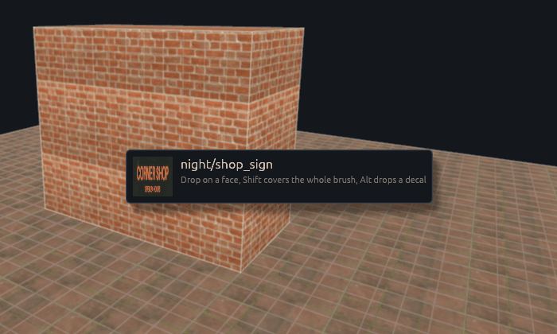
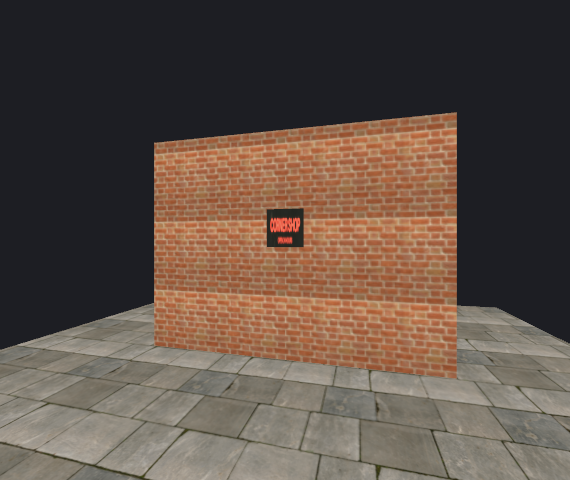
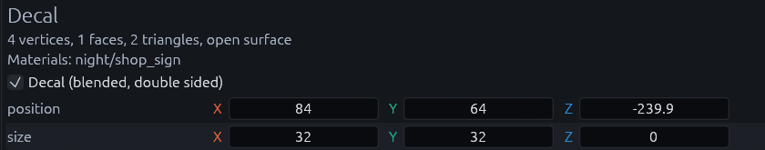

# Decals

Decals put grime, stains, cracks, posters and signs on a surface. They are drawn a hair closer to the camera than the
wall behind them and blended over it, so they never flicker against the wall or against each other.

## Placing a decal

1. Find the material

    Look it up in the Materials panel, the search box at its top left helps.

2. Hold Alt and drag it onto a face

    The card next to the cursor reminds you that Alt drops a decal.

    

3. Let go

    You should see the decal land where you dropped it as a one meter square, 32 by 32 units, facing out of the face.

    

A decal is a normal mesh, so move, rotate and scale it like one. With it selected, the Inspector shows **Decal
(blended, double sided)** ticked, and the position and size fields to place it exactly.

That same checkbox turns any thin mesh into a decal, for one with a custom outline.

Soft edges stay soft. For a hard cut, use a material in alpha scissor mode, see
[Transparency](../godot/materials.md#transparency).

## Why not a thin brush

> [!WARNING]
> Do not fake decals with thin brushes or meshes a few millimeters off a wall. They flicker.

Up close a thin brush looks fine. Step back and it starts flickering through the wall in stripes that crawl as you
move. This is called z-fighting.

The GPU works out which surface is nearest at each pixel by comparing their depths, and it stores depth in a limited
number of steps. The steps get coarser the farther away a surface is and the flatter you look along it. A few meters
out, the brush and the wall round to the same step, so each pixel picks one of them almost at random, and the pick
changes every time the camera moves. Moving the brush further off the wall only pushes the flicker further away, and up
close it then floats visibly in front of the wall.

A decal does not have that problem. When Godot builds the map, it pulls each decal toward the camera by 0.05 percent of
its distance, half a millimeter at 1 meter and 5 centimeters at 100 meters, so it stays in front of the wall at any
range. The pull runs along your line of sight, so the decal does not shift on screen. It also writes no depth of its
own, so decals that overlap blend over each other instead of fighting.

A thin mesh is fine once you tick **Decal (blended, double sided)** on it, that makes it a real decal.

## Projected decals

A regular decal is flat. For a stain that wraps over a step, a pipe or bumpy ground, use a projected decal instead. It
is an entity that shines a material onto everything inside its box, props included. It costs more to draw, so stick to
regular decals on flat surfaces.

Your project needs an entity class for it first. [Projected decals](projected-decals.md) shows you how to set one up,
place it and what to watch out for.

## MCP

Over the [MCP server](../mcp.md), place a decal with `run_action` `create_decal`, passing `material`, `at`, `normal` and
`size` as `[width, height]`.

