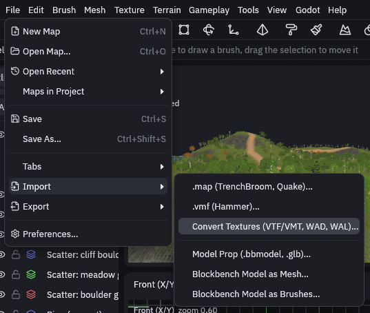
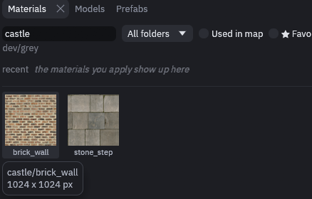

# Converting textures

Godot cannot load `.vtf`, `.wad` or `.wal` files, so the editor turns them into PNGs, plus a `.tres` where a plain
image cannot carry the settings. Each one lands in the project's texture folder under the face's material name, so the
imported faces find it straight away.

Importing a map offers this for the textures it uses, see [Importing Hammer and TrenchBroom maps](importing.md). To
convert a whole folder, open the Godot project first, then:

1. Open the converter

    Go to *File > Import > Convert Textures (VTF/VMT, WAD, WAL)…*.

    

2. Pick the folder

    Pick the folder with the `.vmt` and `.vtf`, `.wad` or `.wal` files. If the open map lacks some of them, the editor
    asks whether to convert only **The map's** or **All**.

    The status bar should then say how many were converted, like "Textures: 12 converted", and they show up in the
    Materials tab under their material names.

    

## Where they are found

The editor searches the usual places each game keeps its textures, so a map copied along with its game folders finds
them without any setup.

| Source | Looked for | Named after |
| --- | --- | --- |
| Valve `.vmt` and `.vtf` | a `materials` folder next to the map or up to four folders up | the path below `materials`, like `brick/brickwall001a` |
| Quake and Half-Life `.wad` | the worldspawn `wad` key, then the same file name in nearby folders | the texture name, like `{grate` |
| Quake 2 `.wal` | a `textures` folder nearby | the path below `textures`, like `e1u1/floor1_1` |
| Loose `.png`, `.jpg`, `.tga` | a `textures` folder nearby, as Qodot and FuncGodot projects ship them | the path below `textures`, copied as they are |

## Valve materials

A Valve `.vmt` file describes a material as a list of parameters. These carry over to the Godot material, the rest is
left out:

| Valve material | Godot material |
| --- | --- |
| `$basetexture` | albedo, its alpha dropped unless the material is see through |
| `$bumpmap`, or `$normalmap` on water | normal map, green flipped from DirectX to Godot |
| `$translucent`, `$additive` | alpha blend for `$translucent`, additive blend for `$additive` |
| `$alphatest`, `$alphatestreference` | alpha scissor at that threshold, 0.5 by default |
| `$selfillum`, `$selfillummask` | a glowing emission texture, masked by the base texture's alpha or by the mask |
| `$nocull`, `UnlitGeneric` | double sided for `$nocull`, unshaded for `UnlitGeneric` |
| `$color` | albedo color |
| `$surfaceprop` | `metadata/surfaceprop` on the material |
| `patch` with `include` | a patch reuses another material with a few changes, so it becomes the included material with its `insert` and `replace` changes applied |

## Quake textures

Textures starting with `{` are cut out with alpha scissor, skies are unshaded, and `*water` is saved as `water`.
Animated textures, including multi frame VTFs, keep their first frame.

## Skies

Converting a map's textures also sets its sky, so the imported map gets a sky close to its original. This is skipped
when the map already has `sky_top_color`.

A Source map with its `skyname` skybox in `materials/skybox` gets a panorama, `skybox/<skyname>_panorama.png` in the
texture folder, set as `sky_panorama`. Other maps get `sky_top_color` and `sky_horizon_color` from the texture in
`sky_source`. When the scene has no WorldEnvironment of its own (the Godot node that holds a scene's sky, fog and
ambient light), `TrenchDotEnvironment` builds one from these keys.

## VTF formats

The converter reads VTF versions 7.0 to 7.5 in these pixel formats: DXT1 (with one bit alpha), DXT3, DXT5, the 8 bit
RGB and RGBA orders, I8, IA88, A8, RGB565, BGR565, BGRA4444, BGRA5551, BGRX5551, UV88, UVWQ8888, UVLX8888 and the 16
bit RGBA formats. Other formats, and VTF 7.6, are refused with the format named, so you know which file to convert by
hand.

## MCP

Over the [MCP server](../mcp.md), convert a folder of textures with `map_file {op: convert_textures, path}`. Add
`only_missing` to convert only what the open map lacks, and `overwrite` to replace files already in the project.

