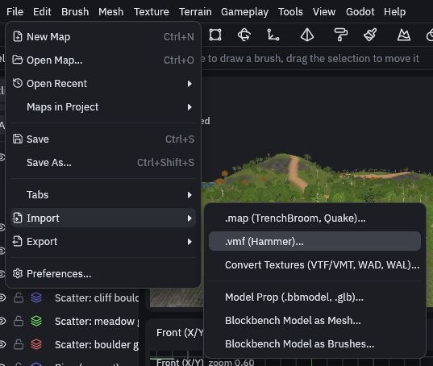
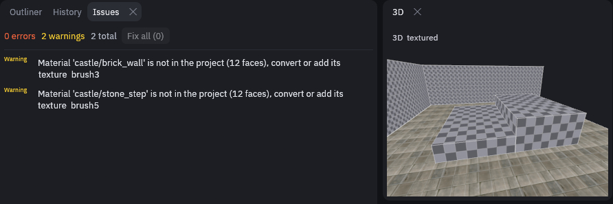
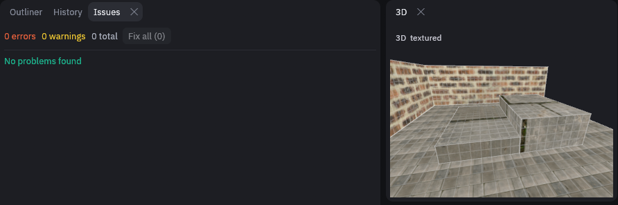

# Importing Hammer and TrenchBroom maps

Got a level from Hammer or TrenchBroom? Bring it over instead of rebuilding it. *File > Import* opens a Hammer `.vmf`,
or a TrenchBroom, Quake or Qodot `.map`, as a new unsaved map (in a new tab if the open map has unsaved changes).
Save it as `.tdm` and Godot builds it like any other map.

## Steps

1. Open the Godot project first

    Open the project the map is for with *Godot > Open Godot Project…*, since converted textures go into its texture
    folder.

2. Import the map

    Go to *File > Import* and pick *.vmf (Hammer)…* or *.map (TrenchBroom, Quake)…*, then the file.

    

3. Convert the textures

    When textures for the map sit near it, the editor asks "Convert the map's textures?" for the ones the project
    lacks. Say yes, see [Converting textures](importing-textures.md).

4. Check the Issues tab

    Open the Issues tab at the top left, next to Outliner and History. Every material the project still lacks shows up
    as a warning, and its faces draw as a checker.

    

    The faces keep the material name, so adding the texture later fixes them. Once every texture is there, those
    warnings are gone.

    

5. Save it

    Use *File > Save As…* and save it as a `.tdm` inside the project.

> [!NOTE]
> Units are kept as they are. Source maps are built for about 40 units per meter and Quake maps for about 32,
> so a Source map comes out a little larger than in its game unless the project uses a different scale.

## What the import keeps

| Hammer | In TrenchDot |
| --- | --- |
| Tool materials (`tools/toolsnodraw`, `toolsclip`, `toolsplayerclip`, `toolstrigger`, `toolsorigin`, ...) | The project's skip, clip and origin textures and `special/trigger` |
| Sky faces | The project's sky texture, `special/sky` by default |
| Displacements | Displacements with their heights and blend alphas |
| `func_instance` | A group holding the instance's contents, moved into place. Names inside get the instance's fixup, its `$` and `#` replacements are filled in, and outputs aimed at `instance:name;Input` are wired to the real entity |
| Visgroups | Layers |
| Hidden objects | Hidden nodes |
| Entity keys and outputs | Entity properties and outputs |

TrenchBroom layers and groups stay layers and groups, and Quake tool textures become the project's tool textures the
same way.

Only need a few brushes? Copy them in TrenchBroom and press Ctrl+V in TrenchDot, they come over converted the same
way, see [Prefab library](prefab-library.md#pasting-from-trenchbroom).

Sky faces collide in Godot but draw nothing. The worldspawn key `sky_source` keeps the texture they had, and converting
the textures turns it into a procedural sky, see [Converting textures](importing-textures.md#skies).

## Known limitations

| Limitation | What to do |
| --- | --- |
| Textures inside `.vpk` or `.pak` archives are not read | Extract them first, for example with VPKEdit |
| Instances are looked for next to the map and in the folders above it | Keep the game's `maps` folder layout. Instances that are not found stay `func_instance` entities |
| Valve and Quake entity classes have no definitions in a new project, so the editor does not know their keys | Add them to your FGD, or replace them with your own classes. The Issues tab lists them |
| Some Source material features are left out: `$basetexture2` blends, detail textures, env maps and proxies | Set them up in Godot |
| Quake 3 patches (curved surfaces) and brush primitives are skipped. The status bar says how many | Rebuild them as meshes |
| Displacements whose vertices move sideways, not only up and down, become meshes with no blend alphas | Edit them as meshes |
