# Interface and navigation

TrenchDot follows TrenchBroom and Hammer, so if you have used either, most habits carry over. If not, this page
shows you around, and [Coming from Unity or Blender](coming-from-unity-blender.md) maps the ideas you already know.

## The window

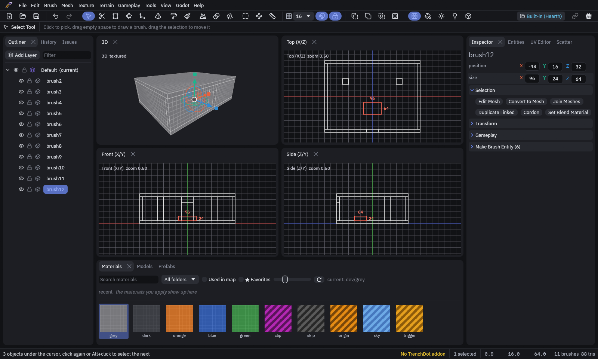

The menus are at the top. A command sits under the kind of object it changes, so CSG is under *Brush* and terrain
sculpting under *Terrain*.

Can't find something? Press Ctrl+Shift+P (or F1) for the command palette and type its name. Commands with a jargon
name, like *Hollow* or *UV Lock*, explain themselves when you hover them, and the palette shows the same line beneath
its list. Escape or a click outside closes it without running anything.

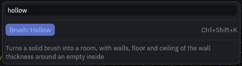

Right under the toolbar is the **tool options bar**. It holds the settings of the active tool, or one line on how to
use a tool that has none. Hover the tool's name there, or its button in the toolbar, for a short description.

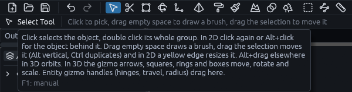

### The empty map card

On a new, empty map a card in the 3D view tells you where to start: drag in the Top view to draw your first box, and
the Top view marks the spot with a yellow label. Below that it explains the 3D camera and links the
[getting started guide](../getting-started.md). When the open project has maps, **Open a map from this project**
lists them, so you can open a finished one instead.

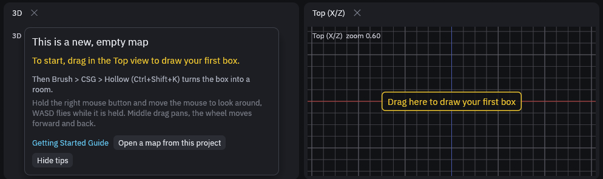

The card goes away once the map has something in it. **Hide tips** turns the tips off, and *Tips on an empty map* in
*File > Preferences* brings them back.

### Panels

| Panel | Dock | What it is for |
| --- | --- | --- |
| Outliner | Left | The map as a tree of [layers, groups](organizing.md) and objects |
| History | Left | Every edit. Clicking one undoes it and everything after it, clicking a dimmed one redoes up to it |
| Issues | Left | Problems found as you work, like faces with no material. Click one to select the object, most offer a fix |
| Inspector | Right | The selection's properties, such as an entity's keys or a brush's exact position and size |
| Entities | Right | Entity classes to drag into a view |
| UV Editor | Right | [Exact texture placement](uv-editor.md) |
| Scatter | Right | The models the [Scatter](scatter.md) tool paints |
| Materials | Bottom | Your project's textures |
| Models | Bottom | [Model files](models.md) to place |
| Prefabs | Bottom | Ready made pieces from the [prefab library](prefab-library.md) to paste |
| Logic | Starts closed | The [entity wiring as a graph](../gameplay/logic-graph.md), to connect entities and preview what an output sets off |
| Reference | Starts closed | Code for using an entity class from your scripts |

Closed a panel by accident? Open it again from *View > Panels*. *Reset Layout* at the bottom of the same menu puts
everything back where it started.

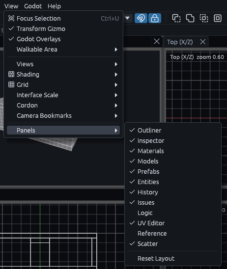

## Help and the manual

Tooltips explain buttons, tabs and settings. For more, point at a tool, a panel tab, a menu entry or an Inspector
section and press **F1**, and the matching page of this manual opens. A Ctrl+click on a tool in the toolbar
(Cmd+click on macOS) does the same. A tooltip ending in *F1: manual* has a page behind it, over anything else F1 opens
the command palette.

*Help > Manual* opens the start of the manual.

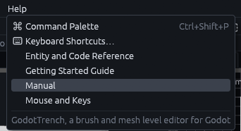

Once you know your way around, untick *Help text* in *File > Preferences* to hide the short guidance lines in the tool
options bar and the panels. Their tooltips stay.

(Note: links open in your web browser. If no browser opens, the status bar says so and the link is copied to the
clipboard.)

## Views

The views are 3D, Top, Front and Side. The 2D views look straight along one axis, which makes lining things up
easier. With something selected, they print its width above it and its height beside it.

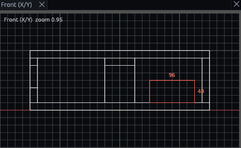

A click in a 2D view selects the nearest object along the view, so in the Top view a ceiling hides the walls under it.
Click again at the same spot within about a second and a half, or Alt+click at any time, to step to the next object
under the cursor.

| Do this | To |
| --- | --- |
| Drag the point where the dividers cross | Resize all four views at once |
| Shift+Space | Maximize the view under the pointer, again to restore |
| *View > Views* | Switch between one, two and four views, or bring back a closed view. Single View keeps the view you last worked in, the 3D view to begin with, and while one view is shown picking another view's name switches to it |

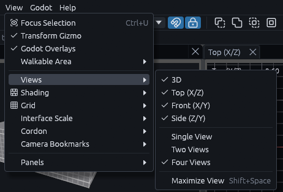

## Tabs

Each open map gets a tab, and the tab bar shows up under the tool options bar once two are open. Ctrl+Shift+N (or the
**+** button) opens a new tab, Ctrl+Tab switches and Ctrl+W closes one.

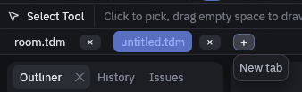

*New Map* and importing open in a new tab when the current map has unsaved changes. Closing a modified tab asks to
save, discard or cancel, and quitting lists every unsaved map.

## Camera

| Input | 3D view | 2D views |
| --- | --- | --- |
| Right drag | Look around. WASD moves, Q and E go down and up, Shift triples the speed | Pan |
| Middle drag | Pan | Pan |
| Wheel | Move forward and back, faster the farther away the surface straight ahead is | Zoom towards the cursor |
| Alt+left drag | Orbit, unless the drag starts on the selection, which then moves vertically | |

WASD only flies while you hold the right button, otherwise those keys are shortcuts. Forgot the controls? Hover a
view's tab. Until you first look around, the 3D view also shows them under its name while the pointer is over it
(**Hide tips** on the empty map card turns that off).

**F** frames the selection in every view, or the whole map when nothing is selected. A wheel notch zooms a 2D view by
the same factor at any zoom, so going from a whole large terrain down to a single room takes about 20 notches, and
**F** on the room is quicker.

Ctrl+Shift+1 to 9 stores the 3D camera as a bookmark and Ctrl+1 to 9 jumps back. Bookmarks are saved in the map, and
undo does not touch them.

## Shading

F4 cycles the 3D view through Textured, Flat, Lit Preview and Wireframe, and the view prints the mode at its top left.
Once the map has a [bake](light-baking.md), **Baked Lighting** comes after Lit Preview. F3 jumps straight to
**Lit Preview** and back to Textured, without cycling through the others.

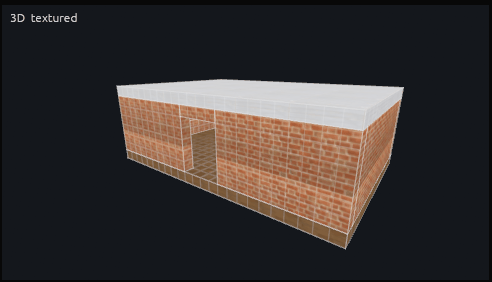

Lit Preview shows the map's lights, sun shadows, sky and fog without building in Godot. It only draws the 64 strongest
point and spot lights, so a map with many more can look darker here than in Godot.

## Interface scale

Ctrl+= and Ctrl+- scale the interface and Ctrl+0 resets it. You find the same as *Interface scale* at the top of
*File > Preferences*. If the monitor reports the wrong display scaling, untick *follow the monitor* right beneath it.

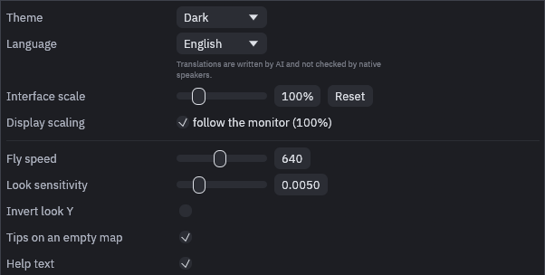
