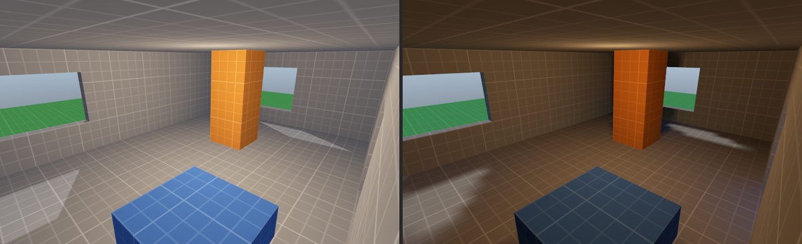
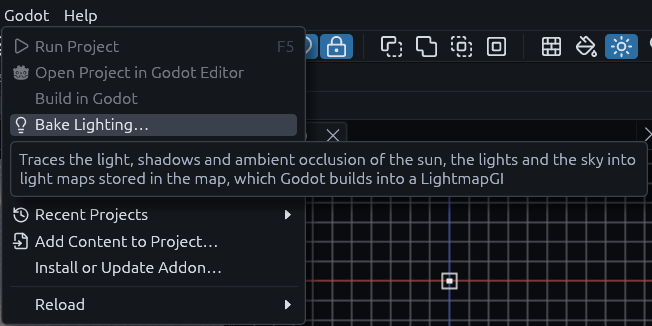
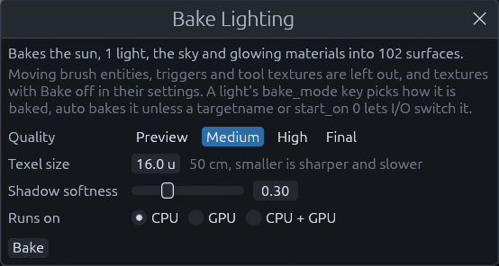
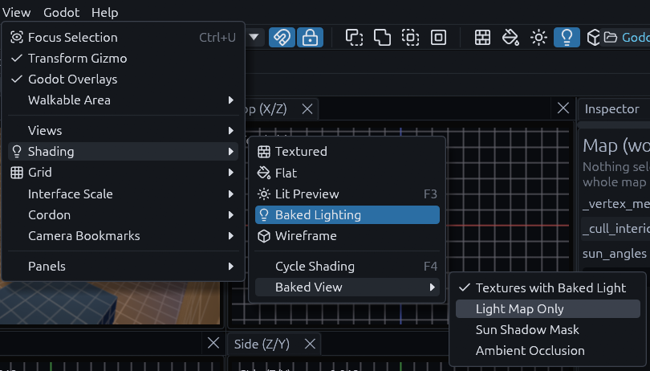
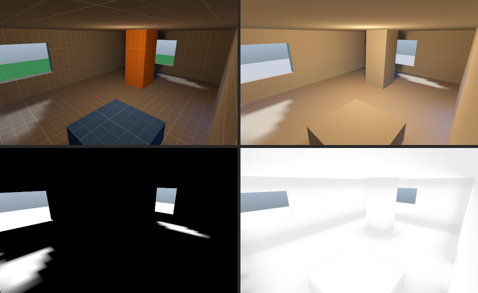
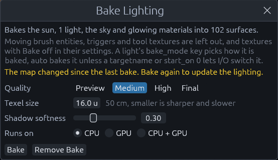
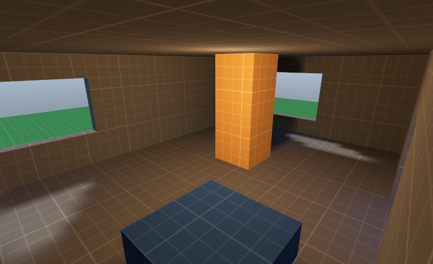
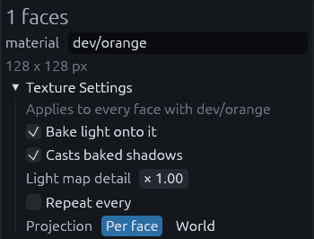

# Baking lighting

Baking works out the light of the sun, the sky, your lamps and glowing materials once, bounces included, and stores it
in the map as a light map. Godot then draws that light instead of computing it every frame. You get soft bounce light,
colored spill from lamps and darker corners at almost no cost at runtime. Lights you want to switch or move stay real
time next to the bake.

The bake covers static geometry: world brushes, meshes, terrains, displacements and brush entities that do not move.
Moving brush entities such as doors and platforms, trigger volumes, decals, tool textures and layers left out of the
export are neither lit by the bake nor cast baked shadows.

## Baking a map

1. Open the Bake Lighting window

   Choose *Godot > Bake Lighting…*.

   

2. Check what goes in

   The top line sums it up, for example "Bakes the sun, 1 light, the sky and glowing materials into 102 surfaces", and
   says which lights stay real time.

   

3. Pick a quality and a texel size

   See [the options](#dialog-options) below. The defaults are fine for a first look.

4. Click **Bake**

   A progress window shows the stage, and you can keep editing meanwhile. Changes made during the bake are not in it.
   **Cancel** stops it and the map keeps the lighting it had.

5. Look at the result

   When it is done the 3D view switches to **Baked Lighting** shading, and the status bar says how long it took and how
   big the light map is.

The bake is saved inside the `.tdm`, and baking is one undo step. **Remove Bake** in the same window drops it, Godot
then lights the map in real time again.

## Dialog options

| Option | What it does |
| --- | --- |
| Quality | How many rays and bounces the tracer spends, see the table below |
| Texel size | Map units one light map texel covers, 2 to 128, 16 (50 cm) by default. Smaller is sharper and slower |
| Shadow softness | 0 to 1. Spreads lights that have no `light_size` of their own so shadows get soft edges. 0 keeps them hard |
| Runs on | CPU, GPU or CPU + GPU, see below |

| Quality | Rays per texel | Bounces | Shadow rays per light | Use it for |
| --- | --- | --- | --- | --- |
| Preview | 32 | 1 | 4 | Placing lights, noisy but quick |
| Medium | 96 | 2 | 8 | Everyday work, the default |
| High | 192 | 3 | 12 | A clean result |
| Final | 384 | 4 | 16 | The build you ship, slow on big maps |

The light map is at most 4096 texels on a side. When a map does not fit at the texel size you asked for, the bake uses
a coarser one and says so in the status bar. The map remembers the options it was last baked with.

### CPU, GPU or both

| Runs on | Pick it when |
| --- | --- |
| CPU | Always works, on every core. The safe default |
| GPU | The machine has a dedicated graphics card, which is usually much faster |
| CPU + GPU | Both are strong. The card and every core take work from one queue, each as much as it keeps up with |

When the GPU cannot be used, for example because there is none, it is a software renderer or the map is too big for
its buffers, the CPU bakes the map and the status bar says why. A GPU that fails halfway hands the rest to the CPU.

## Looking at the bake

*View > Shading > Baked Lighting* shows the bake, and once the map has one, F4 includes it when it cycles the shading.
*View > Shading > Baked View* picks what it shows.

| Baked View | Shows |
| --- | --- |
| Textures with Baked Light | The textures lit by the light map, close to what Godot shows |
| Light Map Only | The light alone, without textures, to judge bounce and noise |
| Sun Shadow Mask | How much of the sun reaches each spot, white in full sun |
| Ambient Occlusion | Darkening in corners and under objects, for checking only, Godot does not use it |

## Light keys

Every `light` and `light_spot` has a `bake_mode` key, and worldspawn has `sun_bake_mode` for the sun:

| Value | In the bake | In Godot |
| --- | --- | --- |
| `auto` | Like `baked`, but a light with a `targetname` or `start_on` 0 stays real time, since I/O can switch it. The sun is always baked | Static or disabled |
| `baked` | Direct and bounced light and its shadows | Static, the light map carries it |
| `bounce` | Only the bounced light | Dynamic, Godot draws the direct light and its shadows in real time |
| `realtime` | Left out | Disabled, fully real time |

Use `bounce` for a lamp whose shadows must follow moving objects while its bounce still fills the room. Godot's own
names `static`, `dynamic` and `disabled` work too. A real time light also lights moving objects through the
[light probes](../godot/baked-lighting.md#light-probes).

`light_size` is the radius of the lamp in meters. A bigger lamp casts softer shadows, and 0 uses the window's shadow
softness instead. `light_indirect_energy` scales the bounced light, and `omni_attenuation`, `spot_attenuation` and
`spot_angle_attenuation` shape the falloff. The Godot light gets all of them as its properties of the same name, so
the real time light matches the bake.

## When a bake goes out of date

The bake remembers the geometry and lights it was made from. Moving, reshaping, adding or deleting static geometry, or
changing a light, a light probe, the worldspawn sun and sky keys, the textures in use or their settings, makes it out
of date. The Bake Lighting window then warns that the map changed since the last bake.

Until you bake again, faces that changed show the Lit Preview in the editor and the average light of the map in Godot,
while the rest keeps its baked light. Here the pillar was moved after the bake: it shows the Lit Preview, and its old
shadow is still on the floor. Bake again before you ship.

## Texture settings

Select a face and open **Texture Settings** in the Inspector to set how every face with that texture is treated, across
the whole map. The settings are saved with the map.

| Setting | What it does | Use it for |
| --- | --- | --- |
| Bake light onto it | Off leaves the faces out of the light map, Godot gives them the map's average light | Sky, water, faces nobody sees up close |
| Casts baked shadows | Off lets light pass through the faces in the bake | Glass, grates, thin decals |
| Light map detail | Multiplies the texel size on these faces, below 1 is sharper, above 1 saves space | Sharp shadows on a floor, blurry ones on a far ceiling |
| Repeat every | Map units one repeat of the texture covers, instead of its pixel size | One scale for a texture everywhere |
| Projection | World ignores each face's own offset, scale and rotation, so the texture runs on seamlessly | Wallpaper, tiles, concrete |

> **Tip:** For a backrooms style map, set the wallpaper to World projection and a repeat size once, and every wall you
> draw with it lines up without touching the Texture tool.

A face with both bake options off is left out of the bake entirely. Repeat size and projection also apply in Godot.



## MCP

The `bake_lighting` tool bakes with the same options as the window, `quality`, `texel_size`, `softness` and
`backend` (`cpu`, `gpu` or `hybrid`), and `view` switches the Baked View. It waits for the bake to finish and returns
the light map size, the counts, the GPU used or why it was not, and `out_of_date`. The `texture` tool's `settings` op
reads and sets texture settings, with `material`, `bake`, `casts`, `texel_scale`, `size` (`null` clears it) and
`projection` (`face` or `world`). See [MCP server](../mcp.md).


