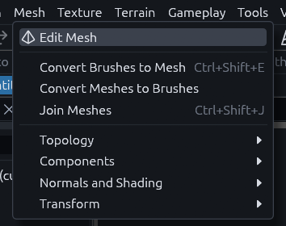
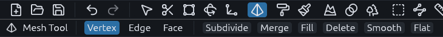
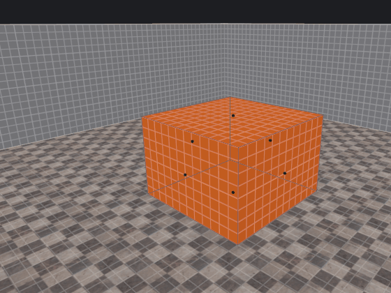

# Meshes

Unlike brushes, meshes can have dents, holes and bent faces, so use them for rocks, pipes, smooth arches and other
shapes brushes cannot make.

## Editing a mesh

Select the brushes you want to reshape and choose *Mesh > Edit Mesh*. It converts them to a mesh and starts editing
straight away.

With a mesh selected, **Tab** does the same, and Tab again takes you back to objects. Tab on brushes opens the Vertex
tool instead, so a stray key press never turns a brush into a mesh. The Mesh tool button in the toolbar starts editing
without converting anything. Ctrl+Shift+E only converts, Ctrl+Shift+J joins meshes into one.

While you edit, the tool options bar at the top switches between **Vertex**, **Edge** and **Face**, and has buttons for
the common operations.

## Keys

The keys follow Blender. For example, press 3, click the top face of a box and press E, then move the mouse up and
click to extrude it:

| Key | Action |
| --- | --- |
| 1, 2, 3 | Work on vertices, edges or faces |
| A, Alt+A | Select all, select none |
| Alt+click, Ctrl+Alt+click | Select the edge loop through the clicked edge, or the ring across it |
| Ctrl+L | Select everything connected to the selection |
| G, R, S | Move, rotate, scale |
| E | Extrude new geometry out of the selection |
| I | Inset, a smaller face inside each selected face |
| Ctrl+B, Ctrl+Shift+B | Bevel edges or vertices, cutting the corner off |
| Ctrl+R | Loop cut, a new ring of edges across the mesh. The wheel or + and - set the number of cuts |
| K | Knife, click two points to cut along that line |
| M | Merge the selected vertices at their center |
| F | Fill, a new face across the selected vertices |
| X or Delete | Delete |
| Shift+D | Duplicate and move |
| P | Separate the selection into a new mesh |
| Alt+F | Flip normals, for faces that show from the wrong side |

While moving, rotating or scaling, press X, Y or Z to lock to that axis, or Shift with the letter to lock it out. Type
a number for an exact amount. Click or Enter confirms, right click or Escape cancels. The hint line at the bottom of the
view lists these as you go.

## Gizmo

Double click an element to put a move, rotate and scale gizmo on it. It is the clean way to slide a vertex along one
axis, and it works in the 2D views too. Escape hides it and keeps the selection.

The *Mesh* menu holds the rest, such as subdivide, triangulate, solidify, mirror and smooth shading.
