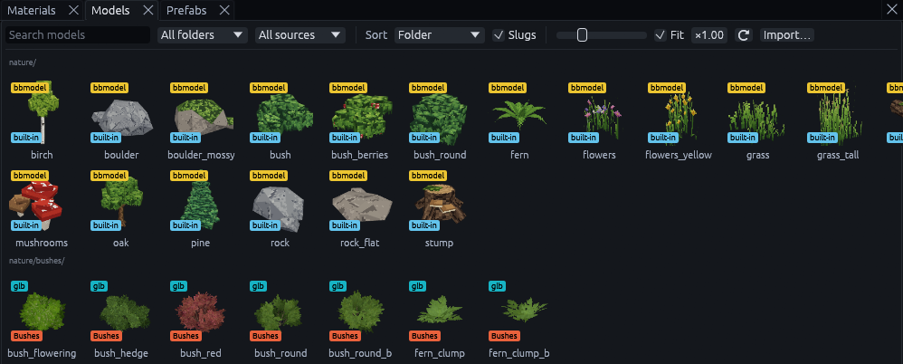
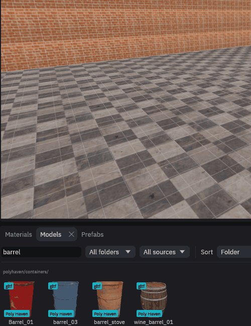
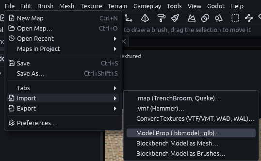
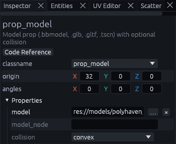
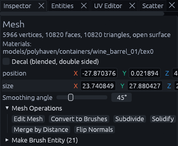
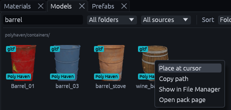
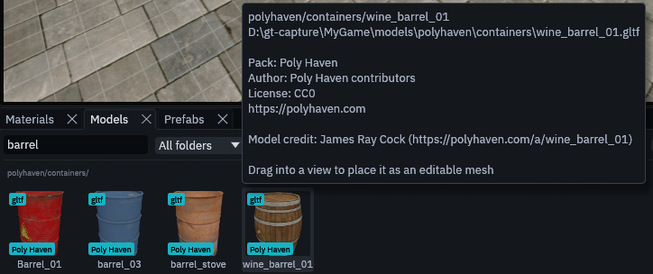

# Models

Models are 3D files made in another program, like Blender or Blockbench. TrenchDot reads glTF, OBJ, Blockbench,
STL, MD2 and MD3 files.

You find them in the **Models** tab at the bottom, next to Materials and Prefabs. It lists everything under
`res://models`, plus the nature models in `res://trenchdot/nature` once you installed them.



A new project starts without models. *Godot > Add Content to Project…* adds the nature models, and the demo choice
also brings the Poly Haven props in `res://models/polyhaven`. Or copy your own files into `res://models` and press the
⟳ button to rescan.

## Placing a model

A model goes into the map in one of two ways. Pick by whether you want to change its shape in the editor.

| Placed as | Stored in the map | Use it for |
| --- | --- | --- |
| Editable mesh | A copy of the geometry, which no longer follows the file | Shapes you want to edit with the [mesh tools](meshes.md) |
| `prop_model` entity | Only a `res://` path, Godot loads the file | Props you keep as they are. Every copy follows the file when you change it |

### As an editable mesh

1. (Optionally) Set the size

   Fit, in the Models toolbar, is ticked by default. It scales a model whose longest side is under a quarter meter or
   over 256 meters to 2 meters, so tiny or huge files still come in usable. The × field next to it multiplies the size
   on top of that. Both apply when you place, so set them before you drag.

2. Drag it into a view

   Drag a thumbnail from the Models tab into any view. It lands on the surface under the pointer.

   

For a file anywhere on disk, use **Import…** at the end of the Models toolbar.

### As a prop

1. Pick the file

   Go to *File > Import > Model Prop (.bbmodel, .glb)…* and pick the model.

   

2. Check the Inspector

   It lands at the 3D cursor as a `prop_model` entity, and its `model` key holds the `res://` path.

   

A prop has to point at a file Godot can load. Pick one outside the project and the editor offers to copy it into
`res://models` first.

Blockbench models have two more ways in, *File > Import > Blockbench Model as Mesh…* and *Blockbench Model as
Brushes…*. As brushes, every cube becomes a brush, grouped under the file's name.

## Textures of a placed mesh

An editable mesh keeps the model's look. Its textures are copied into `models/<name>` in the project's texture folder,
where `<name>` is the model's path in the Models tab, or its file name for a model from elsewhere. Select the mesh and
the Inspector lists the materials it draws with:



Where the plain image would not draw like the model, a Godot material goes into the project's material folder as well.
That way cut out leaves, pixel art and glowing parts (a glTF model's emission color and emission map included) draw in
Godot like they do here. To swap the materials, click one in the Materials tab while the mesh is selected, *Edit >
Undo* brings them back.

Placing never overwrites a file. Place the same model again and it reuses its textures, and keeps a material you tuned
in Godot. If another model's textures already sit in that folder, like those of `rock.bbmodel` next to `rock.glb`, the
new ones go into a numbered folder such as `models/rock_2`. Undo leaves the files where they are. If the textures
cannot be written, say in a read-only project, the mesh comes in untextured and the status bar says why.

Textures count as the same by their pixels, so one that another program only saved again is still reused. Painted over
one? Meshes placed before keep your version, and the next placement gets fresh copies in a numbered folder, with a new
material. To give later placements your changes, apply your material to them from the Materials tab.

> **Note:** FuncGodot only builds a face's material from the project's `default_material` when there is no material
> file of the same name. Faces of a placed model that got a material file draw with that file, so a custom shader set as
> `default_material` does not reach them. Edit the file in Godot to change them. A project whose material extension is
> not `tres` gets no material files, and its default material applies.

## More on a thumbnail

Right click a thumbnail to place it at the cursor, copy its path or find the file on disk. *Open pack page* shows up
when its pack has a url.



## Pack credits

Free model packs usually ask for credit. Put a `pack.json` in a model's folder, or any folder above it (the nearest one
wins), and the panel knows which pack the model came from, who made it and under which license. Hover a thumbnail to
see it:



```json
{
  "name": "Nature Kit",
  "short": "Nature",
  "author": "Some Artist",
  "license": "CC0",
  "url": "https://example.com/nature-kit",
  "credits": [{ "asset": "pine", "author": "Other Artist" }]
}
```

`short` is the label on each thumbnail while Slugs is ticked, and falls back to `name`. `credits` overrides the author,
license or url of single models, matched by file name without extension. Folders without a `pack.json` are listed under
their top folder's name.
