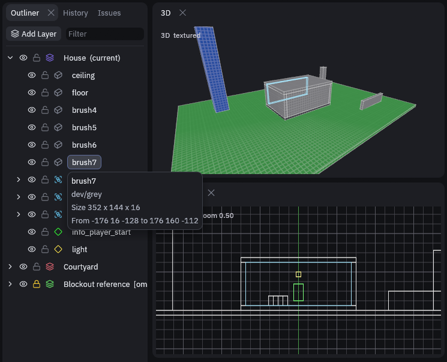
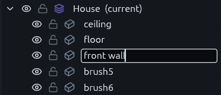
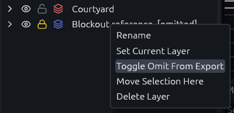
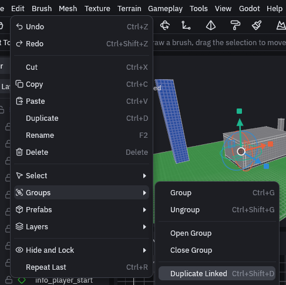
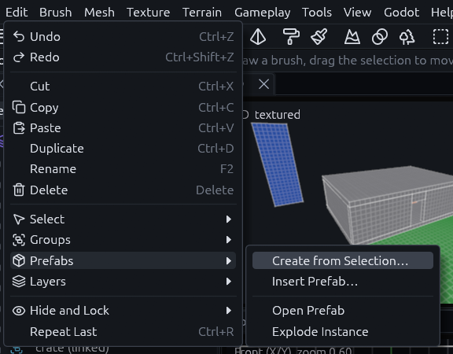
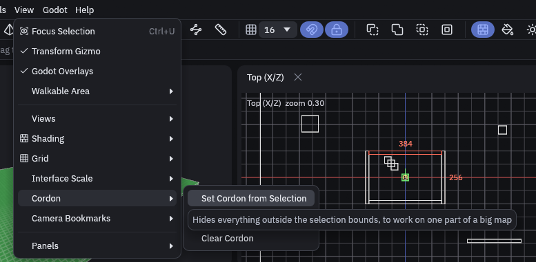
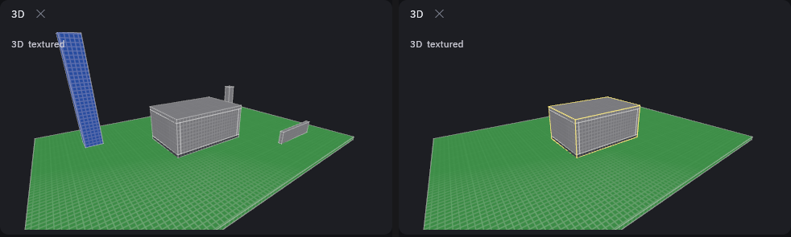
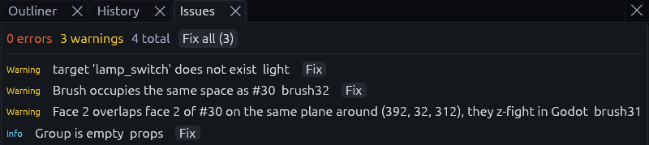
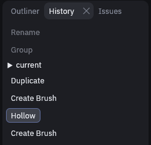

# Organizing a map

Once a map gets bigger you want to sort it into parts, find things again and keep pieces you reuse in one place. Most
of that starts in the Outliner, the panel on the left.

## Layers

The Outliner shows the map as a tree of layers, groups and objects. Layers let you split a map into parts, for example
one building per layer, so you can hide or lock a part while you work on the rest.

Click **Add Layer** at the top of the Outliner to make a new one, it becomes the current layer right away. New objects
go into the current layer, the one marked *(current)*, and clicking a layer makes it current. The eye in front of a
row hides it, the lock stops it from being selected or edited.

Hover a row to see its materials, size and bounds. The object is outlined in every view at the same time, so you can
see which wall `brush7` is.

Brushes and meshes are listed by kind and id, such as `brush12` or `mesh40`, so the walls a Hollow or a Subtract leaves
behind can be told apart. The id stays the same when the object moves and across saves.

### Naming things

Select an object and press F2, or right click it in the Outliner or a view and pick *Rename*. The row turns into a text
field. Enter keeps the name, Escape cancels, and an empty name brings back the default one.

Names are saved with the map. Entities keep their `targetname` apart from this name, so renaming never changes what an
output reaches. The pieces a Clip, a CSG operation or a conversion leaves behind keep the name, and naming an object
inside a linked group names it in every copy.

(Layers, groups and scatter sets always keep a name, so for them an empty one changes nothing. Renaming a scatter set
also renames the layer the Scatter tool made for it.)

### Picking objects in the Outliner

Ctrl+click a row to add it to the selection or take it out. Shift+click selects every row between the last one you
clicked and this one, and Ctrl+Shift+click adds that range to what is already selected. The Outliner is often the
easier place to pick objects that hide behind others in the views.

### Keeping a layer out of Godot

For reference geometry that should never reach the game, right click its layer and pick *Toggle Omit From Export*. The
layer then shows *[omitted]* after its name. Hiding is not enough, Godot still builds hidden objects.

## Groups

A group keeps objects together so they select and move as one, like the brushes of a table. Find everything about
groups under *Edit > Groups*.

| Input | Result |
| --- | --- |
| Ctrl+G, Ctrl+Shift+G | Group the selection, ungroup it |
| Click | Select the object inside the group |
| Double click | Select the whole group |

**Duplicate Linked** (Ctrl+Shift+D) makes a copy that stays in sync with its original, so fixing one window frame fixes
all of them. Linked copies show *(linked)* in the Outliner, and a click on one selects the whole group, since its copies
are edited as one. *Edit > Groups > Unlink Groups* breaks the link when one copy has to differ.

## Prefabs

For pieces you reuse across maps, select them and choose *Edit > Prefabs > Create from Selection…*. That saves the
selection as its own `.tdm` and puts an instance in its place. Every instance updates when the prefab file changes.

> [!NOTE]
> Save the map once before you create a prefab. Prefab paths are stored relative to the map, so the editor
> refuses until the map has a file.

For pieces you paste once and then shape freely, use the [prefab library](prefab-library.md) instead.

Placing a prefab twice gives two entities the same targetname. An instance's fixup solves that: with a fixup of `p1`,
every name inside it gets that prefix, so `door` becomes `p1-door` and each copy keeps its wiring apart. The map file
and the Godot build know the fixup, but the editor has no field to set it yet.

## Cordon

A cordon shrinks the editor down to one part of a big map.

1. Select what you want to work on.
2. Choose *View > Cordon > Set Cordon from Selection*, or click **Cordon** in the Inspector.

    

3. Everything that does not touch the yellow box around your selection is now hidden and cannot be selected, and the
    status bar says *cordon*.

    

*View > Cordon > Cordon Enabled* switches it off and on again, and *Clear Cordon* removes it. The cordon is saved with
the map.

It only changes what the editor shows, Godot still builds the whole map. To hand one area to another tool, *File >
Export > .map, cordon only…* writes just the objects inside it.

## Issues

The Issues panel, the tab beside the Outliner and History, checks the map while you work. It lists problems that
would break or look wrong in Godot, such as brushes with no volume, faces with no material, or outputs aimed at a
targetname nothing has.

Click an issue to select and frame the object. Many have a **Fix** button, and **Fix all** in the header fixes every one
it can.

A warning that a face overlaps a face of another brush on the same plane means the two will flicker in Godot. Move one
face off the plane or trim the overlap.

A warning that a model does not exist means a prop's `model` names a file that is not there, so the prop builds with no
mesh. When a file of the same name with another extension exists, `chair.gltf` for `chair.glb`, the warning names it.

## History

The History panel lists every edit, newest at the top. Click an older entry to undo back to it, that entry included.
Undone edits stay dimmed above *current*, click one to redo up to it.

## MCP

An agent or script driving the editor over the [MCP server](../mcp.md) runs the same checks as the Issues panel with
the `validate_map` tool, which names them by code, such as `coplanar_faces` and `missing_model`. The
`run_action` action `insert_prefab` takes a `fixup`, so an agent can give an instance its fixup when it places it.

