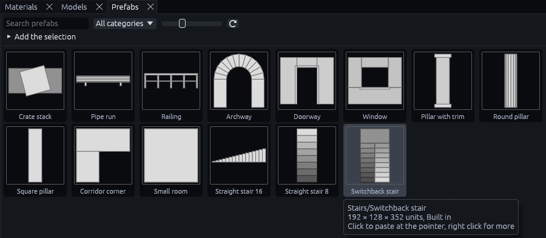
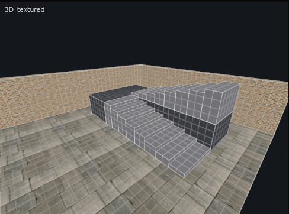
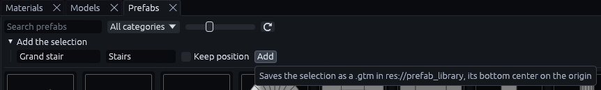
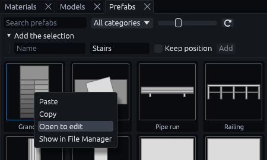

# Prefab library

The **Prefabs** tab at the bottom, next to Materials and Models, holds ready made pieces to paste into a map: stairs,
doorways, pillars, small rooms and details. Think of the prefab collections TrenchBroom mappers copy from, only built
into the editor.

Each card draws its piece from the side that shows the most: from above for floor plans like a stair, from the front
for walls like a doorway. Lighter means nearer.

## Pasting a piece

1. Point at the spot

   Hover the spot in a view where the piece should go, that sets the 3D cursor.

2. Click the card

   Type in *Search prefabs* or pick a category to find it, then click it. The piece is pasted centered on that spot
   and snapped to the grid, like Ctrl+V.

   

Only the spot on the floor plan follows the cursor. The height stays as the piece was saved, so on an upper floor lift
it up afterwards.

The paste is a plain copy with no link back to the library, so reshape or retexture it freely. The built-in pieces use
the `dev/` materials every project has, retexture them from the Materials tab.

Right click a card for *Paste* and *Copy*. Copy puts the piece on the clipboard, to paste into another map or share as
text.

To cover a whole area with pieces picked at random, use [Random fill](random-fill.md).

> **Tip:** A piece is plain map content once pasted. For something that should stay in sync everywhere it is used, like
> a window frame repeated across a building, make a [prefab instance](organizing.md#prefabs) instead.

## Your own pieces

1. Select the objects

   Select what should become the piece, with a Godot project open.

2. Add the selection

   Open **Add the selection** at the top of the Prefabs tab, give the piece a name and a category, and click **Add**.

   

3. Find the new card

   It shows up first, with a blue frame. Right click it for *Open to edit*, which opens the piece as a map, and *Show in
   File Manager*. Built-in pieces cannot be edited.

   

The piece is saved as a `.tdm` in `res://prefab_library/<category>/`, moved so the bottom center of the selection sits
on the origin. Tick **Keep position** to leave it where it is instead, for a piece you built around the map's origin on
purpose, like the pieces of a [random fill](random-fill.md) kit.

Every `.tdm` in that folder is a piece. Save maps there yourself with *File > Save As…* and they show up as cards right
away. For files you copied in by hand, or a folder of pieces shared between projects, press the ⟳ button.

## Pasting from TrenchBroom

TrenchDot also pastes what TrenchBroom puts on the clipboard. Copy brushes in TrenchBroom, or from a TrenchBroom
prefab collection on the web, and press Ctrl+V in a map. Groups come across as groups, entities as entities, and the
axes are turned the same way as when [importing a .map](importing.md). Texture names are kept, other games' tool
textures become the project's.


## MCP

The `prefab_library` tool lists pieces (`op: list`), pastes one by its `category/name` (`op: paste`, with `origin` or
`offset`), returns its clipboard text (`op: copy`), and adds objects to the project's library (`op: add`, the selection
unless `ids` are given). `run_action` with `paste` accepts TrenchBroom clipboard text as well as TrenchDot's.

