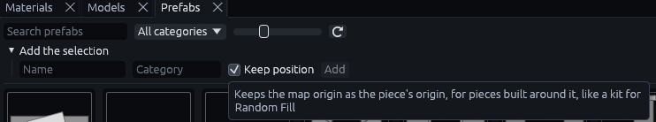
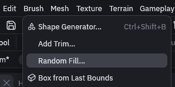
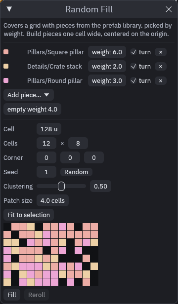
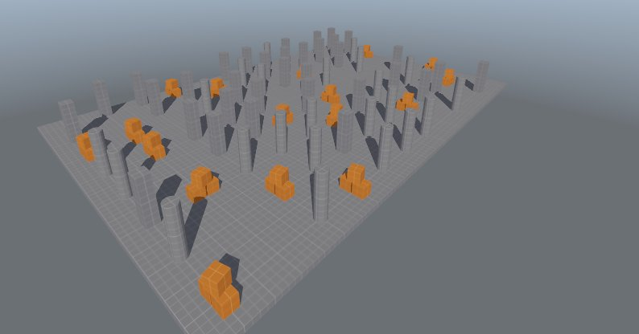

# Random fill

*Brush > Random Fill…* covers a grid of cells with pieces from the [prefab library](prefab-library.md), picking each
cell's piece by weight. Build a small kit of pieces, like an office room, a hallway, a pillar grid and an open floor,
and the fill lays out a whole floor plan from them. Every seed gives a different plan, and the same seed always gives
the same one.

1. Build your pieces

    Build each piece one cell wide (128 units by default), centered on the origin. Keep walls off the cell's border, so
    pieces next to each other always connect.

    Then add it to the library: select it, open **Add the selection** at the top of the Prefabs tab, tick **Keep
    position**, give it a name and click **Add** (see [Your own pieces](prefab-library.md#your-own-pieces)).

    

2. Open the dialog

    Go to *Brush > Random Fill…*.

    

3. Add the pieces

    Pick each piece from **Add piece…** and give it a **weight**: a piece with weight 6 fills about twice as many cells
    as one with weight 3. **turn** lets a piece turn by a random multiple of 90 degrees.

    

4. (Optionally) Leave some cells open

    **empty weight** works like a piece that places nothing.

5. Place the grid

    Select the floor and click **Fit to selection**, or set the **Cell** size, the number of **Cells** and the
    **Corner** yourself.

6. (Optionally) Cluster the pieces

    **Clustering** gathers each piece into patches of about **Patch size** cells, so a wing of offices sits next to a
    hall of pillars instead of everything being evenly mixed.

7. Fill it

    The colored grid previews the layout, one color per piece. Click **Fill**, and **Reroll** replaces the last fill
    with the next seed.

    

The fill is one group of plain copies, so it bakes and builds like anything you place by hand, and you can edit any
cell afterwards. Each copy's entity names get their own prefix, `rf<seed>_<n>-`, so a piece with wired entities, like a
lamp that flickers on a timer, works on its own in every cell.

> [!TIP]
> Fill different kinds of detail in separate passes over the same grid, for example one fill for the walls and
> one for the ceiling lights, with their own weights, such as a few dead or flickering lights among working ones.

## MCP

The `random_fill` tool takes `pieces` as `[{name, weight, rotate}]`, `empty`, `min`, `cell`, `cells`, `seed`,
`cluster` and `cluster_size`. `preview: true` only returns the layout as a sketch, `replace` removes an earlier fill
first.

