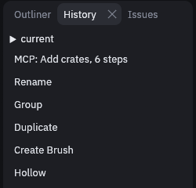

# Reviewing changes

Keep your maps in git and you can see what changed between two versions, the same way you review code. For changes
inside the current session, the [History panel](organizing.md#history) lists every edit and undoes back to any of them.

## Maps in git

`.tdm` files are binary, but git can still show you readable diffs. It asks the editor to print each version as JSON
and compares those. You set this up once:

1. Add this line to `.gitattributes` in your project:

    ```
    *.tdm binary diff=tdm
    ```

2. Tell git how to print a map, once per clone:

    ```sh
    git config diff.tdm.textconv "trenchdot --dump"
    ```

3. (Optionally) keep backups and autosaves out of the repository with these lines in `.gitignore`:

    ```
    *.tdm.bak
    *.tdm.autosave
    ```

`git diff` and `git log -p` should now show map changes as JSON, instead of only saying that the binary files differ.

> [!WARNING]
> `trenchdot` has to be on your `PATH`, or `git diff` fails on maps.

To get that JSON as a file, `trenchdot --to-json map.tdm map.json` writes it, and `trenchdot --to-tdm map.json
map.tdm` turns it back into a binary map. See [Command line](../command-line.md).

<div class="td-mcp" markdown>

## MCP

The MCP review tools show you what an AI agent did to your map.

### Edits made by an AI agent

When an agent edits your map over [MCP](../mcp.md), every tool call is one undo step named `MCP: ...` in the
[History panel](organizing.md#history). A whole `run_script` is one step too, such as `MCP: Add crates, 6 steps`.
Undo that step to take the agent's work back.



| To see | Ask the agent for |
| --- | --- |
| What changed since you last saved | `changes_since`, which lists nodes added, removed, moved or otherwise edited |
| What its last call or script changed | `changes_since` with `undo_steps: 1` |
| What changed since a git commit | `changes_since` with `file` set to that version, written with `git show HEAD:maps/level.tdm > old.tdm` |

> [!TIP]
> Ask the agent to put a multi-step job in one `run_script` with a `label`, so the whole job undoes in one
> step under a name you recognize.

</div>
