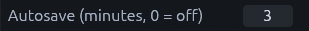
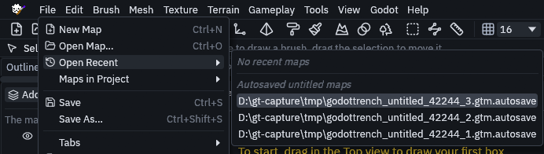

# Saving and recovery

Press Ctrl+S to save, or Ctrl+Shift+S for *Save As…*. File dialogs start in the folder of the current map, or in the
Godot project for a map you never saved, since the addon loads maps by their `res://` path. *File > Maps in Project*
lists every map in the project if you just want to open one quickly.

## Backups and autosave

The editor keeps two kinds of spare copies next to your map:

| File | Written |
| --- | --- |
| `<map>.tdm.bak` | On every save, a copy of the previous version. Rename it to `.tdm` to go back one save |
| `<map>.tdm.autosave` | Every three minutes, for every tab with unsaved changes |

To change how often it autosaves, go to *File > Preferences* and set *Autosave (minutes, 0 = off)*.

Autosaves use an extension Godot does not import, so a half finished map never shows up in your game. Saving the map
deletes its autosave.

## Recovering a map

If the editor closed before you saved, open the autosave:

1. Choose *File > Open Map…*.
2. Pick the **Autosave (recover a map)** file type and open the `.tdm.autosave` file. The status bar should say it
   recovered the map from its autosave.
3. Save. This writes the real `.tdm` again.

Maps you never saved autosave to a temporary file instead. You find those under *File > Open Recent*, below
*Autosaved untitled maps*.

## Damaged files

A map file damaged on disk still opens. The editor reads every intact part, puts objects whose layer, group or entity
was lost into a layer named *Recovered*, and says in the status bar what could not be read. Saving keeps the damaged
original as `<map>.tdm.bak`, so you can still restore it from version control.
