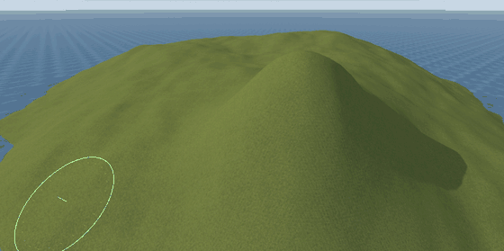
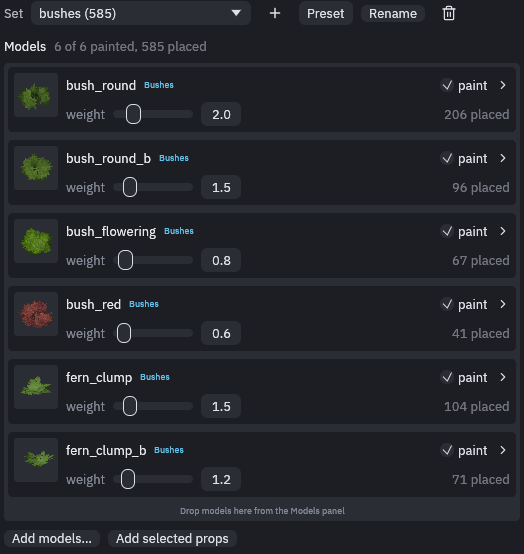
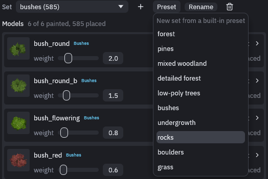
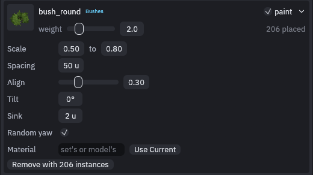
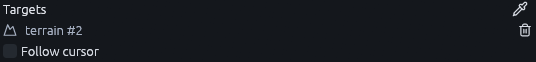
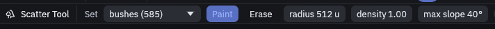
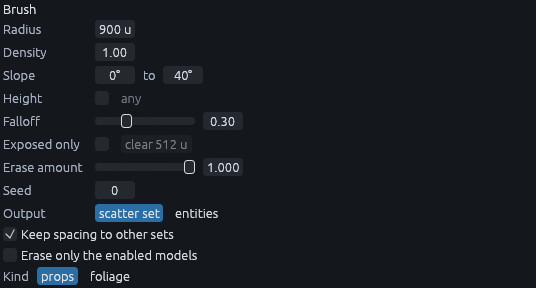
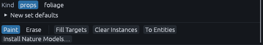

# Scatter

The **Scatter** tool (B) paints trees, rocks and grass onto surfaces you choose, so you can cover a hillside in seconds
instead of placing every model by hand. The [sea island tutorial](../tutorials/sea-island-scatter.md) walks through a
full setup.

## Scatter sets

Everything you scatter lives in a **scatter set** on its own layer, for example one set for trees and one for grass.
Press B and the Scatter panel opens on the right, with a card for every model in the active set.

| To | Do this |
| --- | --- |
| Start an empty set | **+** next to the set menu |
| Start from a preset | **Preset**, then pick one of the ten built-in sets |
| Add models | Drag them in from the Models panel, or **Add models…**. **Add selected props** takes the models of the selected entities |
| Stop painting one model | Untick **paint** on its card. What it already placed stays |
| Tune a model | Click the arrow at the right of its card |

The rocks, boulders, grass, undergrowth and low-poly trees presets use Blockbench models built into the editor.
Picking one adds the models it needs to `res://trenchdot/nature`, offline. The forest, pines, mixed woodland,
detailed forest and bushes presets use the glTF trees and bushes of the nature pack, a download of about 23 MB. In a
project without it, picking one of those opens *Godot > Add Content to Project…* on the nature models instead of
making a set whose models are missing. *Terrain > Scatter > Install Nature Models…*, or **Install Nature Models…** at
the bottom of the panel, opens it too. Files already in the project are never overwritten.

### Model cards

Open a card with its arrow to tune that one model.

| Card setting | What it does |
| --- | --- |
| weight | How often this model is picked compared to the others in the set |
| Scale | A random size between the two values |
| Spacing | The smallest distance in map units to any other instance |
| Align | 0 stands the model upright, 1 tilts it to follow the surface |
| Tilt | The largest random lean in degrees |
| Sink | How far the model is pushed into the ground, to hide the bottom of a trunk or rock |
| Random yaw | Turns each instance to a random direction |
| Material | Drawn instead of the model's own materials. Left empty, the set's material applies, if it has one |

## Targets

A set only lands on its **targets**, so a forest painted on a terrain never covers the house on it. Alt+click in a view,
or click the eyedropper at the right of *Targets* and then click in a view, to add or remove a target. A set without
targets takes whatever its first stroke lands on. Another set can be a target too, which is how grass grows on
boulders.

Ticking **Follow cursor** ignores the targets and paints on any surface or scattered prop under the brush.

## Painting

The quick settings sit in the tool options bar at the top left: the set, **Paint** or **Erase**, radius, density, max
slope, **Follow cursor**, the eyedropper and **Fill**. **Scatter Panel** brings the panel back if you closed it.

| Input | Action |
| --- | --- |
| Left drag | Paint |
| Shift+left drag | Erase, from the active set only |
| Ctrl+wheel | Resize the brush |
| **Fill Targets** | Cover every target in one go, within the slope and height limits |

The *Brush* section of the panel holds the rest.

**Density** is how many placements the brush tries per 64 by 64 units, and each model's spacing limits how many
actually fit. **Exposed only** skips points with geometry above them, which keeps grass out from under balconies and
roofs. **Keep spacing to other sets**, on by default, stops a bush growing through another set's trunk.

## In Godot

A set's **Kind** decides what Godot builds.

| Kind | Built as |
| --- | --- |
| props | MultiMeshes with collision and shadows. Models whose scenes carry scripts are instanced one by one so the scripts run |
| foliage | MultiMeshes without collision or shadows, hidden beyond 2400 units by default. Meant for grass and small plants |

Select the set in the Outliner and its **Collision** row in the Inspector picks the shape each instance collides with.
New props sets start on convex and foliage sets on none.

| Collision | Shape per instance |
| --- | --- |
| none | No collision |
| box | One box around the instance |
| convex | One convex hull around the instance |
| decomposition | Several convex hulls that follow concave models, such as an arch, slower to build |
| trimesh | Every face of the model, exact but the most expensive |

When you need to edit single props, **To Entities** at the bottom of the Scatter panel, or *Terrain > Scatter > Scatter
Sets to Entities* for the selected sets, replaces a set with one `prop_model` entity per instance.

