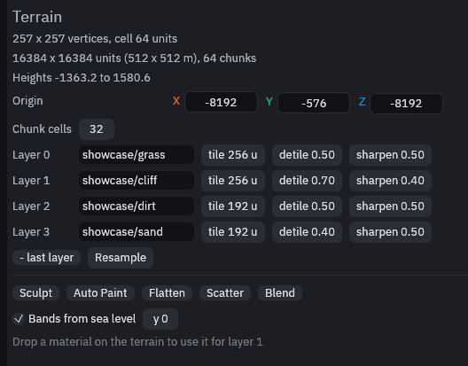
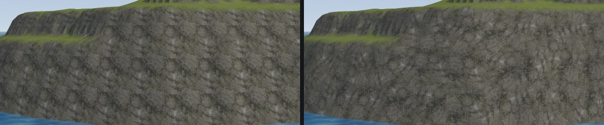
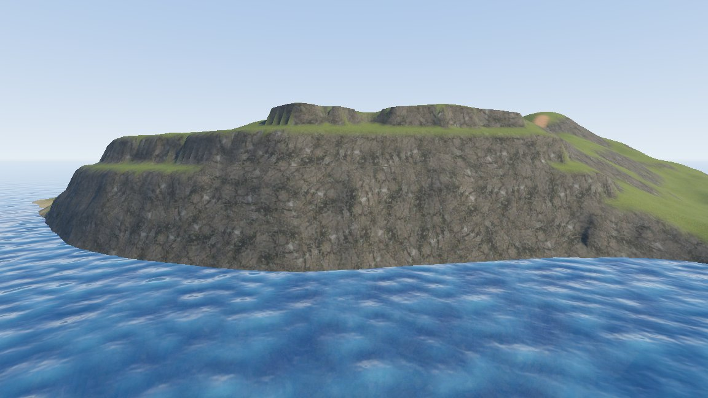

# Terrain layers

A terrain has one to four layers, each one a material plus a few settings for how it repeats. Select the terrain and
you find them in the Inspector. The layers share the ground between them, so painting sand onto grass takes weight away
from the grass.

| To | Do this |
| --- | --- |
| Add a layer | **+ layer (current material)** under the layers, which uses the material you last clicked in the Materials panel. It shows while the terrain has fewer than four |
| Remove the last layer | **- last layer** |
| Change a layer's material | Type its name into the layer's field, or drag a material from the Materials panel onto the terrain. The line at the bottom of the Inspector says which layer a drop goes to, and with the Blend tool active it is the layer the tool paints |

**Layer 0 is the base ground.** Unpainted ground shows layer 0 and erasing paints back to it, so put your most common
ground there, usually grass.

A new terrain gets the layers named in the *Create Terrain* dialog, four by default. Dropping a material for a layer
the terrain doesn't have yet adds it as the next layer.

## Tile and de-tiling

Any texture repeated across a large area shows a grid pattern from a distance. These settings trade sharpness up close
against hiding that pattern.

| Setting | Meaning |
| --- | --- |
| tile | How many map units one repeat of the texture covers. 128 to 384 works well for ground you walk on |
| detile | 0 to 1. Turns and shifts every repeat randomly so the grid stops showing |
| sharpen | 0 to 1, shows up once detile is above 0. 0 blends the shifted repeats evenly, which looks soft. 1 blends them only along their seams, which keeps the texture crisp |

A small tile is sharp up close but repeats visibly from afar, a large one blurs at your feet. Detile hides the repeat
without a bigger tile, but it costs extra texture reads, so leave it at 0 where the repeat does not show.

> [!NOTE]
> The material's `metadata/texture_size` does not apply to terrain, only **tile** does.

## How it looks in Godot

Each layer is projected from above and from the sides, so cliffs show rock instead of a smear, and it matches what you
see in the editor. Each layer uses its material's color texture, normal map, roughness and emission. Ambient occlusion
is used when it sits in the roughness texture, like in an ORM texture, or when the layer has no roughness texture.

