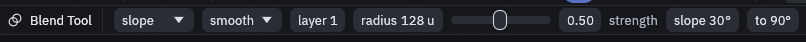
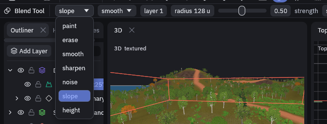
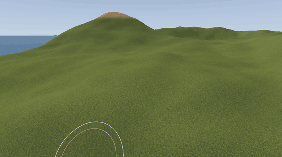
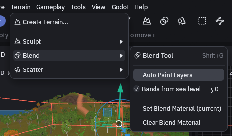
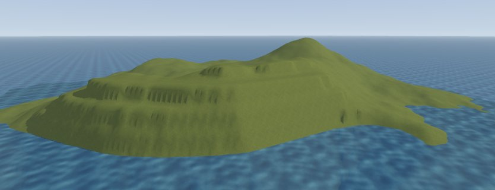
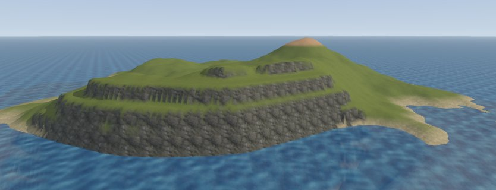
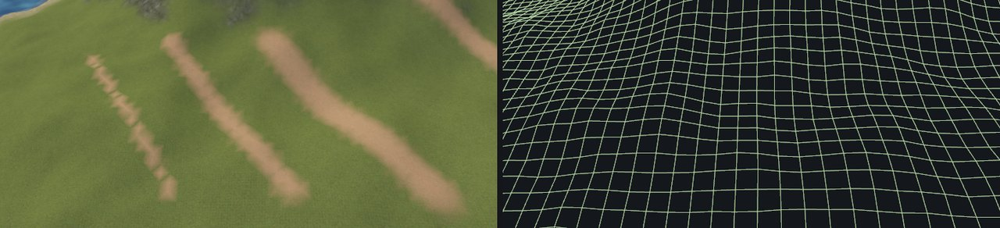

# Terrain painting

The **Blend** tool (Shift+G) paints a terrain's [layers](terrain-layers.md), for example sand along a beach or rock on
a cliff. Like Sculpt, it works on the selected terrains, or on all of them when nothing is selected.

## The Blend tool

1. Pick the tool

   Press Shift+G, or use *Terrain > Blend > Blend Tool*. Its options show up in the tool options bar at the top left.

   

2. Pick a mode

   The first menu in the bar decides what the brush paints, the modes are listed below.

   

3. Pick the layer and paint

   Set **layer** (0 to 3) to the layer you want, then drag over the terrain. Several light passes give softer edges
   than one strong pass.

   

| Mode | What it paints |
| --- | --- |
| paint | Adds the chosen layer under the brush |
| erase | Paints back towards layer 0, the base ground |
| smooth | Softens the borders between layers |
| sharpen | Lets the strongest layer win, for crisp borders |
| noise | Only in cloud shaped patches of the given **size**, for moss, dry grass or gravel |
| slope | Only where the ground is between two angles. `30` to `90` puts rock on anything steeper than 30° |
| height | Only between two world heights, for sand at a waterline or snow above a tree line |

Slope and height make huge brushes safe, a hill sized brush in slope mode only turns the cliffs to rock.

The second menu in the bar is the falloff, how the strength fades from the center of the brush to its rim.

| Falloff | Shape |
| --- | --- |
| smooth | A gentle fade, the usual choice |
| linear | An even fade from center to rim |
| constant | The whole disc at the same strength, for hard edges |
| spray | Random speckles, for pebbles and flowers |

Shift turns paint, noise, slope and height into erase, and Ctrl smooths. Ctrl+wheel resizes the brush.

(Note: **Set Blend Material**, **repeat**, **detile**, **sharpen** and **Apply Tiling** further right in the bar are
for blending brush faces, a terrain takes those settings from its layers.)

## Auto Paint

Auto Paint repaints a terrain from its shape, a quick first pass before you paint by hand.

1. Select the terrain

   Auto Paint only touches the selected terrains.

2. Run it

   Go to *Terrain > Blend > Auto Paint Layers*, or click **Auto Paint** in the Inspector.

   

| Layer | Goes on |
| --- | --- |
| 1 | Slopes steeper than about 50° |
| 2 | The top 20% of the height range |
| 3 | The bottom 8% of the height range |

Layer 0 covers everything else. A terrain with fewer layers gets the missing bands in its last layer.

The range starts at the lowest point, which on an island is the sea floor. Tick **Bands from sea level** to measure
from a height you give instead, like the waterline at y 0 above.

> **Warning:** Auto Paint replaces all paint, so sculpt first, auto paint, and paint by hand last.

## How narrow you can paint

Paint lives on the vertices, so a stroke needs a radius of about two cells for a clean band. Below one cell it turns
into a staircase. For a narrow track, use smaller cells, or lay a mesh or [decal](decals.md) on top.

