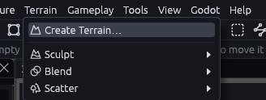
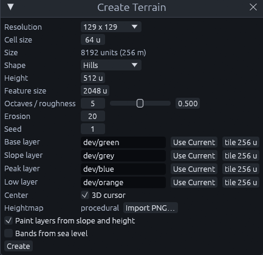
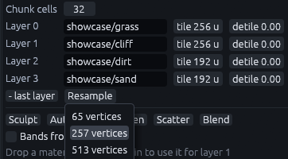
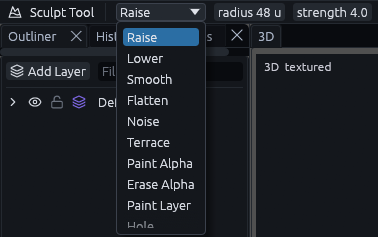
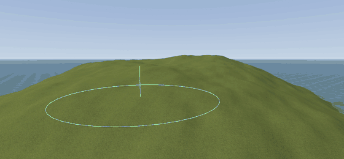

# Terrain

A terrain is a big grid of heights you sculpt like clay, with up to four textures painted over it. Use it for open
ground like hills, beaches and valleys, where shaping brushes by hand would take forever.

This page covers making one and shaping it with the Sculpt tool (G). Texturing it is on
[Terrain layers](terrain-layers.md) and [Terrain painting](terrain-painting.md).

## Creating a terrain

1. Open the dialog

   Go to *Terrain > Create Terrain…* in the menu bar.

   

2. Pick a size

   **Resolution** and **Cell size** decide how big it gets, and the **Size** row under them shows the result in units
   and meters. The default of 129 x 129 vertices with 64 unit cells gives 8192 units, 256 m. See
   [Picking the cell size](#picking-the-cell-size) below.

   

3. (Optionally) Pick a starting shape

   **Shape** is the ground you start from. It's Hills by default, the others are Flat, Mountain, Island, Valley and
   Ridges. **Import PNG…** reads a grayscale heightmap instead, where brighter pixels are higher. Both only work here,
   on creation.

4. (Optionally) Pick the layers

   **Base layer**, **Slope layer**, **Peak layer** and **Low layer** are the terrain's four textures, and **Use
   Current** puts in the material you last clicked. With **Paint layers from slope and height** ticked they get painted
   right away, see [Auto Paint](terrain-painting.md#auto-paint).

5. Click **Create** at the bottom

   The terrain is centered on the 3D cursor, or on the **Center** you type in with **3D cursor** unticked, and that
   height becomes the terrain's zero. You should see the new terrain selected, with the Sculpt tool already active.

## Picking the cell size

| Setting | Meaning |
| --- | --- |
| Resolution | How many vertices run along each side, from 33 to 1025. More vertices hold more detail but cost more to draw and sculpt |
| Cell size | The distance in map units between two neighboring vertices |

257 vertices with 64 unit cells, for example, give 16384 units, 512 m.

Nothing sits between two vertices, so the cell size is the finest detail the terrain can hold. A mountain range wants
big cells, a garden small ones.

Picked wrong? Select the terrain and open **Resample** in the Inspector. It rebuilds the grid at 65, 129, 257 or 513
vertices along the longer side and keeps the heights, paint and holes. The terrain keeps its size, so more vertices
means smaller cells.

**Chunk cells** (32 by default) splits the terrain into square pieces for drawing and collision. Smaller chunks rebuild
faster while sculpting, larger ones mean fewer nodes in Godot.

## Sculpting

Press G, pick a mode in the tool options bar at the top left, and drag over the terrain. It works on the selected
terrains, or on all of them when nothing is selected.

Keep the mouse button down and the ground keeps rising under the brush.

| Mode | What it does |
| --- | --- |
| Raise, Lower | Builds height up or digs it down for as long as you hold the button. A click makes a small bump |
| Smooth | Relaxes each vertex towards its neighbors, to soften lumps and sharp ridges |
| Flatten | Pulls the ground to the height where the stroke started, for building pads, roads and plateaus |
| Noise | Adds small random bumps, so flat ground looks less artificial |
| Terrace | Snaps heights to steps of **step** units, for rice fields or stepped cliffs. The field shows up next to the mode |
| Paint Alpha, Erase Alpha, Paint Layer | Paint instead of shaping. The alpha modes are meant for displacements, Paint Layer paints the terrain layer set next to the mode. On a terrain the [Blend tool](terrain-painting.md) does this with more control |
| Hole, Unhole | Cuts whole cells out or fills them back, collision included. Use it for cave or bunker entrances |

Ctrl+wheel resizes the brush, Shift swaps raise and lower, and holding Ctrl smooths whatever the mode.

**Strength** sets how fast the brush works. Raise and Lower move the center of the brush 8 units a second per point of
strength, whatever the radius, so the default 4 builds 32 units a second. For hills and islands turn the strength up
rather than holding for a minute.

Keep the radius above the terrain's cell size, a smaller brush only nudges the one vertex under it (the status bar
tells you when that happens).

To start over, *Terrain > Sculpt > Flatten*, or **Flatten** in the Inspector, sets the whole selected terrain back to
its zero height.

> **Tip:** Shape with a large brush and smooth after every rough pass. Small brushes leave lumps.

## In Godot

Every terrain becomes a `TrenchDotTerrain` node, a `StaticBody3D` (Godot's node for solid ground that never moves)
whose collision matches what it draws. For gameplay code, `height_at(x, z)` returns the ground height at a local
position, handy for placing things on the ground at runtime.



## MCP

The `terrain_edit` tool's `sculpt` op applies a single dab, and its strength is how far that dab moves the center, again
whatever the radius. Holding a stroke for one second at strength 4 matches a dab of strength 32.


