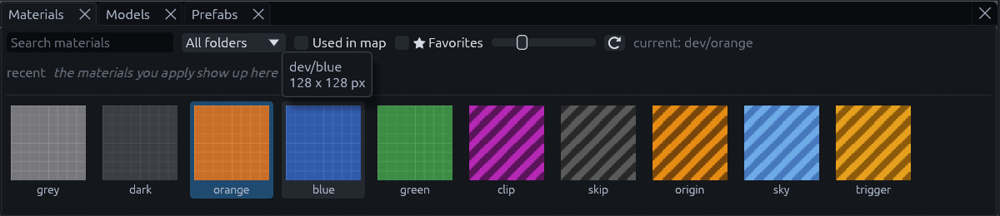
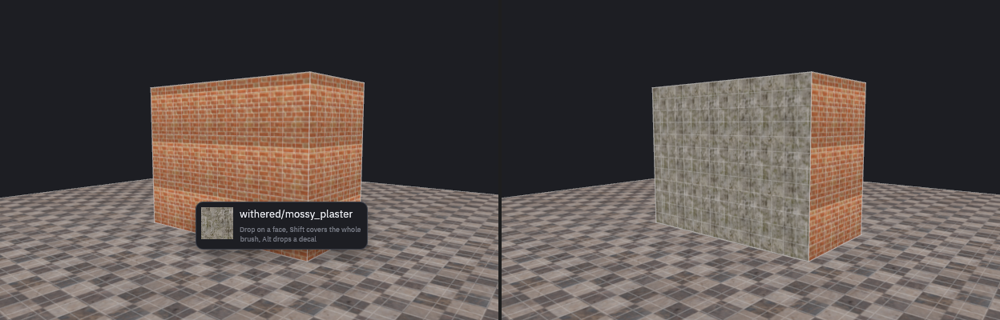
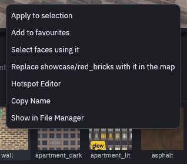
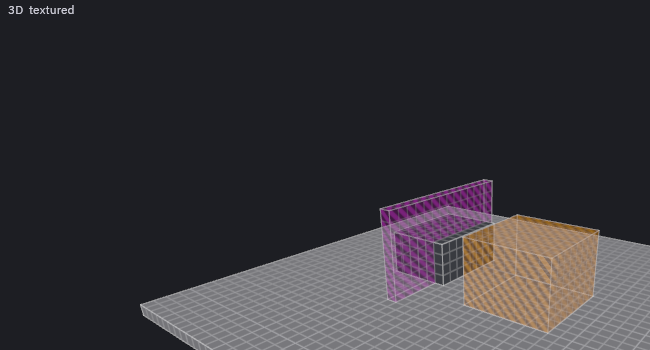
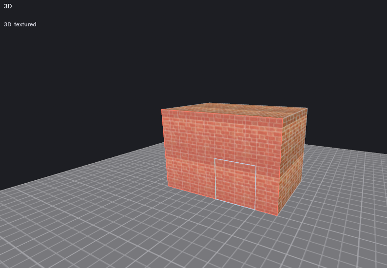
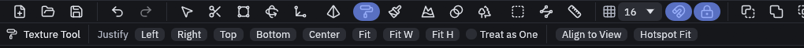
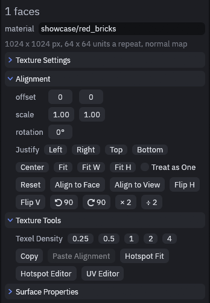
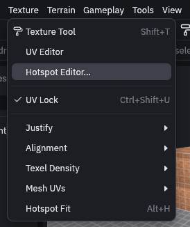
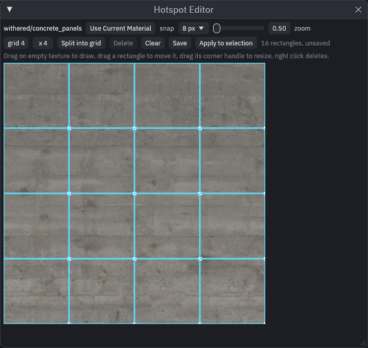
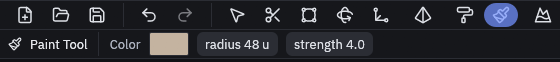

# Texturing

## Applying materials

Your textures live in the **Materials** panel, at the bottom of the window under the views. The search box at its
top left filters them by name, **Used in map** and **Favorites** narrow the list down, and the slider sets the
thumbnail size.

| Do this | Result |
| --- | --- |
| Click a thumbnail | Apply it to the selection, and use it for new brushes |
| Drag a thumbnail onto a face | Apply it to that face |
| Shift while dropping | Apply it to the whole brush or mesh |
| Alt while dropping | Place it as a [decal](decals.md) |

While you drag, a little card next to the cursor reminds you of the modifiers, and the face changes as soon as you let
go.

To texture one face without dragging, Shift+click it in a view first, then click the thumbnail. Ctrl+Shift+click adds
or removes more faces.

Right click a thumbnail for more: add it to your favourites, select the faces that use it, swap it in for the current
material across the whole map, open the hotspot editor, or *Show in File Manager* to open the folder of its texture
with the file selected, for example to edit it.

Dropping a material on a terrain sets a terrain layer instead, see [Terrain layers](terrain-layers.md).

UV lock (Ctrl+Shift+U) is on by default, so textures stay attached to a brush while you move it.

## Built in colors

The Materials panel always offers `dev/grey`, `dev/dark`, `dev/orange`, `dev/blue` and `dev/green`, grid textures
for blocking out a level before it has art. Color coding rooms with them survives the build, since the addon ships the
same grids and Godot uses them when the project has no texture of that name. A texture of your own at, for example,
`res://textures/dev/grey.png` replaces one.

## Tool textures

The editor draws tool textures see-through with stripes, and the Godot build gives them no visual mesh. Every texture
in the `special/`, `tools/` or `td/` folder counts, and so does any texture named after one of the tools below, such as
`common/caulk`.

| Texture | In Godot |
| --- | --- |
| `special/clip`, `playerclip`, `nodraw`, `caulk`, `trigger`, `sky` and any other tool | Collides but draws nothing. A trigger keeps its trigger shape |
| `special/skip`, `origin`, `hint`, `hintskip`, `null`, `areaportal` | Builds nothing at all. A brush of only these faces does not collide |
| `special/occluder` | Draws nothing and does not hide neighbors, but adds to the occluder of an entity that builds one, like `func_geo` |

The map settings name the clip, skip, origin and sky textures, `special/clip` and so on by default. An origin brush only
sets its entity's origin with the texture the map settings name.

## The Texture tool

A face's alignment is where its texture sits on it: the offset, scale and rotation. Press **Shift+T** for the Texture
tool, which edits it in place, like Hammer's face edit mode. Click a face to select it. It is tinted red and shows a
blue box around one repeat of the texture, plus two short lines for the U and V directions. The face under the cursor
gets a yellow outline.

| Input | Result |
| --- | --- |
| Click, Ctrl+click | Click selects a face, Ctrl+click adds or removes one |
| Drag a selected face | Slide the texture, the pixel under the cursor stays under it |
| Arrow keys | Slide by the grid size in pixels, with Shift by one pixel |
| Ctrl+wheel | Scale by 2, with Shift in fine steps |
| Alt+wheel | Rotate by 15°, with Shift by 1° |
| Alt+click | Pick up a face's material and alignment |
| Right click | Apply the current material |
| Ctrl+right click | Apply it and reset the alignment |
| Shift+right click | Paste the picked material and alignment |
| Alt+right click | Apply the current material, continuing the selected face's alignment across the edge |

Alt+right click is how a texture, like a trim or a row of bricks, runs cleanly around a corner.

The tool options bar at the top has the **Justify** buttons. **Left**, **Right**, **Top**, **Bottom** and **Center**
push the texture to that side of the face, **Fit** stretches it over the face, **Fit W** and **Fit H** only across or
only up. With **Treat as One** ticked they work on all selected faces as one area, so one texture spans all of them.
**Align to View** projects the texture along the 3D camera.

If you prefer numbers, the **Inspector** shows the same face under **Alignment**, with offset, scale and rotation
fields and buttons to flip, turn and reset it. **Texture Tools** below it sets the texel density and copies
alignment from face to face.

For faces with explicit UVs, and for meshes, use the [UV Editor](uv-editor.md).

## Texture scale

By default one texture pixel covers one map unit, so a 64 pixel texture repeats every two meters. That suits low
resolution textures, but a 1024 pixel photo would stretch over 32 meters. Set `metadata/texture_size` on the material to
the world size one repeat should cover, see [Texture size](../godot/materials.md#texture-size). The Inspector line under
the material name tells you what a face got, like "1024 x 1024 px, 64 x 64 units a repeat".

To set it for one map only, or to make a texture run on seamlessly across every face, use
[Texture Settings](light-baking.md#texture-settings) in the Inspector. Its repeat size wins over the material's.

## Hotspots

Hotspots let one trim sheet texture lots of differently shaped faces. You mark its rectangles once, then TrenchDot
picks the right one for each face.

1. Right click the trim sheet in the Materials panel and choose **Hotspot Editor**. *Texture > Hotspot Editor…*
    opens it too, for the material of the selected face or else the current one.

    

2. Drag on the texture to draw a rectangle, or set a grid and click **Split into grid**. Drag a rectangle to move it,
   its corner handle to resize it, right click deletes it.
3. Click **Save**. The rectangles go into `<texture>.hotspots.json` next to the texture file.
4. Select the faces and use *Texture > Hotspot Fit* (Alt+H), or **Apply to selection** in the editor.

Hotspot Fit gives each face the rectangle whose shape matches it best, preferring one that keeps the texture close to
its normal scale.

## Vertex paint

The **Paint** tool (P) paints vertex colors onto brush faces, for dirt, tint and fake lighting. Pick the color in the
tool options bar, next to the brush radius and strength, then drag over the faces. It paints the selected brushes, or
every brush when nothing is selected. Ctrl+wheel resizes the brush.

