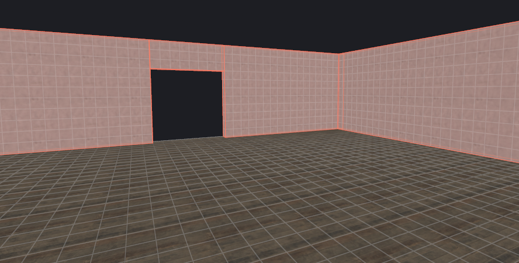
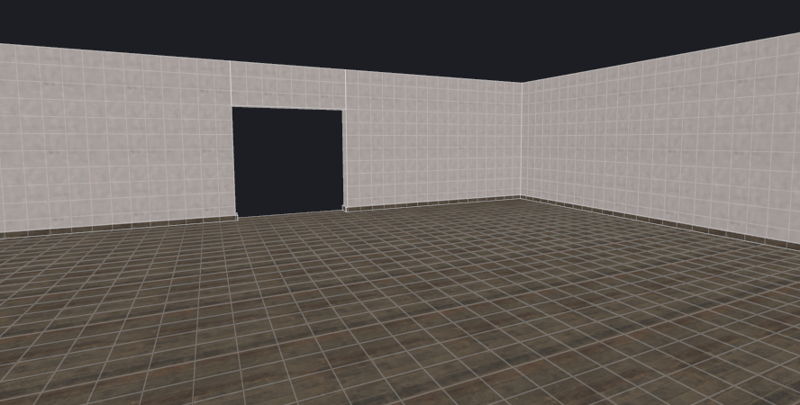
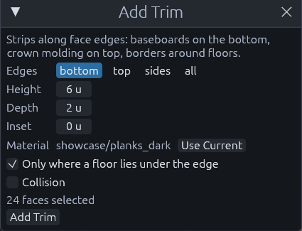

# Trim

*Brush > Add Trim…* lays strips of brush along the edges of faces, standing out from them. Along the bottom of walls
they are baseboards, along the top crown molding, around a floor a border, around a pool its coping. Here is a plain
room before and after one click:

1. (Optionally) Pick the trim material

    Press Escape so nothing is selected, then click the material in the Materials panel. It becomes the current
    material without changing the map.

2. Select the walls

    Every upright face of the selected brushes gets trim. For single faces, Shift+click them instead,
    Ctrl+Shift+click adds or removes more.

3. Open the dialog

    Choose *Brush > Add Trim…*. It starts with the current material, **Use Current** switches to it again later. At
    the bottom it says how many faces it found.

4. Set the strip

    Pick which **Edges** get it: bottom, top, sides or all. **Height** is how far the strip runs over the face,
    **Depth** how far it stands out, and **Inset** leaves a gap between the edge and the strip.

    

5. Click **Add Trim**

    The status bar says how many strips it made.

The strips land in a `func_detail_illusionary` while **Collision** is off, the default, so players do not snag on them.
Tick it, or use a game without that entity, and they land in a plain group instead.

Where two trimmed faces meet, one strip runs into the corner and the other stops at it, so corners close without two
strips overlapping. Around the end of a free standing wall or a doorway the strip wraps around. A strip that would end
up inside another brush, like on the ends of a lintel between two wall pieces, is left out.

**Only where a floor lies under the edge** keeps bottom trim to edges that stand on something, so the underside of a
lintel over a doorway gets no baseboard.

> [!TIP]
> Trim is plain brushes. Retexture, delete or reshape single strips afterwards like any other brush.

## MCP

The `trim` tool takes `faces` as `[[brush, face], ...]`, or brush `ids`, or the selection, plus `edges`, `height`,
`depth`, `inset`, `material`, `on_floor` and `collision`. It returns the new group or entity and how many strips it
made.

