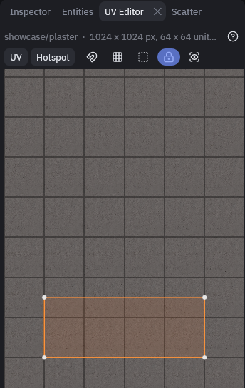
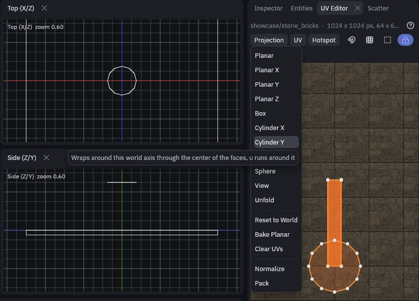
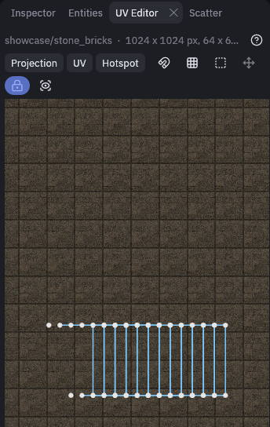

# UV Editor

The UV Editor draws the selected brush and mesh faces flat over their tiled texture, so you can see which part of the
texture each face shows. Use it for what the [Texture tool](texturing.md#the-texture-tool) cannot do in the 3D view,
like placing mesh UVs to the pixel.

## Opening it

The UV Editor is a tab in the right panel, next to the Inspector, and *Texture > UV Editor* brings it up too. Then
select faces: Shift+click one in a view, or use the Texture tool. The top line names the material and how many faces
you have.

> [!TIP]
> While the UV Editor is the visible tab in its panel, Ctrl+click on a brush or mesh selects all its faces, so
> every side can be textured at once. Brushes and meshes that were already selected turn into their faces as well. When
> the selection holds anything else, such as a terrain or an entity, Ctrl+click adds and removes objects as usual.

A brush face normally gets its texture from one offset, scale and rotation. A face with **explicit UVs** stores a
texture position for each corner instead, which is what meshes need. The UV Editor draws those faces blue, and you can
pick their corners one by one. Orange faces have no explicit UVs and move as a whole.

## Controls

The **?** at the end of the top line shows these in the editor too.

| Input | Result |
| --- | --- |
| Drag empty space | Move the texture, or the whole faces when they have explicit UVs |
| Wheel, right drag | Scale, rotate |
| Click a corner | Select it together with the corners of neighboring faces stitched to it |
| Shift+click, Ctrl+click | Add, remove |
| Alt+click | Select only that face's corner, to split a stitch |
| Shift or Ctrl+drag on empty space | Box select, adding or removing |
| Drag a selected corner | Move the whole selection |
| Double click a corner | Gizmo that moves along U or V only, Escape hides it |
| Middle drag, Ctrl+wheel | Pan, zoom the canvas |

With corners selected, the wheel and right drag scale and rotate them around their center. The U and V fields under the
canvas place the selection to the pixel.

The small buttons after the menus switch pixel snap, show the texture's hotspots, make a plain drag box select, show the
gizmo, toggle UV lock and frame the faces again. Hover one to see which is which.

## Mesh UV projections

With mesh faces selected, the **Projection** menu lays out explicit UVs for you. It uses the texel density a brush face
with the same texture would get, so meshes match the brushes around them. Hover an entry for a one line explanation.

| Command | Result |
| --- | --- |
| *Planar*, *Planar X*, *Y*, *Z* | Projects along the direction the faces mostly point, or along one world axis, keeping them in one piece |
| *Box* | Projects each face from its closest world axis, for blocky shapes |
| *Cylinder X*, *Y*, *Z*, *Sphere* | Wrap the texture around the faces, for pipes, columns and domes |
| *View* | Projects straight along the 3D camera |
| *Unfold* | Lays the faces out flat edge by edge, so strips and grids stay continuous |
| *Reset to World* | The projection of a freshly reset brush face |
| *Bake Planar* | Turns the planar texture into editable corner UVs, shown while some faces have none yet |
| *Clear UVs* | Drops the explicit UVs again |
| *Normalize* | Scales the UVs to fit the texture once |
| *Pack* | Packs the islands into the texture at one texel density |

Here a 12 sided column got *Cylinder Y*, its sides now run side by side as one strip around the texture:

The **UV** menu flips, turns, fits, aligns, straightens and snaps to pixels. The **Hotspot** menu fits to a hotspot
rectangle, see [Hotspots](texturing.md#hotspots).
