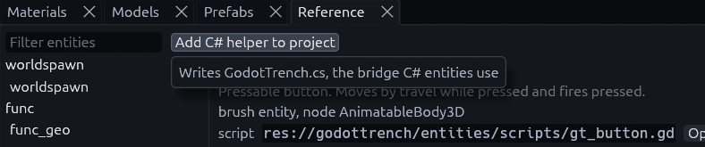

# C# entities

A C# class can be a placeable entity without a `.tres` definition. The addon reads your source files: signals become
outputs, exported members become keys and marked methods become inputs.

Running C# entities needs the .NET build of Godot. The editor lists them either way.

## 1. Add the helper

Open the **Reference** panel (*View > Panels > Reference*) and press **Add C# helper to project** at its top left.



It writes `res://addons/func_godot/csharp/TrenchDot.cs`, which holds the attributes. Without it your entity code
does not compile.

## 2. Declare an entity

```csharp
[GlobalClass]
[TrenchDotEntity("npc_guard", Description = "Patrolling guard",
    Color = "#ff4040ff", Size = "-16 0 -16 16 64 16")]
public partial class NpcGuard : CharacterBody3D
{
    [Signal] public delegate void AlertedEventHandler(Node activator, int level); // output "alerted"
    [Export] public float WalkSpeed { get; set; } = 3.5f;                          // key "walk_speed"
    [TrenchDotInput] public void Alert(Node activator) { }                        // input "alert"
}
```

| Part | Why it matters |
| --- | --- |
| `[GlobalClass]` | Required, the map build creates the node by its class name |
| `Size` | The box the editor draws for the entity, as mins then maxs in map units |
| `Solid = true` | Makes a brush entity, like a door, instead of a point entity |
| `[TrenchDotInput]` | Marks inputs. If no method has it, every public `void` method with a capitalized name is an input |

Names are snake_case in the map and PascalCase in C#. To read keys yourself, implement
`_func_godot_apply_properties(Dictionary props)` and use the helper's readers like
`TrenchDot.Float(props, "walk_speed", 3.5f)`.

> [!TIP]
> The Reference panel's *C# class* tab writes a skeleton with the signals, exports and inputs of any entity,
> a quick start for your own. It leaves out the `[TrenchDotEntity]` line, add that yourself.

## Where the addon looks

The editor and the map build each scan folders for C# entity classes, set in two places:

| Used by | Setting |
| --- | --- |
| The editor (game config export) | *Csharp Source Dirs* on the game config resource |
| The map build | Project setting `trenchdot/csharp_entity_dirs` |

Both default to `res://` and skip `addons`, `bin`, `obj` and hidden folders.

> [!NOTE]
> A C# class cannot replace a library entity. If the FGD already defines its classname, the FGD wins.

## I/O from C#

```csharp
var guide = TrenchDot.FindTargets(this, "guide")[0];
guide.Connect("finished", Callable.From(() => GD.Print("cutscene over")));

foreach (Node barrel in TrenchDot.FindTargets(this, "barrel"))
    TrenchDot.Invoke(barrel, "ignite", "", this);

TrenchDot.FireOutput(this, "alerted", player);
```

The Reference panel's *Use from C#* tab generates this code for any entity.

<div class="td-mcp" markdown>

## MCP

An agent or script driving the editor over the [MCP server](../mcp.md) gets the same generated code from the
`code_reference` tool.

</div>
