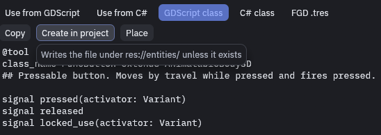
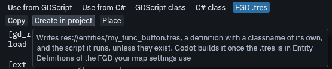

# Custom entities in GDScript

Any script can be an entity. Declare a **signal** for each output and a **method** for each input, then emit the
signal when the thing happens. This alarm has one output, `tripped`, and two inputs, `trip` and `disarm`:

```gdscript
@tool
class_name Alarm extends Node3D

signal tripped(activator: Node)

@export var armed := true

func _func_godot_apply_properties(props: Dictionary) -> void:
	armed = TrenchDotIO.to_bool(props.get("armed", armed))

func trip(activator: Node = null) -> void:
	if armed:
		tripped.emit(activator)

func disarm() -> void:
	armed = false
```

Make the activator the first `Node` argument of your signals, so chains further down still know who started them.

Map keys arrive in `_func_godot_apply_properties`. Read them through `TrenchDotIO.to_bool`, `to_vector3` and
`to_color`, which accept both text and already converted values. Nodes you add there are saved with the scene. Nodes you
add in `_ready` are not, they are made again each time the scene loads, which suits what only the running game needs.
For an entity with a *Scene File*, Godot saves the nodes that come from that scene as the scene file holds them, so
changes you make to them there are lost. Nodes you add are still saved, and changes to the scene's own nodes belong in
`_ready`.

The script needs `@tool`, because maps are built in the Godot editor, where only tool scripts run their methods.

## Making it placeable

The editor and Godot learn about entity classes from your project's FGD, the list of entity definitions. Each
definition is a resource of its own, and the kind you pick decides what Godot builds:

| Your entity | Definition | What to set |
| --- | --- | --- |
| A point entity, at one spot, like a lamp or a pickup | `FuncGodotFGDPointClass` | *Script Class* to your script. To spawn a scene instead, set *Scene File*, a *Script Class* then replaces the script of the scene's root |
| A brush entity, built from brushes, like a door or a trigger | `FuncGodotFGDSolidClass` | *Script Class* to your script, and *Node Class* to the body it extends: `StaticBody3D`, `AnimatableBody3D` or `Area3D`. Left empty, Godot builds the node the script extends. A brush entity that is not a physics body has no collision |

This is the definition of the alarm above, saved as `res://entities/alarm.tres` next to its script `alarm.gd`:

```
[gd_resource type="Resource" script_class="FuncGodotFGDPointClass" load_steps=3 format=3]

[ext_resource type="Script" path="res://addons/func_godot/src/fgd/func_godot_fgd_point_class.gd" id="1_class"]
[ext_resource type="Script" path="res://entities/alarm.gd" id="2_script"]

[resource]
script = ExtResource("1_class")
classname = "alarm"
description = "Trips when told to, until disarmed"
script_class = ExtResource("2_script")
class_properties = Dictionary[String, Variant]({
"targetname": "",
"armed": true
})
node_class = "Node3D"
```

Add it to *Entity Definitions* of the FGD that both your map settings and your game config use, see
[Project setup](../godot/project-setup.md#your-own-resources). The game config then exports it to the editor, with its
signals as outputs and its methods not starting with `_` as inputs. If an entity still builds as a plain node, see
[Entities that do nothing](../godot/entities-troubleshooting.md).

For a quick start, open the **Reference** panel and pick a class close to yours. On the *GDScript class* tab,
**Create in project** writes that skeleton under `res://entities/`.



On the *FGD .tres* tab, **Create in project** writes a definition and the script it runs, both named after the class
with `my_` in front, so `func_button` gives `res://entities/my_func_button.tres` and `my_func_button.gd`. Add the
`.tres` to *Entity Definitions* of your FGD, and Godot builds it.



## Calling I/O from code

Game code can use the same machinery as a map connection:

```gdscript
for door in TrenchDotIO.find_targets(self, "main_door", null):
	TrenchDotIO.invoke(door, &"open", "", null)

TrenchDotIO.fire_output(self, &"tripped", activator)
```

Prefer `invoke` over calling the method directly, it fits the parameter to the arguments like a map connection does
and handles the built-in inputs. `fire_output` fires every connection on that output by hand, useful when the entity
has no signal of that name.
