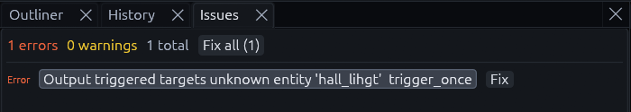
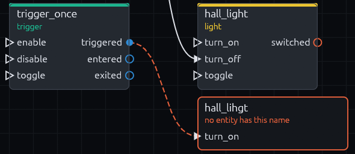

# Debugging wiring

Most wiring mistakes fail quietly: the door just stays shut. Check in this order, from the quickest check to the most
thorough.

## 1. The Issues panel

Open the **Issues** tab, next to Outliner and History on the left. It flags outputs aimed at a targetname no entity
has, and inputs the target's class does not have. A typo in a targetname is the most common reason a door stays shut.



Click an issue to select its entity and frame it in the views, then correct the name in the Inspector.

> **Warning:** **Fix** on a missing target does not guess the right name, it deletes the connection. For a typo, fix
> the name by hand instead.

## 2. The Logic graph

In the [Logic graph](logic-graph.md) a target nobody has shows up as a red node with a dashed red wire, saying no
entity has this name.



**Simulate** fires an output on paper and highlights the whole chain, see [Simulate](logic-graph.md#simulate).

## 3. F3 in game

Add a `TrenchDotDebugOverlay` node to your scene in Godot, or add it as an autoload. Run the game and press F3: it
lists outputs as they fire and draws every `Area3D` volume with its targetname, so you see whether a trigger never
fired or fired at nothing.

Toggle it again after spawning triggers, volumes are collected when it turns on. The key is the overlay's `toggle_key`
property.

## 4. Logging

Place a `logic_debug` entity and tick its `trace_all` box in the Inspector. Every output that fires is then printed to
the Godot output.

From code, connect to `TrenchDotIO.events().fired`, which is emitted for every output, including ones whose target
resolved to nothing.

```gdscript
TrenchDotIO.events().fired.connect(func(source, output, target, input, parameter):
	print(source.name, ".", output, " -> ", target, ".", input))
```

## What each mistake looks like

| Mistake | Symptom | Fix |
| --- | --- | --- |
| Target resolves to nothing | `[TD I/O] <node>.<output>: target '<name>' matches no node` the first time it fires | Make the target match the entity's targetname exactly, case included |
| Target has no such input | `[TD I/O] <node> has no input '<name>'` in the Godot output | Pick an input the target's class has, see the [Entity reference](entities/README.md) |
| Output the entity never emits | `[TD I/O] <node> has no signal '<output>'` once, when the map is built | Pick an output the class has, or fire it from code with `TrenchDotIO.fire_output()` |
| Entity spawned or renamed at runtime | Not found by its targetname | Call `TrenchDotIO.invalidate()`, see [Runtime changes](parameters.md#runtime-changes) |
