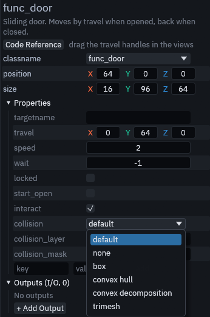

# Collision

Every Gameplay pack brush entity and every model entity collides without you setting anything. Doors, buttons,
lifts, trains and triggers get a convex hull per brush, and `prop_model`, `prop_physics`, `npc_walker` and scatter
props get a shape built from their model. You only touch the keys below when the default does not fit.

## The keys

Select the entity and find these rows in the Inspector. Hover a row to read what each choice does.

| Key | Default | What it does |
| --- | --- | --- |
| `collision` | default | The shape: default, none, box, convex hull, convex decomposition or trimesh |
| `collision_layer` | empty | The physics layers the body is on, as layer numbers such as `1, 3`. `none` puts it on no layer |
| `collision_mask` | empty | The physics layers the body detects, in the same form. `none` detects nothing |

An empty layer or mask keeps the default: the entity definition's layer and mask for brush entities, with triggers
taking *Trigger Collision Mask* from the map settings, and the project settings below for model entities.

## Picking a shape

| Shape | Brush entities | Models |
| --- | --- | --- |
| default | The class shape, a convex hull per brush | The project setting, a convex hull per mesh unless changed. `prop_physics` uses a box from `size` |
| none | No collision | No collision |
| box | One box around all brushes | One box around the model, the cheapest shape |
| convex hull | A hull per brush | A hull per mesh, fine for boxy models |
| convex decomposition | Same as convex hull, a brush is convex already | Several hulls that follow a concave model like an arch, slower to build |
| trimesh | Every face, for static bodies only | Every triangle, exact but the most expensive |

Trimesh only works on static bodies. Doors, buttons, lifts and trains are animatable bodies, which count as static, so
they can use it. Triggers, `prop_physics` and `npc_walker` build convex hulls instead, and a trigger set to trimesh
reports a warning when the map builds.

A `prop_model` whose model already holds a collision body keeps that body and builds no shape of its own.

## Project defaults

Model entities whose keys are empty follow three settings in Godot's *Project Settings*, under *Trenchdot >
Collision*. They appear once the TrenchDot plugin is enabled.

| Setting | Default | What it does |
| --- | --- | --- |
| *Model Shape* | convex | The shape default stands for on `prop_model` and `npc_walker` |
| *Model Layer* | 1 | The layer model bodies are on |
| *Model Mask* | 1 | The layers model bodies detect |

Scatter sets pick their shape in the scatter set's own *Collision* row, see [Scatter](../../editor/scatter.md).

## Your own brush entities

A brush entity you define yourself collides as the body its *Node Class* names. With *Node Class* left empty it takes
the body its script extends, and with no script, or a script extending `Node3D`, it becomes a `StaticBody3D`. Only a
script extending some other node, such as a `Marker3D`, leaves it without collision, and the build warns about it. See
[Custom entities in GDScript](../custom-entities.md).

The editor viewport does not draw collision shapes. Godot's *Debug > Visible Collision Shapes* shows them while the
game runs, in the live session and in a full build alike. Brush entities and `prop_model` save their shapes in the
built scene, `prop_physics` and `npc_walker` build theirs each time the scene loads, the way they load their model.
A `prop_model` or `npc_walker` whose model scene already holds a physics body keeps that body and builds no
shapes of its own.
