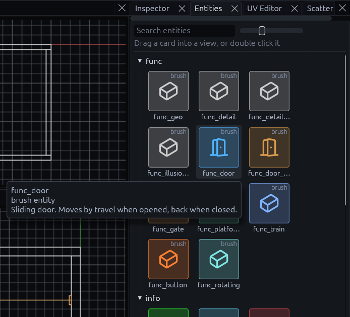
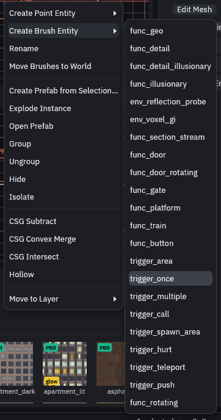
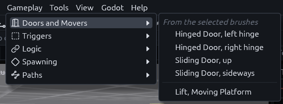
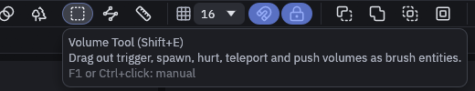
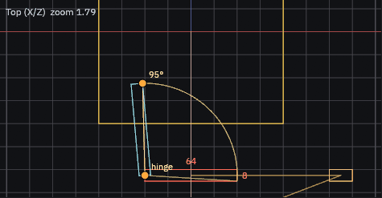
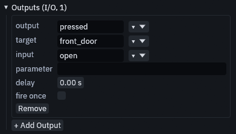
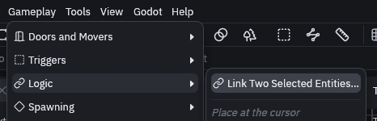
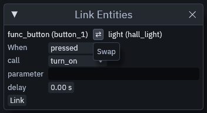
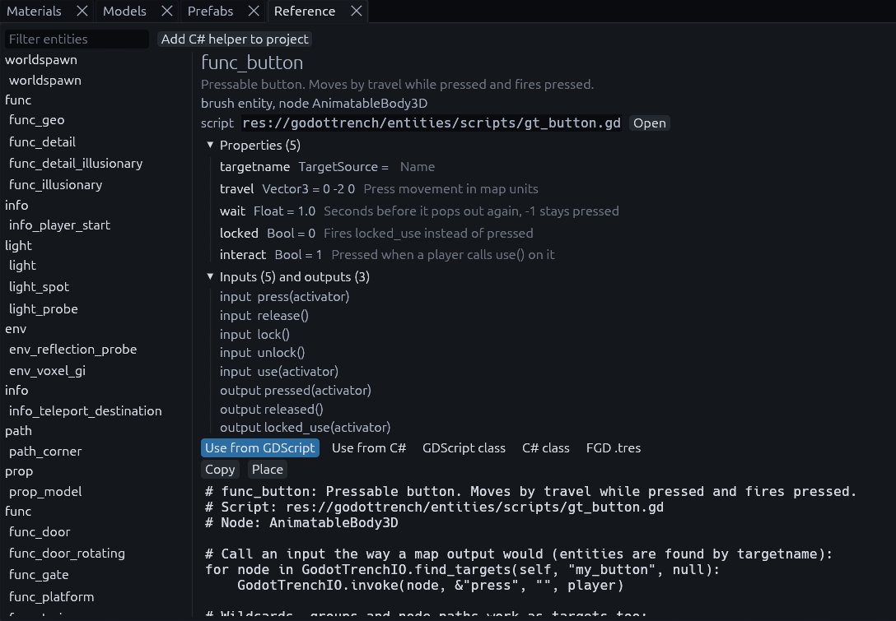

# Placing and wiring

## Placing entities

Open the **Entities** tab, it sits next to the Inspector on the right. Every class your project knows has a card
there, grouped by category. Hover a card to see what it does.

Drag a card into any view to place it, or double click it to drop it at the 3D cursor. (Ctrl or Shift click picks
several cards, drag them in together and they land in a row.)

The entity lands on the first solid surface under the pointer. Trigger volumes, brushes made only of tool textures and
other entities are passed. While you drag, a cyan marker shows where it will land. A 2D view cannot show depth, so there
the marker is labeled with the height (or depth) it lands at. In the Top view the roof of a room is in the way, so hold
Alt while you drop and the entity passes the roof and lands on the floor inside. In the Front and Side views Alt passes
the near wall and puts the entity halfway across the room.

### Brush entities

Doors, buttons and triggers are brush entities, they take their shape from brushes you built.

1. Build the shape, for example a thin box where the door goes, and select it.
2. Right click in a view and pick a class under *Create Brush Entity*. *Brush > Brush Entity* has the same list.

The common ones have quicker routes:

| Tool or menu | What it makes |
| --- | --- |
| *Gameplay > Doors and Movers* | A hinged or sliding door with its trigger, or a lift, from the selected brushes |
| *Gameplay > Triggers* | A trigger volume sized around the selection |
| **Volume** tool (Shift+E) | Drags out any trigger volume in one go, no brush needed first |
| **Path** tool (Shift+P) | Click by click, a chain of `path_corner` entities that trains and walkers follow, Enter finishes |

### Handles

Select a door, gate, platform, button, push trigger, spawner, explosion or physics prop and it shows handles in the
views. Drag them to set its hinge, how far it opens or travels, its radius or its size, instead of typing numbers. A
hinge angle snaps in 15 degree steps, hold Shift for single degrees.

## Wiring

A connection lives on the entity that fires it. Select that entity and look at **Outputs** at the bottom of the
Inspector. **+ Add Output** adds a connection, then you fill in output, target and input. What each field does is in
[How entity I/O works](io.md).

To connect two entities quicker, select both and choose *Gameplay > Logic > Link Two Selected Entities…*. The
Inspector also shows a **Link…** button while exactly two entities are selected.

The *Link Entities* window shows the source on the left and the target on the right. Pick the output under *When*,
the input under *call*, and press **Link**.

> [!WARNING]
> The source is not always the entity you clicked first. Check the two names at the top, and press the
> **Swap** button between them if they are the wrong way round.

The [Logic graph](logic-graph.md) shows all the wiring at once and connects entities by dragging from pin to pin.

## Checking wiring without Godot

Select an entity in the [Logic graph](logic-graph.md#simulate), press **Simulate** and pick an output. The graph
highlights every `source.output → target.input` step that would follow and lists them with their delays, so you can
follow a long chain without building and running the game. Red marks a target that does not exist, usually a typo in a
targetname. Blue marks a runtime target like `!player` or `@enemies`, which only exists in game and is not followed
further.

## Code for any entity

The **Reference** panel shows GDScript and C# for any entity class. It comes in handy when game code has to talk to a
map entity, for example to open a door or listen for a button. Open it with *View > Panels > Reference*, with
*Help > Entity and Code Reference*, or with **Code Reference** in the Inspector, which jumps straight to the selected
entity's class.

Pick a class on the left, then a tab. *Use from GDScript* and *Use from C#* show how to call the entity, *GDScript
class*, *C# class* and *FGD .tres* are skeletons for writing your own. **Copy** puts the code on the clipboard. On the
skeleton tabs **Create in project** writes the file under `res://entities/`, and leaves a file that already exists
alone.
