# Getting started

Steps 1 to 3: First setup. If you already have a Godot project set up with TrenchDot, you may skip these.

Steps 4 and 5: Creating the first room in TrenchDot and seeing it in Godot.

## What you need

* Godot 4.7 or newer, the .NET build if you want to write entities in C#
* The newest [TrenchDot release](https://github.com/Paraxdev/TrenchDot/releases/tag/beta)

## Ensure TrenchDot can see the Godot executable

Make sure TrenchDot can see your Godot install. To check if everything is detected correctly, go to
*File > Preferences… > Godot executable*.

If TrenchDot found Godot by itself, the line beneath the input field already says "Using" and the path. If it says
"Not found" instead, you need to find the executable on your disk.

For this, click the "…" button beside the input field

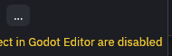

and find the executable starting with "Godot_v".

If you picked the correct executable it should say "Using" and the path you just picked.

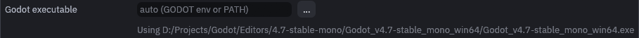

## 1. Create a Project in Godot

Open Godot and click "Create" at the top left corner.

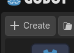

Pick a project name, for this tutorial it will be TrenchDotTest, and (optionally) select a folder where the project
should live.

Then hit "Create".

## 2. Opening the Project within TrenchDot

Choose *Godot > Open Godot Project…*

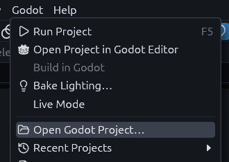

or the **Open Godot Project…** button at the top right of the toolbar

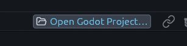

and pick the project folder or any folder inside it. The editor reopens it on the next start.

## 3. The Welcome Screen

Once TrenchDot detects that it's a new Godot project, it shows the *Set up this project* window.

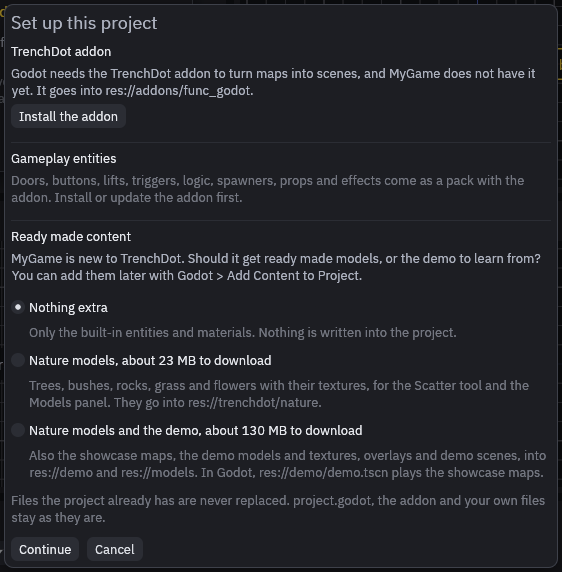

Here you can download the addon, which Godot needs to turn your maps into scenes and to talk to TrenchDot, and extra
content if you want. You can of course start without anything.

Some bare bones entities are always included, like a simple `info_player_start` and `light`.

1. Install the Addon

    Click the "Install the addon" button at the top to download TrenchDot's fork of FuncGodot into your project, this
    is crucial for TrenchDot.
    (Note: this pulls from GitHub releases. If you don't have internet access, download
    `func_godot-trenchdot-addon.zip` first and extract it into the project root to install it by hand.)

    Once you did that, click "Enable the plugin" so Godot loads it.
    (Note: close Godot first if it has the project open, otherwise Godot writes its own copy of `project.godot` back
    and the plugin stays off.)

2. Install the Gameplay entities

    Click **Install Gameplay Entities** below the addon.

    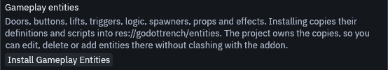

    Doors, buttons, lifts, triggers, props and spawners come with this pack. Without it Godot builds them as plain
    shapes that have no collision and do nothing. The door and trigger helpers in the Gameplay menu install the pack
    by themselves the first time you use them, but installing it now, before Godot first opens the project, means no
    scene is ever built without it.

3. (Optionally) Extra Content

    TrenchDot has optional content you may preload: CC0 textures and models from Poly Haven and ambientCG, plus models
    made for TrenchDot. The licenses and a list of where everything is from are included.

    If you do not want any extra content you can go with "Nothing extra", the minimal entities are still included.

4. Open the project in Godot once

    Once the plugin is enabled, open the project in Godot (the window has an "Open Project in Godot Editor" button for
    that). The addon then creates a file called `trenchdot_game.json` in the project root. This is where TrenchDot
    learns your textures and entities from, and TrenchDot loads it within a second.

    The addon writes it again whenever files change, so there is no need to edit it by hand. Until it exists the status
    bar says there is no `trenchdot_game.json`, and the editor offers the core entities, plus the gameplay entities if
    you installed them.

If you want to add entities, you may use the GitHub source code as reference, or go through the addon source and view
how the included ones are structured. For info on how to add entities that are more complex, see
[Project setup](godot/project-setup.md).

## 4. Build a room

The editor has 4 main views: a 3D view you can fly around just like in Godot, and 3 wireframe views from the top,
front and side.

Brushes and operations depend on the grid size. In the toolbar you can set your grid size (smaller is finer).

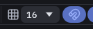

On an empty level you will be shown a small info text explaining how to draw. You can either hide it with "Hide tips"
or just start drawing, it goes away once the map has something in it.

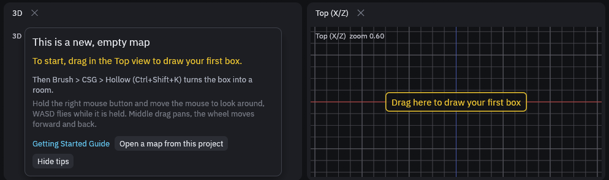

1. Draw your first box

    With the Select tool (Q), drag on empty space in any view.
    You should see a box being drawn. While holding your left click down, move the mouse to shape a rect.

    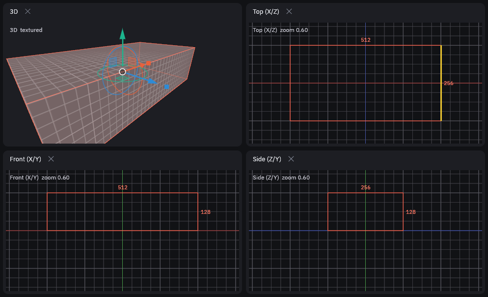

2. Add Height

    In the Side view, hold your mouse over the top edge of the box until it turns yellow, hold down the left click, then
    move your mouse up until the box is 256 units tall.

    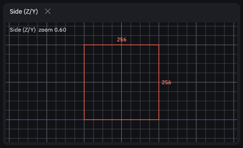

3. Making it Hollow

    Press Ctrl+Shift+K, or use the Hollow button in the toolbar.

    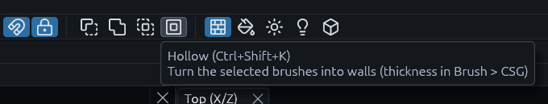

    The box is now split into walls, a floor and a ceiling, this is optimal if you want to make a smaller room or
    corridor. Now, using the fly controls (hold the right mouse button and use WASD), fly into the hollow box.

4. Cutting a doorway

    Using Escape you can deselect the selected brushes. Once nothing is selected, draw a smaller vertical rect within
    the box in the Front view, shaped like a doorway.

    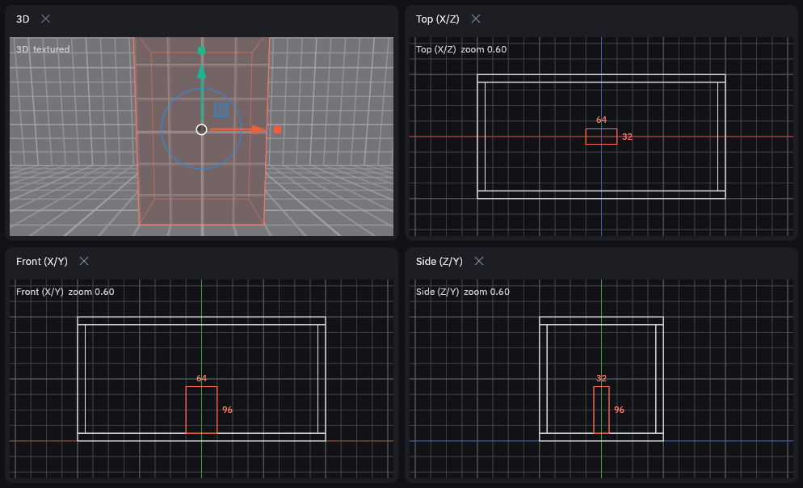

    Then in the Side view extend one side of the door brush so it has a depth, all the way through the wall.

    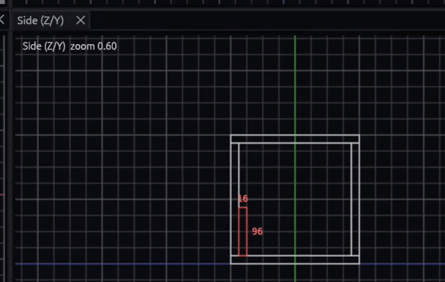

    Now, with the brush selected, hit Ctrl+K or use the Subtract button in the toolbar.

    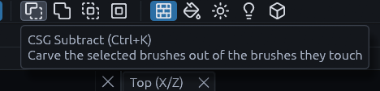

    You should see the brush vanish, and the doorway is cut out of the wall.

    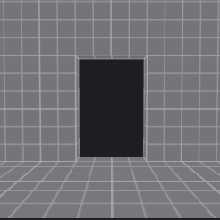

5. Texture it

    You should have 5 included textures for prototyping. To apply a texture to just one face (e.g. the door frame), drag
    the texture from the Materials tab onto the face (hold Shift to cover the whole brush).

    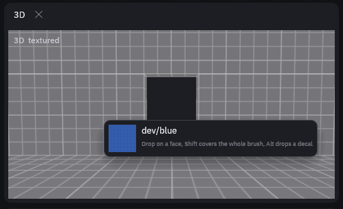

6. Saving the Map

    To see the changes in Godot we have to save the map. Press Ctrl+S, or use *File > Save*.

    The save dialog opens in your Godot project folder. Save it anywhere inside the project, a `maps` folder in the
    project root keeps things tidy, so for example `res://maps/room.tdm`.
    (Note: the folder name is up to you, but keep the map inside the project, so Godot can load it by its `res://`
    path.)

    Once saved, it shows up under *File > Maps in Project*.

    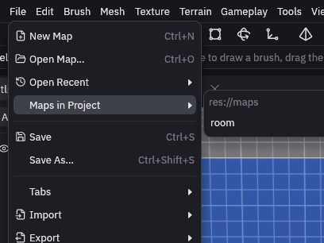

## 5. See it in Godot

In Godot, a level is a scene: a tree of nodes, saved as a `.tscn` file, where each node is one thing such as a mesh, a
light or a camera. Godot writes paths inside the project with `res://`, so `res://maps/room.tdm` is the file
`maps/room.tdm` in your project folder. The map is turned into nodes by one node from the addon, `FuncGodotMap`.

1. In the Godot editor, choose *Scene > New Scene* and click **3D Scene** in the Scene panel on the left.
2. Press Ctrl+A (*Add Child Node*), search for `FuncGodotMap` and add it.
3. With the new node selected, set *Local Map File* to your `.tdm` in Godot's own Inspector, the panel on the right of
   the Godot editor. It works like the Inspector in TrenchDot but belongs to Godot.
4. Press **Build Map** at the top of that Inspector, then save the scene with Ctrl+S.

Brushes become meshes with collision and entities become nodes with their scripts, saved with the scene.
[Building maps](godot/building.md) explains the node's other settings. If an entity comes out as a bare mesh without
collision, TrenchDot's status bar says why, see [Entities that do nothing](godot/entities-troubleshooting.md).

Leave that scene open in Godot and every save in TrenchDot rebuilds it, straight away while its tab is the current
one, or when you switch back to it. Save the scene in Godot to keep the result. If a save does not rebuild, the status
bar says why, see [Rebuild on save](godot/live.md#rebuild-on-save).

> [!WARNING]
> A build deletes the children of the `FuncGodotMap` first. Put your own nodes next to the map node, or in
> an [overlay](godot/overlays.md).

## Try the demo project

The repository's `godot` folder, also in the release as `trenchdot-demo-project.zip`, is a project with the addon
installed. Its main scene plays the showcase maps, which are saved in `godot/demo/maps/showcase`. Open the project in
the editor and pick one under *File > Maps in Project* to see how a finished map is put together.

The demo choice of *Godot > Add Content to Project…* puts the same maps and scenes into your own project. In Godot,
open `res://demo/demo.tscn` and press F6 to play them. Opened in TrenchDot from your project they show without their
textures, because they use the demo's texture folder `res://demo/textures` rather than your project's. The demo project
shows them as they were built.

| Key | Action |
| --- | --- |
| WASD, Space, Shift | Walk, jump, run |
| E | Use doors and buttons |
| 1 to 5 | Switch between the showcase maps |
| F3 | Show the I/O debug overlay, a log of every input and output as it fires, with trigger volumes drawn in |

## Next

To make the room do something, read [How entity I/O works](gameplay/io.md) and build
[Button opens a door](tutorials/button-door.md).

## MCP

The content question does not open by itself in an editor that an MCP client drives: the first tool call other than
`get_state`, `screenshot` and `simulate_input` closes it, and a project opened with `open_project` is not asked about.
`project_content` adds the same content, see [MCP](mcp.md).

