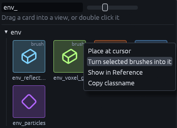

# Baked lighting in Godot

When you [bake a map in the editor](../editor/light-baking.md), the light map is saved inside the `.tdm`. Godot does
not bake anything itself, each build just turns the stored bake into Godot's own lightmap node.

## What the build adds

| Part | What it gets |
| --- | --- |
| A `LightmapGI` named `baked_lighting` | A child of the `FuncGodotMap`, holding the light map, the sun shadow mask and the light probes |
| Baked meshes | Their light map coordinates as UV2 and a static GI mode, streamed chunks included |
| Lights and the sun | Godot's bake mode from their `bake_mode` or `sun_bake_mode`, see [Light keys](../editor/light-baking.md#light-keys) |

With the sun on `bounce`, the sun stays real time and the baked shadow mask shades what lies past its shadow distance.

Faces you changed after the bake fall back to the map's average light, so they look plausible but flat until you bake
again.

## Light probes

Moving objects, like the player, props and doors, take their light from the light probes around them, so they pick up
the baked bounce light and blend in.

The bake places probes on a 2 meter grid over the box around the baked geometry and drops the ones inside solids. Where
the grid is too coarse, like a narrow corridor or a stair, add a `light_probe` entity for one more. A map gets about
1000 probes at most, hand placed ones included, so on a bigger map the grid spreads out.

## Probe entities

| Entity | Kind | Godot node | Use it for |
| --- | --- | --- | --- |
| `light_probe` | Point | `LightmapProbe` | An extra light probe for the bake, see above |
| `env_reflection_probe` | Brush volume | `ReflectionProbe` sized to the brush | Reflections that match a room on glossy floors and metal |
| `env_voxel_gi` | Brush volume | `VoxelGI` sized to the brush | Real time bounce light that follows moving lights and objects |

You find all three in the Entities tab. Drag `light_probe` into a view. For the two volumes, draw a box around the
room, then right click the card and pick **Turn selected brushes into it**.

The brush only gives the box, the build removes it. The keys of all three are listed in
[Props, lights and effects](../gameplay/entities/effects.md#light_probe-env_reflection_probe-and-env_voxel_gi).

An `env_voxel_gi` is baked in the Godot editor every time the map builds. On a big volume, set `bake_on_build` to 0 and
bake it by hand with the **Bake** button of the `VoxelGI` node instead. Maps built while the game runs skip that bake.

## Using another lightmapper

Want to bake with Godot's own `LightmapGI` instead? Untick **Use Baked Lighting** on the `FuncGodotMap` to leave the
stored bake out. The build then adds no `baked_lighting` node and leaves the lights' bake modes alone. Tick *Unwrap
UV2* in *Build Flags* so the meshes get the UV2 a Godot bake needs.
