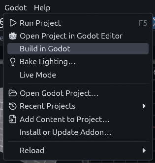

# Building maps

TrenchDot saves a `.tdm` file and never writes Godot scenes itself. In Godot, the addon's `FuncGodotMap` node reads
that file and generates the meshes, collision and entity nodes. The result is saved with your scene like any hand made
node, so nothing rebuilds at runtime unless you ask for it.

## The FuncGodotMap node

1. Add the node

    In the Godot editor, press Ctrl+A in your scene, search for `FuncGodotMap` and add it.

2. Point it at your map

    With the node selected, set *Local Map File* in Godot's Inspector to the `.tdm` you saved.

3. Build it

    Click **Build Map** at the top of the Inspector. You should see the map in Godot's viewport, and the node gets
    children for the meshes and entities. Save the scene with Ctrl+S to keep them. **Clear Map** removes them again.

These are the settings you see in the Inspector:

| Property | What it does |
| --- | --- |
| Local Map File | The `res://` path of the `.tdm` to build. This is the normal choice. |
| Global Map File | A map file outside the project. When both are set, this one wins. |
| Auto Rebuild On Save | Rebuilds the node whenever TrenchDot saves this map, while its scene is the current tab in the Godot editor, see [Rebuild on save](live.md#rebuild-on-save). On by default. |
| Map Settings | Where textures, materials and entity definitions come from and how big a map unit is. Left empty, it uses the project setting `func_godot/default_map_settings`, see [Project setup](project-setup.md). A map node added with an older addon stored the addon's default map settings here, and its build warns about it in Godot's Output, clear the field to follow the project setting. |
| Use Baked Lighting | Lights the map with the lighting [baked in the editor](baked-lighting.md). On by default, untick it to use another lightmapper. |
| Warm Up Shaders | Compiles the map's shaders while it loads, so the first seconds of play do not stutter. See [Shader warm-up](warm-up.md). |

The addon only builds `.tdm` files. To use a Quake `.map` or Hammer `.vmf`, open it with *File > Import* in TrenchDot
and save it as `.tdm` first.

> [!WARNING]
> A build deletes every child of the map node except [overlays](overlays.md). Keep your own nodes next to
> the map node, or in an overlay.

## Three ways to build

| Trigger | What gets built | When to use it |
| --- | --- | --- |
| Save in TrenchDot | Every `FuncGodotMap` using that file in the scene open in the Godot editor | The everyday loop, save and look at the result in Godot |
| *Godot > Build in Godot* | The map as it is in TrenchDot right now, saved or not, without writing the file | To try an unsaved change in Godot without committing to it |
| **Build Map** in Godot | The saved file | When TrenchDot is closed, or to rebuild a scene you just opened |

The first two need a Godot editor with this project open, and they only touch the scene open there. A rebuild marks
that scene as modified, so save it in Godot to keep the result.

Until Godot has the project open, *Build in Godot* stays greyed out. It also needs the map saved into the project once,
so Godot knows which `FuncGodotMap` uses it.



## Building from code

You can also build a map while the game runs, for example to load a level picked from a menu:

```gdscript
var map := FuncGodotMap.new()
map.map_settings = load("res://demo/demo_map_settings.tres")
map.local_map_file = "res://demo/maps/scripted_scene.tdm"
add_child(map)
map.build()
```

The node emits `build_complete` when it is done, or `build_failed` when the map file is missing or not a `.tdm`.

## Environment and sun

The sky, fog and sun keys on worldspawn build a `WorldEnvironment` and a light named `sun` into the map, so a map looks
lit without any setup in Godot. Press Escape so nothing is selected, the Inspector then shows *Map (worldspawn)* with
these keys listed. Its `environment` key picks what gets built. A key you leave unset stays out of the map, so a map
with none of them builds no environment at all. If a project made with an older addon does not list the keys, update
the addon and [export the game config](project-setup.md#the-game-config) again.

| `environment` | Builds |
| --- | --- |
| `1` | The environment and the sun. This is the default. |
| `sun_only` | Only the sun, for a game that brings its own `WorldEnvironment` |
| `0` or `none` | Nothing |

If the scene already has a `WorldEnvironment` or `DirectionalLight3D` of its own, the map keeps it and adds none, so a
game with its own look always wins. When several maps share one scene, the first one built lights it.

## Build report

`build()` returns a Dictionary, also kept in `build_report`. It tells you how long each step took, how many entities of
each class were built and how many vertices the map has. Most useful is the list of what the build could not find,
which is usually a typo or a file that was renamed or never committed:

| Key | What it lists | What you see in the game |
| --- | --- | --- |
| `missing_classes` | Entity classes that no entity definition describes | A brush entity keeps its mesh but has no script and no collision, a point entity is an empty `Marker3D`, see [Entities that do nothing](entities-troubleshooting.md) |
| `missing_models` | Model paths that do not exist, with the entities using each | The prop has no model |
| `missing_materials` | Face textures with neither a material file nor an image | The faces show the placeholder texture |
| `unknown_tool_textures` | Tool textures like `special/clip` that the map settings name differently | The faces still draw nothing, but an origin brush does not set its entity origin |
| `unresolved_targets` | Outputs and target keys whose target matches no targetname in the map or its overlays | The output fires at nothing |

To print it after every build, tick *Print Build Report* under *Build Flags* on the node, or add
`FuncGodotMap.BuildFlags.PRINT_REPORT` to `build_flags` in code. A test or CI check can read the Dictionary instead:

```gdscript
var report := map.build()
if not report["missing_models"].is_empty():
	push_error("missing models: %s" % [report["missing_models"]])
```

Every build also prints a warning in Godot's Output for what it could not find: one for all missing classes, and one for
each missing model, material or tool texture, however many props share the path. After a save, TrenchDot lists the
same warnings in its Issues panel.

> [!NOTE]
> Overlays you add after `build()` are not there when the report looks for targets, so their targetnames show
> up under `unresolved_targets`.

## Damaged maps

A damaged map still builds from the parts that could be read, with a `[TDM]` warning for each part that could not. See
[the .tdm map format](../format/recovery.md).
