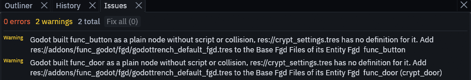

# Entities that do nothing

When Godot builds an entity without its definition, the entity is only a shell. A brush entity like a door keeps its
mesh, but it becomes a plain `Node3D` with no script and no collision, and a point entity becomes an empty `Marker3D`.
The same happens when a definition does not fit its entity, for example a brush entity whose definition builds no
physics body. TrenchDot and Godot both tell you when this happens, and this page explains each message.

## Where you see it

1. The status bar

    Save the map in TrenchDot while its scene is open in Godot. When Godot built classes it has no definition for,
    the status bar at the bottom left names them and the map settings Godot built with:

    

2. The Issues panel

    Open the **Issues** tab, next to Outliner and History on the left. It lists each class Godot built as a plain
    node, with the fix, and the other warnings of that build start with "Godot:". Click a row to select the entity.

    

    Before Godot has built the map, the Issues panel compares your entities with the FGD Godot builds with, which the
    addon exports with the [game config](project-setup.md#the-game-config). An entity that FGD lacks gets the warning
    "Godot builds with ..., whose FGD ... has no ...".

3. Godot's Output panel

    Press **Build Map** on the `FuncGodotMap` node in Godot. The Output panel at the bottom of the Godot editor shows a
    `[TrenchDot]` warning for the classes without a definition and one for each definition that does not fit. Tick
    *Print Build Report* under *Build Flags* on the node for the whole [build report](building.md#build-report).

## Entities without a definition

| The message says | Why | Do this |
| --- | --- | --- |
| Install the Gameplay entities pack | Doors, buttons, triggers, props and spawners come with the pack, and the project does not have it | Choose *Gameplay > Install Gameplay Entities* in TrenchDot, see [Project setup](project-setup.md#installing-and-updating-the-pack) |
| The pack is installed, but the FGD does not include `trenchdot_default_fgd.tres` | Your FGD has no *Base Fgd Files* | Add `res://addons/func_godot/fgd/trenchdot_default_fgd.tres` to *Base Fgd Files* of the FGD that the map settings name in *Entity Fgd* |
| The pack is installed, but the *Entity Fgd* is an FGD of the addon | The map settings use FuncGodot's own FGD or another file of the addon, which an addon update replaces | Set *Entity Fgd* of those map settings to the FGD your game config uses |
| A class of your own has no definition | It is in the FGD of your game config, but not in the *Entity Fgd* of the map settings Godot builds with | Set *Entity Fgd* of those map settings to the FGD your game config uses, see [Your own resources](project-setup.md#your-own-resources) |
| The map node uses the addon's default map settings, not the ones from Project Settings | The node was added with an older addon, which stored the default map settings in the scene | Select the map node in Godot and clear *Map Settings* in the Inspector |
| The scene was built with other entity definitions | It was built before the pack or a definition was there, and not since | Press **Build Map** and save the scene. In [live mode](live.md#when-live-mode-rebuilds-the-whole-map) Godot does this by itself |

## Definitions that do not fit

These come from Godot's Output panel, and after a save from the Issues panel as "Godot:" warnings. The Issues panel also
flags the last two before you save.

| The message says | Why | Do this |
| --- | --- | --- |
| `func_crusher builds as a Node3D, so its brushes have no collision` | The definition has no *Node Class*, and its script extends no physics body | Set *Node Class* to `StaticBody3D`, `AnimatableBody3D` or `Area3D`, or have the script extend one of them |
| `func_crusher: Node Class AnimatedBody3D not found, building it as a Node3D` | A typo, or a `class_name` Godot has not registered yet | Fix the name. For C#, see [C# entities](../gameplay/csharp.md) |
| `alarm: res://entities/alarm.gd has no @tool` | The editor only runs tool scripts, so the keys from the map never reach the node | Add `@tool` at the top of the script |
| `light is a point entity, so its brushes are dropped` | A `FuncGodotFGDPointClass` is used for a brush entity | Make the definition a `FuncGodotFGDSolidClass` |
| `func_door is a brush entity without brushes` | A brush entity with nothing to build from | Give it brushes, or make the definition a point class |

## Entities that build but do not react

| What you see | Why | Do this |
| --- | --- | --- |
| Triggers never fire, and Godot's Output says the trigger ignored your player because no node is in its `filter_group` | By default triggers only react to bodies in the group `player` on physics layer 1 | Add your player to the `player` group. On another layer, add that layer to *Trigger Collision Mask* in the map settings |
| Doors and buttons never move | They move when your game code calls `use()` on them | See [Let the player press it](../tutorials/button-door.md#let-the-player-press-it) |
| `info_spawner` and `npc_walker` look empty in Godot's editor | They spawn or load their model only in the running game | See [Spawners and paths](../gameplay/entities/actors.md) |
| Godot's Output shows `Parse Error` for a script in `res://trenchdot/entities` | Godot compiled a pack script before it knew the classes it uses | Restart Godot, then press **Build Map** and save |
