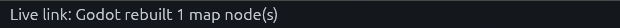
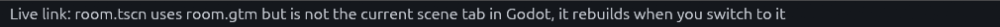
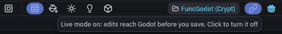
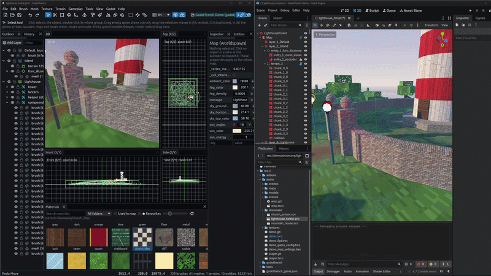
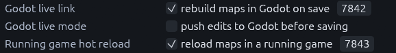

# Saving, live mode and hot reload

## Rebuild on save

Keep the scene with your `FuncGodotMap` open in the Godot editor and just save in TrenchDot with Ctrl+S. Godot
rebuilds that scene straight away, as long as its tab is the one Godot shows and the map node has *Auto Rebuild On Save*
on. A scene in another tab that uses the map rebuilds when you switch to its tab. Closing and reopening a tab or
reloading a scene does not break this.

The status bar at the bottom left tells you what Godot did. When it worked, it should say:



Save the scene in Godot to keep the result. If the status bar says something else, the message tells you why:



| The status bar says | Do this |
| --- | --- |
| The scene is not the current scene tab in Godot | Switch to that tab, it rebuilds then |
| The current scene tab has no `FuncGodotMap` for the map | Open the scene that builds the map, or turn on *Auto Rebuild On Save* on its map node |
| Godot has no scene open | Open the scene with the map in Godot, and if it is open, read on |
| Godot is not running with the TrenchDot addon | Open the project in the Godot editor with the addon enabled |

Only one Godot editor can hold the live link port. A second editor with the same project warns in its Output panel that
the live link could not listen, and TrenchDot keeps talking to the first one, which may have no scene open. Close the
editor you do not use and the other one takes the link over within a few seconds. (Note: *Godot > Open Project in
Godot Editor* brings an editor that already has the project to the front instead of starting a second one.)

## Live mode

Live mode pushes your edits into the scene open in the Godot editor before you save, so you can judge lighting and scale
in the real renderer.

1. Open the scene in Godot

    The map has to be saved inside the project once, and the scene open in Godot needs a `FuncGodotMap` that uses it.

2. Turn it on

    Click the link button at the right end of the toolbar, next to the Godot robot, or use *Godot > Live Mode*. The
    button lights up, and its tooltip says what it is still waiting for, if anything.

    

3. Edit as usual

    Every change shows up in Godot right away.

    

Live mode needs the Godot live link, which is on by default. Both sit in *File > Preferences*, where *Godot live mode*
is the same switch as the toolbar button.



Drags move nodes while you drag, and most edits rebuild only what they touched, so the preview keeps up. Toggling *Omit
From Export* on a layer and editing prefab instances rebuild the whole map instead, once you pause.

The preview is close to a full build but not always identical. Saving always does a full build, and quitting without
saving sends Godot back to the saved file, so nothing you tried in live mode sticks unless you save it.

## Hot reload in a running game

To see your saves in a game that is already running:

1. Add the autoload

    In Godot, go to *Project > Project Settings > Globals > Autoload* and add this script:

    ```
    res://addons/func_godot/src/trenchdot/runtime/trenchdot_hot_reload.gd
    ```

2. Run the game from the Godot editor

    The autoload only listens in games started from the Godot editor, unless you set its `enabled_in_exported_builds`
    to true.

3. Save in TrenchDot

    The game rebuilds the maps that use the saved file and emits `map_reloaded(map)`. Use that signal to put the player
    back at a spawn point or reset game state. The status bar should end with "running game reloaded 1 map(s)".

It listens on port 7843, which must match *Running game hot reload* in the editor's preferences. TrenchDot only sends
it saves while the live link is on.
