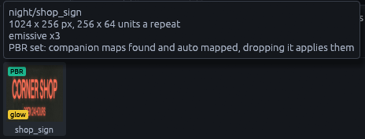
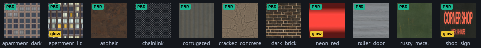
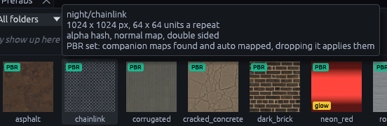

# Materials

Every face points at a material by its path inside the map settings' *Base Texture Dir*, without the extension, for
example `showcase/planks`.

When Godot builds the map it looks for `showcase/planks.tres` in that folder, or in *Base Material Dir* instead if you
set one, and uses it as it is. No `.tres`? Then the addon makes a plain material from the image. TrenchDot previews
the same `.tres`, so both sides look alike.

You only need a `.tres` when a plain image is not enough, for example to change the scale, add glow or make it see
through. A `.tres` with just an `albedo_color` and no texture works too, the editor draws it in that color.

New textures and materials show up in the Materials tab within a couple of seconds, no reload needed.

## Texture size

By default one texture pixel covers one map unit, so a 64 pixel texture repeats every two meters. Great for pixel art,
but a 1024 pixel photo of a two meter wall would stretch over 32 meters.

To fix that, tell the material how many map units one repeat covers:

```
[resource]
albedo_texture = ExtResource("1_albedo")
metadata/texture_size = Vector2(64, 64)
```

(You can also add it in Godot's inspector under *Metadata*, as a `Vector2` or a single number.)

Hover the material in the Materials tab to check it, the tooltip shows the image size and how many units one repeat
covers.



Now you can swap in a sharper image without changing the map. Terrain layers ignore it, their `tile` setting already
sets the repeat.

## Glowing materials

A material glows when its file sets `emission_enabled`. With a black emission color, the emission texture glows exactly
as painted:

```
[resource]
albedo_texture = ExtResource("1_albedo")
emission_enabled = true
emission = Color(0, 0, 0, 1)
emission_energy_multiplier = 2.5
emission_texture = ExtResource("2_emission")
```

No material file? Put an image named like the albedo with `_emission` added next to it, `night/sign_emission.png` next
to `night/sign.png`, and it becomes the glow map.

Glowing materials get a yellow *glow* tag in the Materials tab:



Press F3 for Lit Preview to see them glow in the 3D view. The bloom around them only shows in Godot, see
[Night lighting](night-lighting.md).

## Transparency

Set `transparency` in the material file when the texture's alpha channel should let things show through. Each mode
trades quality for cost differently:

| `transparency` | How it works | Use it for | Watch out |
| --- | --- | --- | --- |
| `1` blend | Mixes the surface with what is behind it | Glass, soft stains, smoke | Casts no shadows |
| `2` scissor | Pixels are either fully shown or cut away | Hard cutouts up close, like grates and leaves | Thin parts vanish at a distance |
| `3` hash | Dithers pixels, the lower the alpha the fewer are shown | Thin cutouts seen from afar, like wire fences | Soft edges turn into static |

The tooltip in the Materials tab tells you which mode a material uses:


