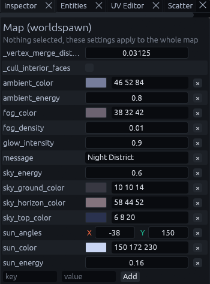
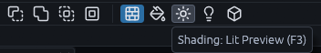
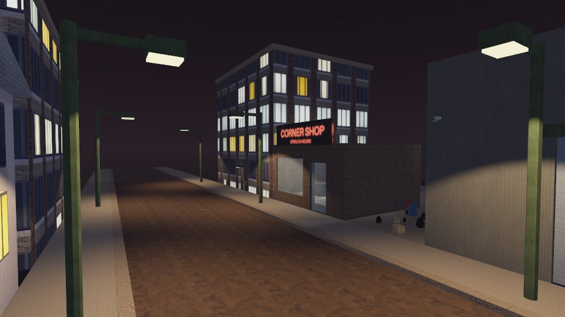
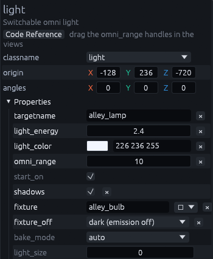

# Night lighting

For a night map you turn the global light down, so the lamps you place do the work.

## Darken the map

Press Escape, or click empty space in a view, so nothing is selected. The Inspector on the right then shows
*Map (worldspawn)*, the settings for the whole map.

Set the keys below. If a key is not listed yet, type it in the *key* field at the bottom, its value next to it, and
click **Add**.

| Key | Default | What to do for night |
| --- | --- | --- |
| `sun_energy`, `sun_color` | 1.1, `255 245 224` | Lower the energy and pick a pale blue, and the sun reads as a moon |
| `ambient_energy`, `sky_energy` | 1.0, 1.0 | Lower both, so unlit areas and the sky go dark |
| `glow_intensity` | 0 | Above 0, lamps and [glowing materials](materials.md#glowing-materials) bloom in Godot |
| `ssr` | 0 | 1 turns on screen space reflections, so wet streets and glossy floors mirror the lamps |

This is what the night district showcase uses:

## Check it in Lit Preview

Press F3, or click Lit Preview in the toolbar, to see the map with its lights, sky and fog.

You should see the lamps, lit windows and glowing signs stand out against a dark sky:

Lit Preview shows all of the keys above except glow and reflections, so check those in Godot. To get the bounce light
of the lamps without paying for it every frame, [bake the lighting](../editor/light-baking.md).

## Lamp fixtures

A lamp is a `light` or `light_spot` entity plus the lamp's geometry with its glowing bulb. Give that geometry a
targetname and put it in the light's `fixture` key (a trailing `*` matches a prefix).

The geometry then follows the light with no wiring: shown while the light is on, hidden while it is off. Set
`fixture_off` to `dark` to keep it visible with its glow switched off instead.

See [Props, lights and effects](../gameplay/entities/effects.md) for the other light keys.



## MCP

The showcase maps are built by [MCP scripts](../mcp-scripts.md) that drive the editor through its
[MCP server](../mcp.md). `examples/mcp/night_district.json` and `examples/mcp/withered_city.json` are complete night
maps built this way.


