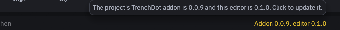
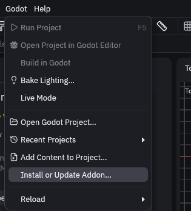
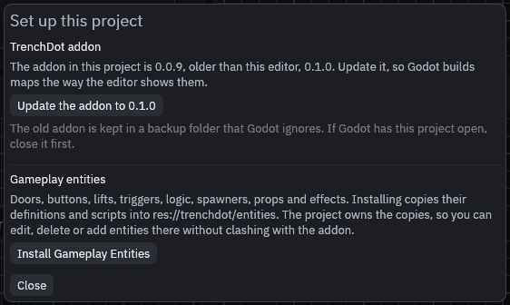
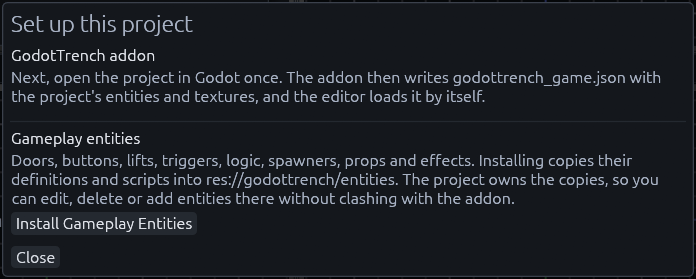
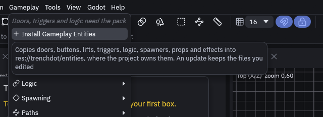
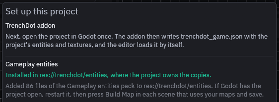

# Project setup

The addon's defaults are fine for your first maps. Once you write your own entities or want another texture folder,
give the project its own resources, because an addon update replaces the defaults.

## Installing and updating the addon

Every time you open a project, TrenchDot checks its addon. When `addons/func_godot` is missing or has a different
version than the editor, the *Set up this project* window pops up once, and a yellow note stays at the bottom right of
the status bar. Hover it to see both versions, click it to bring the window back.



You can also open the window any time with *Godot > Install or Update Addon…*.



It only offers the step your project needs next:

| The project has | The window offers |
| --- | --- |
| No addon | **Install the addon**, then **Enable the plugin** |
| An older addon | **Update the addon to** the editor's version |
| A newer addon, or one without a version | **Replace the addon with** the editor's version |
| The addon, not enabled | **Enable the plugin**, which adds it to `[editor_plugins]` in `project.godot` and changes nothing else |
| The addon as a git checkout or submodule | Nothing. Update it with git, the editor never replaces it |



> [!WARNING]
> Close Godot before you update. It keeps running the old addon until it restarts, so the button stays
> greyed out while the live link sees Godot with the project open. Enable the plugin with Godot closed too, or Godot
> writes its own copy of `project.godot` back. Ticking it in Godot under *Project > Project Settings > Plugins* works
> as well.

The old addon is not deleted, it moves to `.trenchdot/addon-backups/func_godot-<version>` in your project. Godot skips
folders that start with a dot, so it neither imports the backup nor lists it as a second plugin. Delete it once the new
addon works. (Note: the download is unpacked first and only then swapped in, so a failed or canceled update leaves the
old addon as it was.)

If the download fails, the window links to the [releases](https://github.com/Paraxdev/TrenchDot/releases) and
[itch.io](https://paraxdev.itch.io/trenchdot), which carry the same `func_godot-trenchdot-addon.zip`. Extract it
into the project folder so you get `addons/func_godot`, and replace the old folder instead of unpacking over it.

## Core entities and the Gameplay entities pack

Every project gets a small core from the addon: worldspawn, `func_detail`, `func_illusionary`, `func_geo`, `light`,
`light_spot`, `light_probe`, `env_reflection_probe`, `env_voxel_gi` and `info_player_start`.

Doors, buttons, lifts, trains, triggers, logic, spawners, teleports, path corners, props, effects and the rest of the
[entity reference](../gameplay/entities/README.md) come as the Gameplay entities pack. You install it when you want it,
and it gets copied into `res://trenchdot/entities`:

| Path | Holds |
| --- | --- |
| `gameplay_fgd.tres` | The pack's FGD file, listing every definition |
| `definitions/` | One definition per entity: its keys, inputs, outputs and editor gizmos |
| `scripts/` | The GDScript each entity runs |
| `pack.json` | What was installed, so updates can tell your edits apart. Leave it as it is |

The copies belong to your project. Change a script or a definition, delete the entities you do not use, or add your own
definitions to `gameplay_fgd.tres`. The addon never defines these classnames or script classes itself, so nothing you do
there clashes with it, and an addon update does not undo it.

### Installing and updating the pack

1. Install the pack

    Click **Install Gameplay Entities** in the *Set up this project* window, below the addon.

    

    While the project only has the core, the same button sits at the top of the Gameplay menu and in the Entities panel.

    

2. Check that it worked

    The window should now say "Installed in res://trenchdot/entities" in green. The editor offers the new entities
    right away, and Godot picks up the files and exports the game config again on its own.

    

3. (Optionally) Update it later

    When an addon update brings a newer pack, the window offers **Update Gameplay Entities**, and the Gameplay menu shows
    it with the number of changed files. Nothing is updated until you click it. The update adds new files and replaces
    the ones you did not touch. Files you edited stay as they are and the editor names them, and files you deleted stay
    deleted.

Older maps made before the entities left the addon keep working. When a project's maps use pack entities that nothing in
the project defines, the pack installs itself, both when the editor opens the project and when Godot starts with the
updated addon. A `.tdm` file keeps every entity either way, with or without a definition.

> [!NOTE]
> The template inside the addon, `addons/func_godot/gameplay_pack`, has a `.gdignore` file so that Godot skips
> it. Keep that file, or Godot finds every script class of the pack twice once it is installed.

### Which definition wins

The core FGD, `res://addons/func_godot/fgd/trenchdot/trenchdot_fgd.tres`, reads the installed pack by itself, so
every FGD built on the addon's defaults gets the pack without listing it. When two definitions share a classname, the
later one wins, in this order:

1. FuncGodot's classes and the addon's core
2. The installed pack in `res://trenchdot/entities`
3. The entities of your own FGD file

To change an entity, edit its copy in the pack, or define the same classname in your own FGD. Both work, but a
classname defined twice is easy to forget, so the editor tells you: when the project opens, the status bar names the
definition that wins, and the Issues panel warns about each doubly defined class a map uses. Delete one of the two to
settle it.

## Your own resources

Three resources work together. The FGD file lists the entities your maps can use. The map settings tell a build where
textures are and which FGD to read. The game config tells TrenchDot about both, so the editor offers the same
entities and textures while you edit.

The quickest route is to copy `demo_fgd.tres`, `demo_map_settings.tres` and `demo_game_config.tres` from
[`godot/demo`](https://github.com/Paraxdev/TrenchDot/tree/main/godot/demo) into your project and fix the paths. To
make them yourself, do this in the Godot editor:

1. Create a `FuncGodotFGDFile`. Set *Base Fgd Files* to `res://addons/func_godot/fgd/trenchdot_default_fgd.tres`, so
   you keep the core and the installed pack, then add your own entities under *Entity Definitions*. Without that base
   your FGD has none of them, and even worldspawn builds without collision.
2. Create a `FuncGodotMapSettings`. Set *Entity Fgd* to the FGD from step 1 and *Base Texture Dir* to your texture
   folder (default `res://textures`). A new map settings resource starts on `trenchdot_default_fgd.tres`, which has
   the core and the pack but not your own entities.
3. Create a `TrenchDotGameConfig`. Set its *Fgd File* and *Map Settings* to the two resources above. (Optionally) set
   *Game Name*, the editor shows it at the top right of the toolbar next to the project folder.
4. In *Project > Project Settings*, point `func_godot/default_map_settings` at your map settings and
   `trenchdot/game_config` at your game config. Every map node whose *Map Settings* field is empty follows it. A
   node added with an older addon stored the addon's defaults in that field, so clear it there.

The editor offers the entities of the game config's FGD, but Godot builds with the FGD of the map settings, so keep the
two the same. When they differ, Godot warns in its Output panel each time it exports the game config, and the
TrenchDot Issues panel names every entity that the FGD Godot builds with lacks.

> [!TIP]
> Set *Entity Name Property* in the map settings to `targetname`, like the demo does. Built nodes are then
> named after their targetnames, which keeps the scene tree readable.

## The game config

TrenchDot learns your entities, texture folders and unit scale from `res://trenchdot_game.json`, which the game
config writes. The addon exports it again whenever Godot notices files changing, and the editor reloads it within a
second. The export also names the default map settings and the classes their FGD defines, which is how the editor warns
about entities Godot would build without a definition. To export by hand, use *Project > Tools > TrenchDot: Export
Game Config* in Godot, or run it headless, for example in CI:

```sh
godot --headless --path <project> --script res://addons/func_godot/src/trenchdot/export_game_config_cli.gd
```

## Project settings

Most projects only change the first and third one. The live link ones matter when another program already uses the
port.

| Setting | Default | Purpose |
| --- | --- | --- |
| `func_godot/default_map_settings` | the addon's defaults | Map settings for every map that does not set its own |
| `func_godot/default_inverse_scale_factor` | 32 | Map units per meter |
| `trenchdot/game_config` | the addon's config | The config that writes `trenchdot_game.json` |
| `trenchdot/auto_export_game_config` | true | Export the game config again when files change |
| `trenchdot/live_link_enabled` | true | Run the live link server that TrenchDot talks to |
| `trenchdot/live_link_port` | 7842 | Must match *Godot live link* in the editor's preferences. Changes apply right away. Between 1024 and 65535, anything else falls back to 7842 with a warning |
| `trenchdot/threaded_build` | true | Convert brushes and terrain chunks on the WorkerThreadPool, so big maps build faster |
| `trenchdot/live_chunk_size` | 16.0 | In live mode, worldspawn geometry is split into chunks of this size in meters, so an edit only rebuilds its chunk |
| `trenchdot/csharp_entity_dirs` | `res://` | Where C# entities are found at build time |
