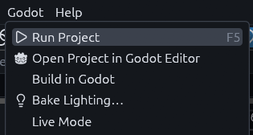
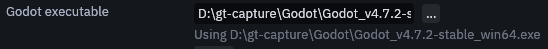
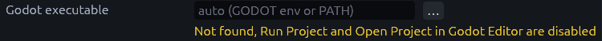
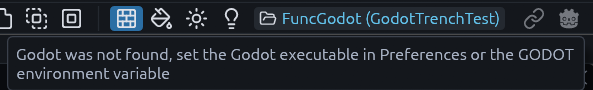
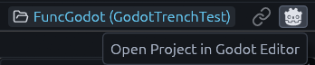
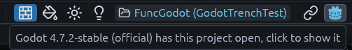

# Running Godot from the editor

Saving, builds and live mode talk to the addon over the live link, so they work with any Godot editor that has the
project open. TrenchDot only needs to find the Godot executable for *Godot > Run Project* (F5), *Godot > Open Project
in Godot Editor* and the Godot robot in the toolbar, since those start Godot themselves.

## Finding the executable

Go to *File > Preferences* and look at *Godot executable*. When TrenchDot found one, it says "Using" and the path
beneath the input field.

When it says "Not found" in yellow, click the "…" button next to the field and pick the Godot executable on your disk,
the one starting with "Godot_v". Do the same if it picked the wrong Godot. Until it finds one, Run Project and Open
Project in Godot Editor stay greyed out.

Without a working path in Preferences, the editor takes the first match of:

1. The `GODOT` environment variable.
2. `godot` or `godot4` on `PATH`, then downloaded builds like `Godot_v4.7.2-stable_win64.exe`, newest first. Mono
   builds win when the project folder has a `.csproj`, since a C# project needs them. Console builds are skipped.
3. Common install folders: WinGet, Scoop, Steam and `Programs/Godot` on Windows, `~/.local/bin` and Steam on Linux,
   `/Applications/Godot.app` on macOS.

## The Godot button

The Godot robot at the right end of the toolbar shows the connection. Hover it to see what it would do.

Grey means no project is open or Godot was not found, so clicking does nothing.

Plain means Godot was found. Click it to open the project in the Godot editor.

Cyan means a Godot editor has this project open. Click it to bring that editor to the front.

A spinner shows next to it while Godot is building. If the tooltip says the running Godot has an older addon, update it
with *Godot > Install or Update Addon…* to get live mode.
