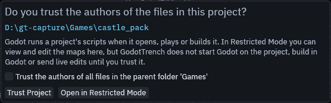
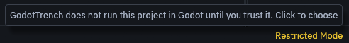
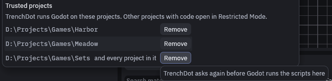

# Running Godot from the editor

Saving, builds and live mode talk to the addon over the live link, so they work with any Godot editor that has the
project open. TrenchDot only needs to find the Godot executable for *Godot > Open Project in Godot Editor*, the Godot
robot in the toolbar, and *Godot > Run Project* (F5) while no Godot editor has the project open, since those start
Godot themselves.

## Run Project

While a Godot editor has the project open, *Run Project* asks that editor to save its open scenes and play the main
scene, as pressing Play in Godot does. The game then has everything Godot built, live edits included. The status bar
should say "Godot saved its open scenes and runs the main scene". If the project has no main scene, it says so, set
one in Godot under *Project > Project Settings > Application > Run*.

Without a Godot editor, *Run Project* starts the game with the Godot executable. It then runs the scenes as they were
last saved in Godot. The same happens with an older addon, and the status bar adds that Godot may have map changes it
has not saved. Save them in Godot, or press Play there.

## Finding the executable

Go to *File > Preferences* and look at *Godot executable*. When TrenchDot found one, it says "Using" and the path
beneath the input field.

When it says "Not found" in yellow, click the "…" button next to the field and pick the Godot executable on your disk,
the one starting with "Godot_v". Do the same if it picked the wrong Godot. Until it finds one, Open Project in Godot
Editor stays greyed out, and so does Run Project while no Godot editor has the project open.

Without a working path in Preferences, the editor takes the first match of:

1. The `GODOT` environment variable.
2. `godot` or `godot4` on `PATH`, then downloaded builds like `Godot_v4.7.2-stable_win64.exe`, newest first. Mono
   builds win when the project folder has a `.csproj`, since a C# project needs them. Console builds are skipped.
3. Common install folders: WinGet, Scoop, Steam and `Programs/Godot` on Windows, `~/.local/bin` and Steam on Linux,
   `/Applications/Godot.app` on macOS.

## The Godot button

The Godot robot at the right end of the toolbar shows the connection. Hover it to see what it would do.

Grey means no project is open or Godot was not found, so clicking does nothing.

Plain means Godot was found. Click it to open the project in the Godot editor.

Cyan means a Godot editor has this project open. Click it to bring that editor to the front.

A spinner shows next to it while Godot is building. If the tooltip says the running Godot has an older addon, update it
with *Godot > Install or Update Addon…* to get live mode.

## Project trust

Godot runs a project's scripts as soon as it opens, plays or builds it, and a project or map pack you downloaded can
bring scripts of its own. So when you open a project TrenchDot doesn't know yet and it holds code, TrenchDot asks
first.

TrenchDot first looks through the project for code. While it does, the status bar shows *Looking for code* and
nothing is started in Godot on the project, so a big project takes a moment before it asks or opens.

Click **Trust Project** for your own projects and ones from people you trust. Tick *Trust the authors of all files in
the parent folder* first to trust every project in that folder, such as the one you keep all your games in. Without it
you trust that one project only, and a project unpacked inside it, such as a map pack with its own `project.godot`,
isn't trusted along with it.

Click **Open in Restricted Mode** when you're not sure. You can still view and edit the maps, but TrenchDot doesn't
start Godot on the project, build in Godot or send live edits. *Restricted Mode* then shows in yellow at the right of
the status bar, click it to answer the question again.

In Restricted Mode, *Run Project*, the Godot robot, *Build in Godot* and turning on live mode ask "Running it runs its
scripts. Trust it and continue?", and go ahead once you click **Trust Project**.

Opening a map that belongs to another project you haven't trusted keeps the open project, and the prompt adds **Keep
Current Project** to its buttons. A `project.godot` inside the open project's folder is ignored, the way Godot ignores
it. When a map from outside the open project runs GDScript of its own, the status line says so and the Issues panel
shows where.

Projects in *Recent Projects* from before TrenchDot asked about trust count as trusted, and so does a project you
start the editor with through `--project`, for that session.

> [!NOTE]
> Restricted Mode covers only what TrenchDot starts. Opening the project in Godot yourself runs its scripts as usual.

### Projects without code

A project that holds no code opens without the question, since Godot has nothing in it to run. That is an empty folder,
a project you just made, or one with only TrenchDot's addon and the Gameplay entities pack it installed. Code here
means scripts, C# projects, native libraries, scenes and resources with scripts in them, autoloads, editor plugins and
maps whose `logic_script` holds GDScript. The addon and the pack only count as TrenchDot's own while every file in
them is the one this version installs, so an edited or older copy counts as code, and so does a project too big to look
through quickly.

TrenchDot looks again each time it opens the project and remembers nothing, so it asks once the project has gained
scripts. To keep your own project trusted, save a map into it with *File > Save* while it holds no code. From then on
TrenchDot trusts it, also after you add scripts in Godot. Saving a map into a project in Restricted Mode trusts
nothing.

### Trusted projects

Open *File > Preferences…* and look at *Trusted projects* at the bottom to see every project and folder you trust.
Click **Remove** next to one to take the trust back. When that is the open project, it goes into Restricted Mode right
away and the yellow chip shows in the status bar, unless the project holds no code.

## MCP

An agent never gets the prompt in its way. `open_project` and `get_state` report `restricted`, and the tools that would
have Godot run or build the project fail with an error until you trust it with the chip. `map_file` `open` keeps the
open project for a map of an untrusted one and returns that project as `other_project`.

`trust` in both results says why a project is not in Restricted Mode: `stored`, `session` for `--project`, or `no_code`.
Saves an agent makes, with `map_file`, `run_action` or inside `run_script`, never store trust, so a project an agent
works in without code is asked about again once it has scripts.

