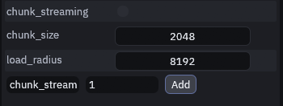
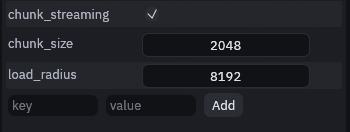

# Streaming big maps

Big outdoor maps can hide what is far away, so the map costs what the player can see instead of everything it holds.
The build sorts the map's meshes into chunks on a grid, and only the chunks near the camera get drawn.

## Turning it on

1. Select nothing

    Press Escape so nothing is selected. The Inspector on the right then shows *Map (worldspawn)*.

2. Add `chunk_streaming`

    Type `chunk_streaming` in the *key* field at the bottom, `1` in *value*, and click **Add**. (If it is already
    listed, just turn it on there.)

    

    You should see it listed with the other worldspawn keys:

    

3. Save the map

    The next build adds a `TrenchDotStreamer` to the map.

(Optionally) add `chunk_size` and `load_radius` the same way:

| Key | Default | Meaning |
| --- | --- | --- |
| `chunk_size` | 2048 | Chunk size in map units, 64 m. Smaller chunks hide more precisely but cost more to check |
| `load_radius` | 8192 | How far from the camera chunks stay visible, in map units, 256 m |

Streaming only hides meshes. Collision and scripts keep running everywhere, so it saves rendering cost, not physics or
logic. Overlays, content spawned at runtime and anything on a moving door or train are never hidden.

The streamer follows the viewport's current camera, or an `info_player_start` while there is no camera. To pin it to
one camera, set its `camera_path` from code after the build, since a rebuild replaces the streamer. It only runs in the
game, so the Godot editor always shows the whole map.

As chunks come and go the streamer emits `area_loaded(key, bounds)` and `area_unloaded(key, bounds)`, so you can
stream your own content alongside:

```gdscript
streamer.area_loaded.connect(func(key, bounds): spawn_wildlife(bounds))
```

## Streaming sections

Want to play several maps as one world without loading screens? Split it into sections and join them with connector
rooms. Only one section is in the scene tree at a time. The next one loads in the background while the player
explores, and swaps in while the player walks through a connector, lined up so the room around them stays exactly the
same. This needs the [Gameplay entities pack](../gameplay/entities/README.md#installing-and-customizing).

1. Build a connector room

    A corridor with a bend on each side, so neither end can be seen from its middle. Put an `info_landmark` in the
    middle, and two `func_section_stream` volumes, one covering each half, meeting in the middle. Add it to the
    [prefab library](../editor/prefab-library.md) so every copy is the same.

2. Paste it where two maps meet

    In each map that meets another, paste the connector where the two meet and name its landmark, for example
    `lm_hall_cellar`. Set each half's `section` to the section on that side and `landmark` to the landmark's name.
    Both maps get the same copy with the same names, turned the same way.

3. Bake lighting in every section map

    SDFGI only notices geometry a swap brings in once its cascades scroll, so a swapped in section would stay unlit.
    Baked lighting comes with the section.

4. Make a scene per section

    One scene per section with its built map, the usual way.

5. Add the streamer

    Add a `TDSectionStreamer` node to your world scene and set its `first_section` and its player, see
    [TDSectionStreamer](../gameplay/entities/sections.md#tdsectionstreamer).

> [!TIP]
> Keep a landmark's position a multiple of 480 map units, or any size all the connector's textures repeat
> at, so the textures line up the same way in both copies.
