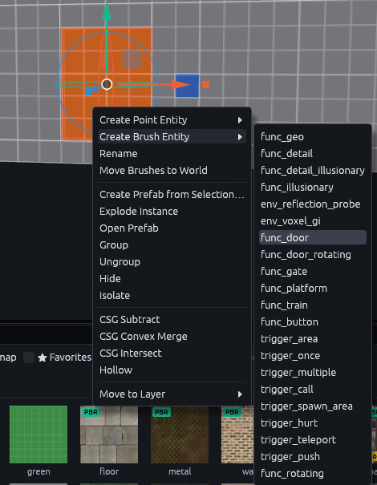
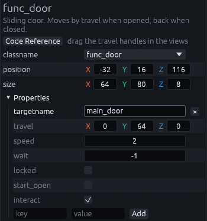
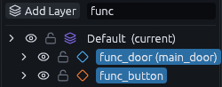
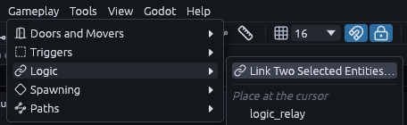
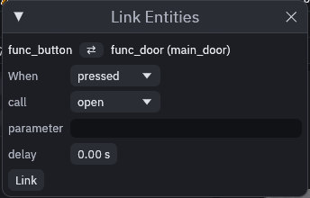
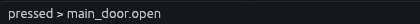
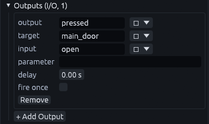
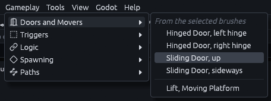

# Button opens a door

A button on the wall that slides a door open when the player presses it. It is the smallest useful bit of entity I/O:
the button fires an output called `pressed`, and a link turns that into a call of the door's `open` input.

> **Tip:** If outputs, inputs and `targetname` are new to you, read [How entity I/O works](../gameplay/io.md) first. It
> only takes a few minutes and this page builds on it.

## Wire it

`func_door` and `func_button` come with the Gameplay entities pack. If your project does not have it yet, use
*Gameplay > Install Gameplay Entities*, or **Install Gameplay Entities** in the *Set up this project* window
(*Godot > Install or Update Addon…*).

1. Make the door

   Draw a door sized brush in a doorway, [Getting started](../getting-started.md#4-build-a-room) shows how to cut one.
   Right click the brush and pick *Create Brush Entity > func_door*.

   

2. Name it

   In the Inspector on the right, type `main_door` into `targetname`. The name is how other entities find the door.
   Leave `travel` at `0 64 0`, so the door slides up 64 units (2 m) when it opens.

   

3. Make the button

   Draw a small brush on the wall next to the door and turn it into a `func_button` the same way.

4. Select both

   Click the button, then Ctrl+click the door, in a view or in the Outliner on the left. Walls in the way? Type `func`
   into the Filter box at the top of the Outliner, then only these two are listed.

   

5. Link them

   Go to *Gameplay > Logic > Link Two Selected Entities…*, or press **Link…** at the top of the Inspector.

   

   The entity that fires has to be on the left, here that is the button. The dialog puts the one you made first on the
   left, which is the door, so press the small swap button between the two names. Pick `pressed` under *When* and
   `open` under *call*, then hit **Link**.

   

The status bar at the bottom left should now say `pressed > main_door.open`. Read it as "when pressed, call open on
main_door".



Select the button on its own and you find the link under *Outputs* in its Inspector, where you can change or remove it
later.



> **Tip:** *Gameplay > Doors and Movers*, also in the Inspector's *Gameplay* section, turns the selected brush into a
> hinged or sliding door in one click. It names the door, sets how it opens and puts a `trigger_multiple` in front of
> it that opens the door when the player walks up. Delete that trigger if only the button should open the door.
>
> 

## Let the player press it

The addon has no interaction system of its own, since every game handles "use" differently. Doors and buttons have a
`use(activator)` method and your player script calls it. The demo player does that on **E**: it casts a ray from the
camera and calls `use` on the first thing it hits that has one
([godot/demo/player.gd](https://github.com/Paraxdev/TrenchDot/blob/main/godot/demo/player.gd)):

```gdscript
func use_target() -> void:
	var from := camera.global_position
	var query := PhysicsRayQueryParameters3D.create(from, from - camera.global_basis.z * use_distance)
	query.exclude = [get_rid()]
	query.collide_with_areas = false
	var hit := get_world_3d().direct_space_state.intersect_ray(query)
	var node: Node = hit.get("collider")
	while node:
		if node.has_method(&"use"):
			node.call(&"use", self)
			return
		node = node.get_parent()
```

The player passes itself as the activator, so `pressed(activator)` carries the player along. Later outputs in the
chain can target `!activator` to act on whoever pressed the button.

## Variations

| You want | What to change |
| --- | --- |
| Door only opens from the button | Untick the door's `interact`. Otherwise pressing **E** on the door opens it too |
| Door closes by itself | Set the door's `wait` to the seconds it stays open. The default, -1, keeps it open |
| Locked door | Tick `locked`. The door ignores `open` and `use` and fires `locked_use` instead, until an output calls its `unlock` input, for example from a key pickup |
| One button, several doors | Name the doors `gate_1`, `gate_2` and so on and target `gate_*`. A trailing `*` matches every name that starts with `gate_` |
| Swinging door | Use `func_door_rotating` instead and drag its hinge handle in the view to where the hinge should be |

## The same wiring in code

Rather connect things in GDScript than in the editor? This does the same as the link above:

```gdscript
# pressed(activator) > main_door.open
button.pressed.connect(func(activator):
	for door in TrenchDotIO.find_targets(button, "main_door", activator):
		TrenchDotIO.invoke(door, &"open", "", activator))
```

Connecting `pressed` straight to `door.open` fails, because `pressed` passes one argument and `open()` takes none.
`invoke` fits the arguments to the method, the same way map links do.
