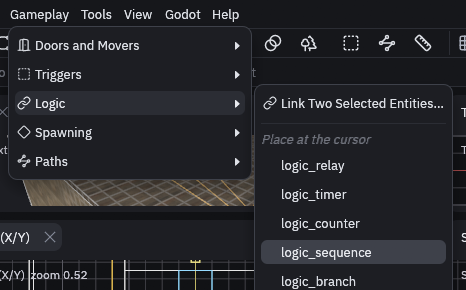
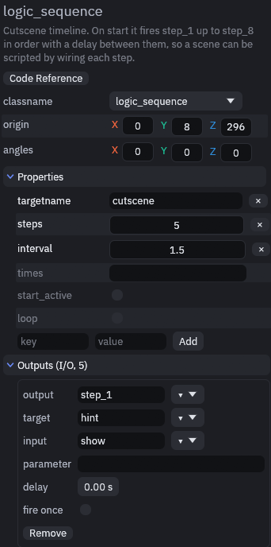

# Scripted cutscene

The player walks into a room, a sign pops up, a guide walks off, a barrel explodes, a lamp comes on and the exit
opens. None of it needs code of its own: a timer entity fires one output per beat, and each output is wired to the
entity that should act. You find it as the `scripted_scene` map in the demo project.


## The timeline

Every entity here comes with the Gameplay entities pack. Install it first if your project does not have it yet, with
*Gameplay > Install Gameplay Entities*.

1. Cover the entrance

    Draw a brush over the entrance and make it a `trigger_once` named `start_zone` (right click, *Create Brush Entity >
    trigger_once*). It fires `triggered` the first time the player walks in, then switches itself off, so the scene
    only plays once.

2. Add the timeline

    Pick `logic_sequence` from *Gameplay > Logic*, it lands at the 3D cursor. Name it `cutscene`, set `steps` to 5 and
    `interval` to 1.5. Once started it fires `step_1`, `step_2` and so on, 1.5 seconds apart.

    

3. Start it from the trigger

    Link `start_zone`'s `triggered` output to `cutscene.start`, with *Gameplay > Logic > Link Two Selected Entities…*
    like in [Button opens a door](button-door.md).

4. Wire each beat

    Link each step output of `cutscene` to the entity that acts in that beat, one pair at a time. Dragging from an
    output pin to an input pin in the [Logic panel](../gameplay/logic-graph.md) works too.

| Output | Target and input | What happens |
| --- | --- | --- |
| `step_1` | `hint.show` | A `game_text` reads "Follow the guide" |
| `step_2` | `guide.start` | An `npc_walker` sets off along its `path_corner` chain, a row of markers each naming the next |
| `step_3` | `barrel.ignite` | An explosive `prop_physics` burns its fuse, then blasts and breaks |
| `step_4` | `lamp.turn_on` | The lamp switches on |
| `step_5` | `exit_door.open` | The exit door slides up |

Select `cutscene` and you should see all five under *Outputs* in its Inspector.



The sequence waits before every step, the first one too, so step 1 fires at 1.5 s and step 5 at 7.5 s. For uneven
timing, set `times` to one wait per step, like `0.5 2 1 1 3`.

## Reading the player's health

Some reactions need a little logic that no built in input covers. A `logic_script` runs a short GDScript snippet when
it is fired. Link the barrel's `broken` output to `hp_readout.run`, a `logic_script` whose `source` writes the
player's health onto a HUD `game_text` named `hpmsg`:

```gdscript
var players = io.find_targets(this, "!player", null)
if players.is_empty():
	return
var hp = int(players[0].health)
for label in io.find_targets(this, "hpmsg", null):
	label.set_text("HP " + str(hp))
	label.show()
```

Use `!player` here, not `!activator`. `!activator` is whoever set the chain off, and the step outputs and `broken`
carry nobody. `!player` always finds the node in the `player` group. `broken` fires after the blast has done its
damage, so the health is already up to date.

## Playing it

The scene script,
[godot/demo/scenes/scripted_scene.gd](https://github.com/Paraxdev/TrenchDot/blob/main/godot/demo/scenes/scripted_scene.gd),
only builds the map, spawns the player at the `info_player_start` and adds a `TrenchDotDebugOverlay`. Press **F3**
in game to watch each output fire. It is the quickest way to spot a step that is wired to the wrong name.

<div class="td-mcp" markdown>

## MCP

The demo map is built by driving the editor through the [MCP server](../mcp.md). The calls are in
[examples/mcp/scripted_scene.json](https://github.com/Paraxdev/TrenchDot/blob/main/examples/mcp/scripted_scene.json).

</div>
