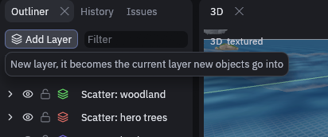
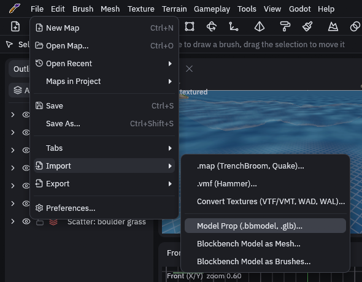
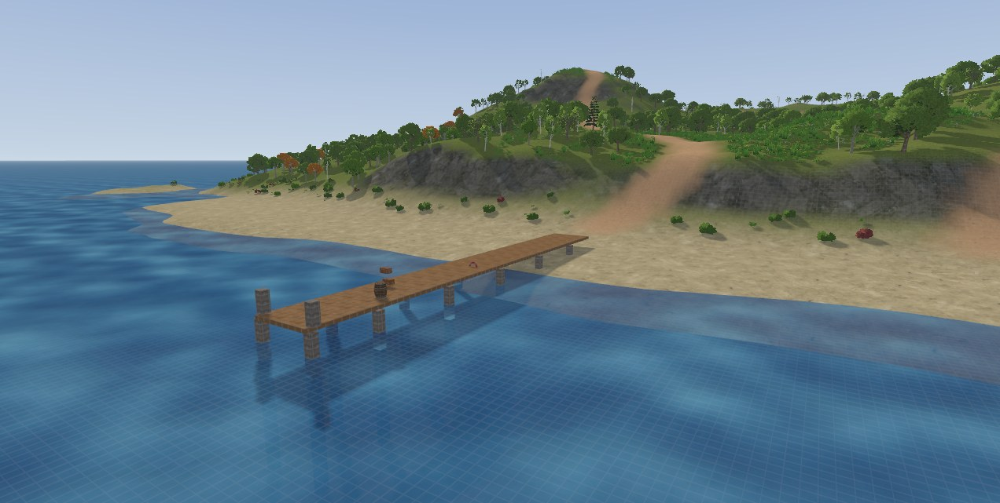
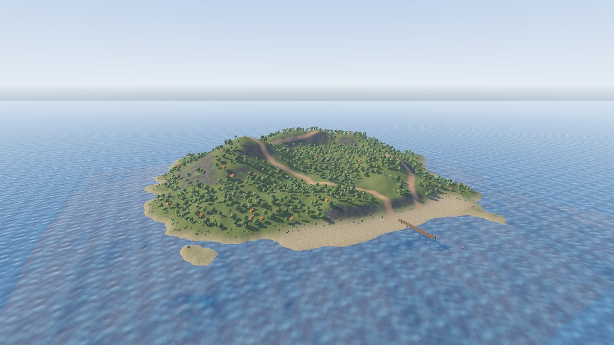
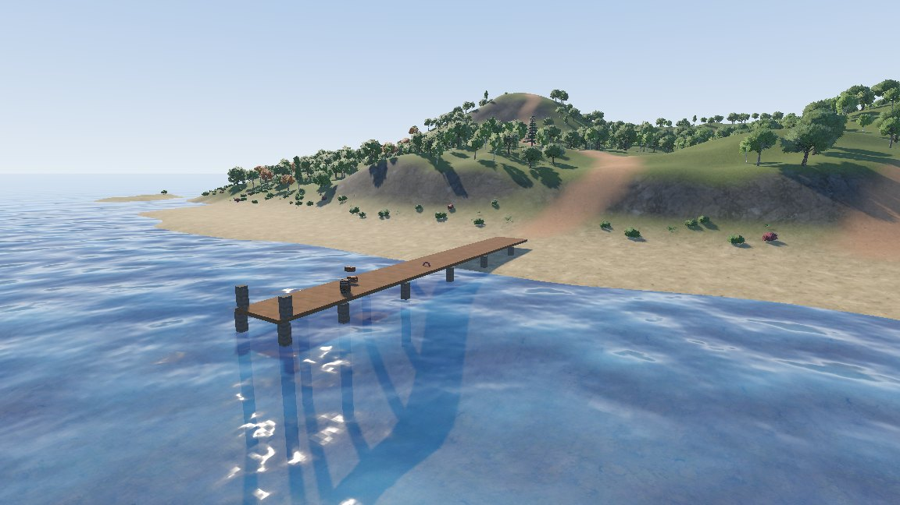

# Sea island 5: pier and Godot

## The pier

1. Give it its own layer

    Click **Add Layer** at the top of the Outliner. The new layer becomes the current one, so the pier lands on it and
    you can hide or lock it apart from the terrain.

    

2. Build it

    Press **Q** for the Select tool, since a drag with the Scatter tool still paints models. Then draw plain brushes
    running out to sea from the middle of the beach, sized like the table below.

3. Add props

    Go to *File > Import > Model Prop (.bbmodel, .glb)…* and pick models from the demo project's `models/polyhaven`
    folder: two `containers/wooden_crate_01` and a `containers/wine_barrel_01` on the deck, a `nautical/lifebuoy`
    against a post and a `nautical/ocean_buoy` in the water. Each one lands at the 3D cursor, move it into place from
    there.

    

| Part | Size | Material |
| --- | --- | --- |
| Deck | 128 wide, 1100 long, 8 thick, top 48 above the water | `showcase/planks` |
| Posts | 16 units square, two rows every 200 units, from 320 below the water up to the deck | `showcase/beam` |
| Railing | Two short posts at the far end, 40 high | `showcase/beam` |

A prop references its model by `res://` path, so the file has to be inside the open Godot project. Pick one from
somewhere else and the editor offers to copy it into `res://models` first.

## See it in Godot

Save the map inside your Godot project and build it with a `FuncGodotMap`, see [Building maps](../godot/building.md).
Each part of the map turns into a different kind of node:

| Map part | What you get in Godot |
| --- | --- |
| Terrain | A `TrenchDotTerrain` split into chunks, each a mesh that blends the four layers and has its own collision |
| Sea | The `func_illusionary` brush, visible without collision |
| Tree, bush and boulder sets | MultiMeshes, plus one static body per model with a collision shape for every instance, all sharing one shape |
| Grass sets | MultiMeshes without collision that fade out with distance |

