# Sea island 4: scatter

Scattering places lots of trees, bushes, rocks or grass with a brush instead of one by one. Each kind of planting
below is its own scatter set, and a set only grows on its targets, the surfaces you pick for it.

## Set up a set

Every set on this page starts the same way.

1. Pick the Scatter tool

    Press **B**, or click the Scatter button in the toolbar. The Scatter tab opens on the right, next to the Inspector.
    (If you close it, **Scatter Panel** in the tool options bar brings it back.)

    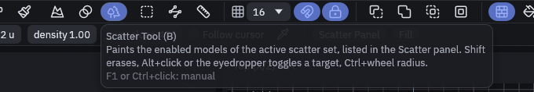

2. Start it from a preset

    Click **Preset** at the top of the Scatter panel and pick the preset the step names.

    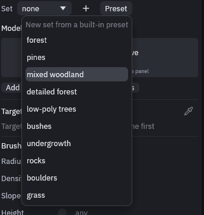

3. Target the terrain

    Click the eyedropper next to **Targets**, then click the terrain in the 3D view. You should see it listed under
    Targets, as `terrain #2` or similar.

    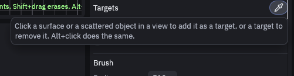

Leave **Follow cursor** unticked, since it paints on whatever is under the brush and ignores the targets. Leave
**Keep spacing to other sets** ticked, so the sets keep their distance from each other and nothing grows through a
trunk.

## Woodland

1. **Preset** > *mixed woodland*, then click **Rename** at the top and call it `woodland`. Target the terrain.
2. In the Brush section set **Density** 0.16 and **Slope** 0 to 30, and tick **Height**, 120 to 2000. The slope range
    keeps trees off the cliffs, and the height range keeps them off the beach.

    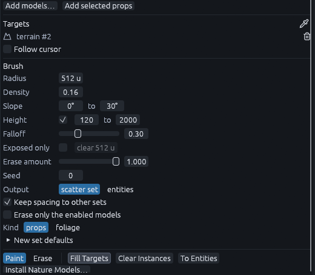

3. Click **Fill Targets** at the bottom of the panel to plant the whole terrain at once.

Density counts attempts per 64 x 64 units, so 0.16 is roughly one tree every 5 m.

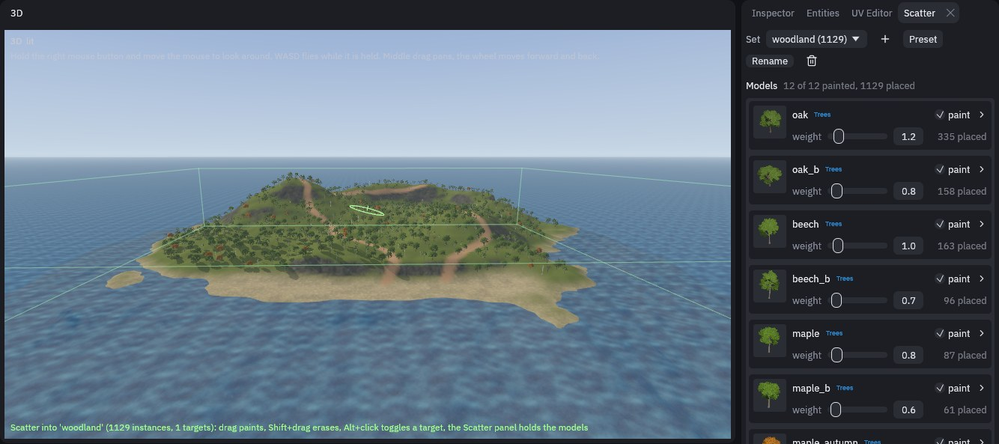

Hold **Shift** and drag along each path with radius 260 to erase the trees there. Erase a clearing on the main
hilltop (radius about 520) and a meadow behind the beach (about 700).

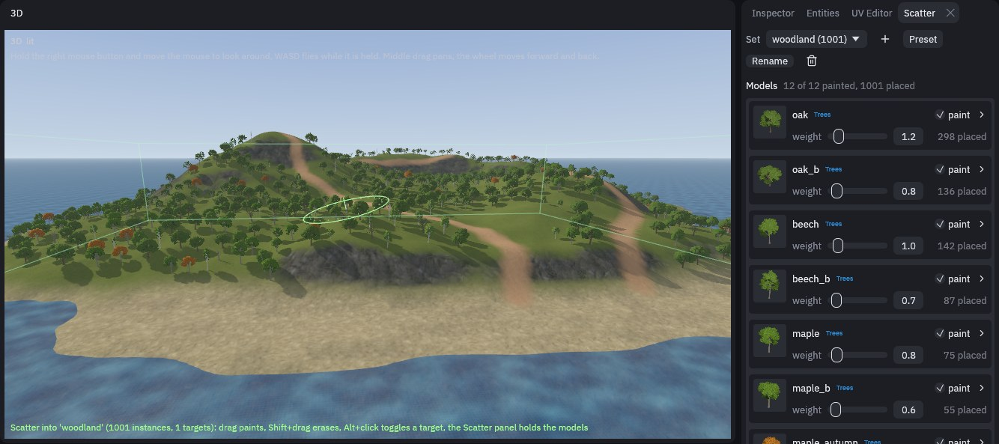

## Hero trees, bushes and boulders

Each row is a new set from the named preset, targeted at the terrain like the woodland. Hero trees are a few large,
detailed trees placed where the player looks closely.

| Set | Preset | How to place it | Radius | Density | Slope | Height |
| --- | --- | --- | --- | --- | --- | --- |
| Hero trees | detailed forest | Single clicks where the paths leave the beach and around the hilltop clearing | 260 | 0.08 | 0 to 30 | off |
| Bushes | bushes | **Fill Targets**, then erase along the paths with radius 190 | | 0.35 | 0 to 32 | 45 to 200 |
| Boulders | boulders | One stroke along the top of the cliffs | 1100 | 0.035 | 12 to 50 | 20 to 2000 |

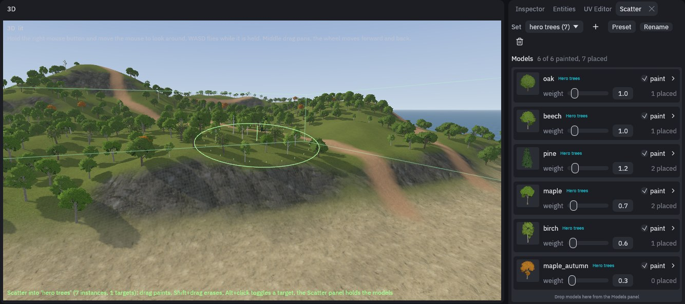

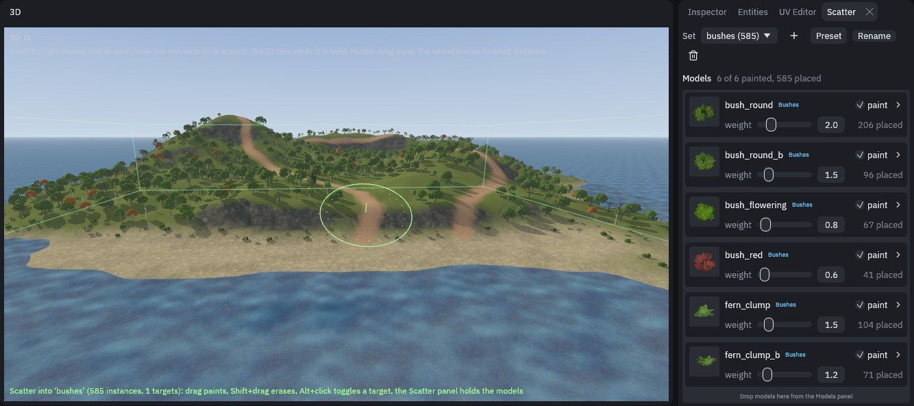

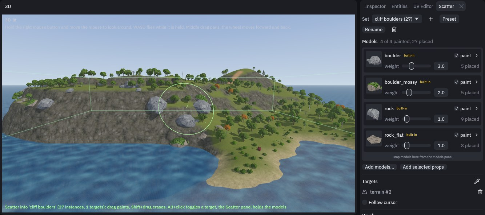

## Grass

1. Start a set from the *grass* preset. Grass is foliage, drawn without collision or shadows, so it can be dense
   without slowing the game down.
2. Paint the open meadows with radius 650, density 2.5, slope 0 to 28, height 45 to 2000. Erase it off the paths with
    radius 170.

    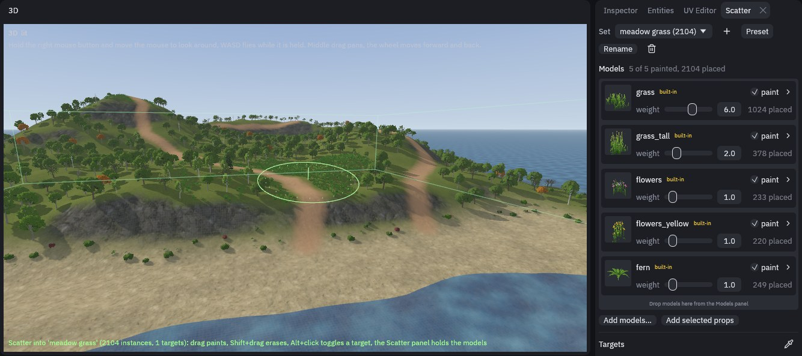

3. For grass on the boulders, start one more *grass* set. With the eyedropper, click a boulder instead of the terrain,
    so the boulder set becomes its target. You should see it under Targets with `(set)` after its name. Then
    **Fill Targets** with density 6 and slope 0 to 45.

    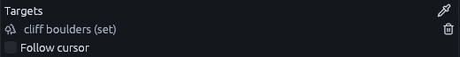

> [!NOTE]
> Fill places grass on the boulders as they are at that moment, so finish the boulders first.

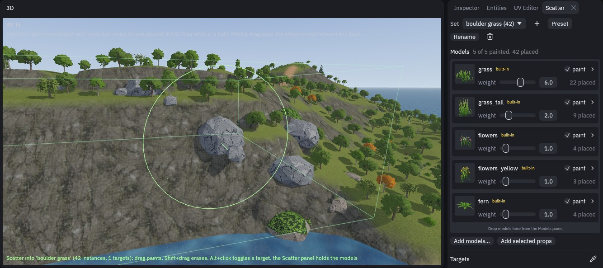

Next: [Sea island 5: pier and Godot](sea-island-finish.md).
