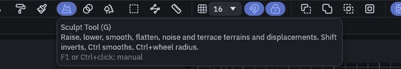
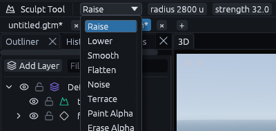
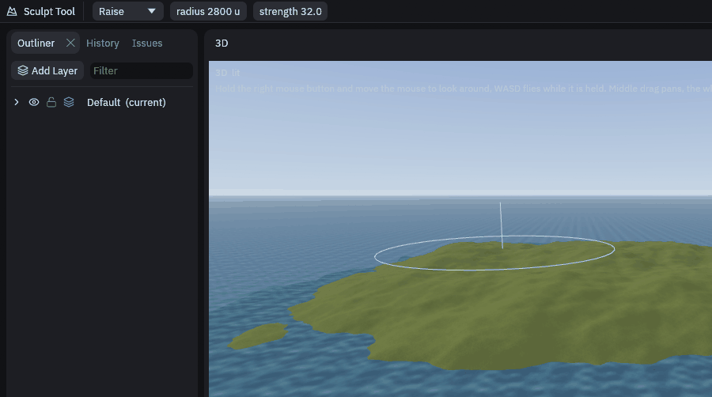
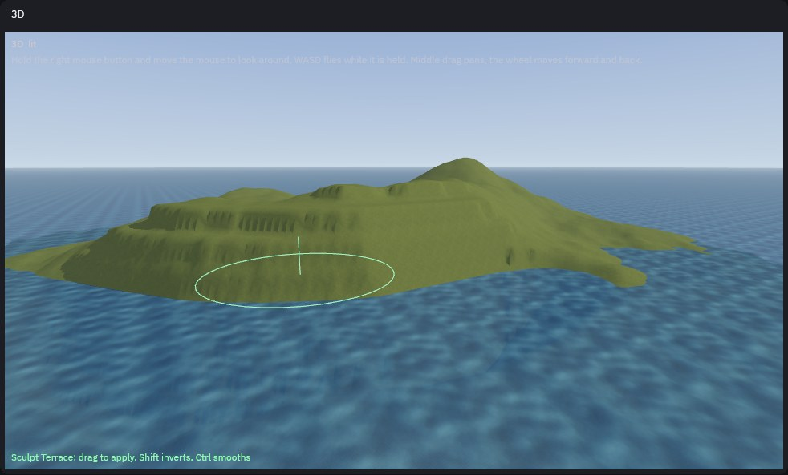
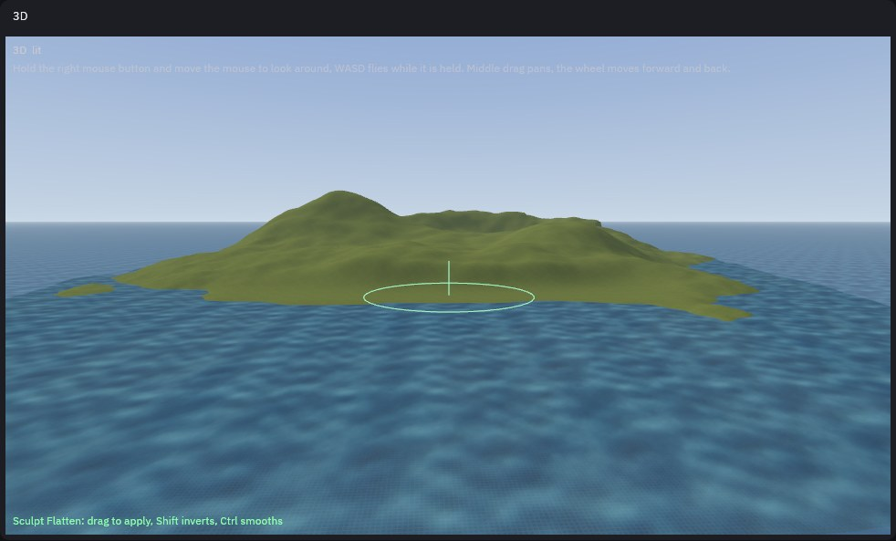

# Sea island 2: sculpting

Sculpting pushes the generated ground into the shapes you want.

1. Pick the Sculpt tool

   Press **Escape** first, since the sea from the last part is still selected and Sculpt does nothing then. It works on
   the selected terrain, or on every terrain when nothing is selected. Then press **G**, or click the Sculpt button in
   the toolbar.

   

2. Find its settings

   Mode, radius and strength sit in the tool options bar right under the toolbar, at the top left. Hold **Ctrl** while
   you drag to smooth, whatever the mode.

   

3. Keep an eye on the height

   The status bar at the bottom right shows the point under the pointer, and its middle number is the height. Handy to
   judge how far you have raised or lowered a spot.

   

## Hills

1. **Raise**, radius 2800, strength 32. Hold the mouse button down west of the middle for about four seconds, until
   the status bar says the hill is about 1500 units high.

   

2. Radius 1300 on the same spot for a steeper top. A smaller brush lifts a narrower area, so the top gets pointier.
3. Radius 1900 for a lower second hill to the south east.

## Cliffs

1. **Raise**, radius 1800. Drag along the north east coast, a little inland, for a headland. Then **Smooth** the whole
   island once with a very large brush to take the lumps out.
2. **Lower**, radius 1000. Drag through the sea in front of that coast to make it deeper, so the cliff drops into deep
   water instead of a shallow shelf.
3. **Terrace**, step 300, radius 1000. Terrace snaps heights to steps of the given size. Drag along the coastline so it
   breaks into shelves and steep faces, then go over it once with a light **Smooth**.

## Beach

1. **Flatten**, radius 900. Flatten holds the height the stroke starts at, so start right at the waterline on the
   south shore and drag along the coast.
2. **Smooth** with a slightly larger brush, so the beach runs into the land without a step.

Next: [Sea island 3: painting](sea-island-painting.md).
