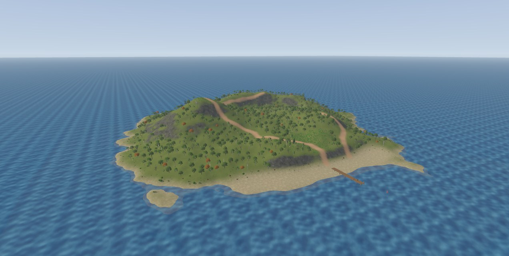
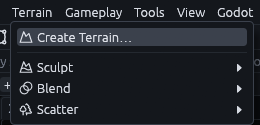
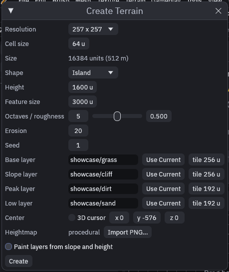
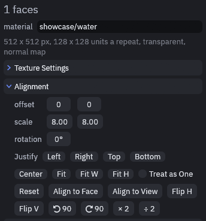
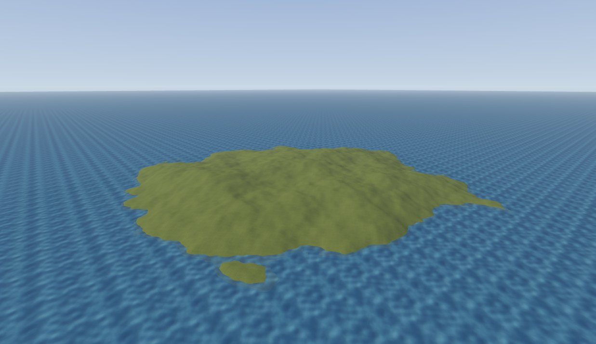

# Sea island 1: terrain

A big island with two hills, cliffs, a beach, paths, woodland and a pier, built in five parts. The numbers are the
ones used for the pictures, in map units at 32 per meter.

## Create the terrain

Go to *Terrain > Create Terrain…* in the menu bar.

Fill in the dialog like this:

| Setting | Value and why |
| --- | --- |
| Resolution, Cell size | 257 x 257 points, 64 units apart. The Size row below shows what you get, 16384 units (512 m) |
| Shape | Island, Height 1600, Feature size 3000, Erosion 20, Seed 1. Island rises in the middle and drops towards the edges. Feature size is the width of the largest bumps, and erosion lets steep slopes slump so they look weathered |
| Base, Slope, Peak, Low layer | `showcase/grass`, `showcase/cliff`, `showcase/dirt`, `showcase/sand`. Tile 256 for the first two, 192 for the others. Base covers everything you do not paint over, the others are meant for steep, high and low ground |
| Center | Untick **3D cursor**, then `0 -576 0` |
| Paint layers from slope and height | Unticked, part 3 paints by hand |

(The tile value is how many units one repeat of the texture covers.)

Click **Create** at the bottom. You should see a green island show up, already selected, and the editor switches to
the Sculpt tool for you.

The sea will sit at height 0, so lowering the terrain by 576 floods its outer ring and leaves the middle dry. Later
parts refer to the layers by their slot number: 0 grass, 1 cliff, 2 dirt, 3 sand.

## Add the sea

The sea is one flat brush the player can walk into.

1. Draw a huge box

    Press **Q** for the Select tool and **Escape** so the terrain is no longer selected, otherwise your drag sculpts or
    moves it. Then drag in the Top view to draw a box many times larger than the terrain, or its edge shows on the
    horizon.

2. Flatten it

    In the Front view, make it 32 units thick with its top at height 0.

3. Make it water

    With the box selected, click `showcase/water` in the Materials tab. Then Shift+click the water in the 3D view to
    select just its top face, and set *scale* to 8 and 8 in the *Alignment* section of the Inspector. That way the
    water texture does not repeat every few meters.

    

4. Let the player wade in

    Click the water once, away from the island, so the whole box is selected again instead of just its top face. Then
    right click it and pick *Create Brush Entity > func_illusionary*. It renders without collision, so the player can
    walk into the water.

You should now have an island in the sea, ready for sculpting:

Next: [Sea island 2: sculpting](sea-island-sculpt.md).

## MCP

The [MCP server](../mcp.md) lets agents and scripts drive the editor.
[examples/mcp/sea_island.json](https://github.com/Paraxdev/TrenchDot/blob/main/examples/mcp/sea_island.json) is an
MCP script that builds the same island, so you can replay it to check a value.

